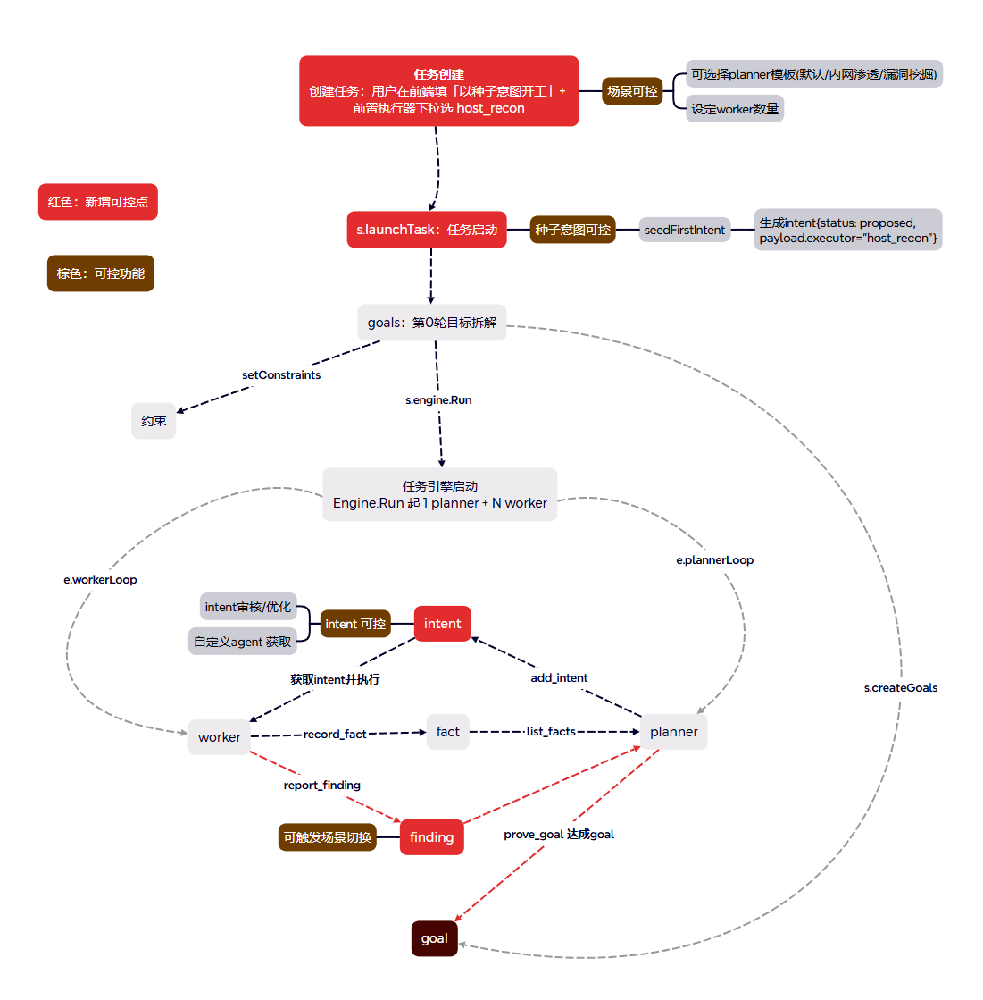
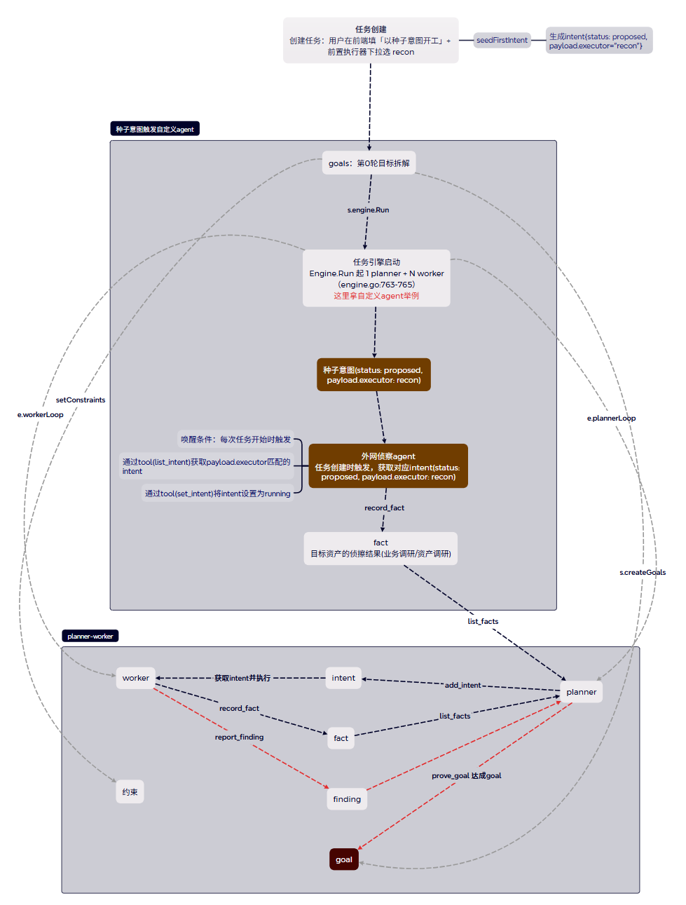

# artex-ld

>基于 **ARTEX v0.3.15+** 的二次开发版本，发布名为 **artex-ld**。
 原版 ARTEX 已经具备自主渗透、探索图、planner-worker、MCP、skill 和报告能力。这次二开重点不是再增加一批扫描工具，而是把原本主要由 AI 自动推进的任务流程，改造成一套**能配置场景、能指定执行者、能人工审核、能在发现漏洞后继续自动编排**的流程 。


 ⚠️ 仅限合法授权、自有系统与隔离靶场。审核、拦截和人工确认只是辅助控制，不能替代授权边界、目标隔离与操作者判断。
 
---

## 截图预览


## 1. 二开内容

### 1.1 原版的典型流程

```text
人填写目标
  → planner 根据内置提示词规划
  → 意图落库后由默认 worker 领取执行
  → fact / finding 写回探索图
  → planner 再根据结果自由规划下一步
```

这个模式通用、自动化程度高，但在实际红队场景里会遇到四个问题：

1. 外网渗透、内网横向、漏洞挖掘、代码审计的规划方式不同，一套提示词不够灵活。
2. 高防护或高约束目标中，意图生成后立即执行，人缺少下发表决的入口。
3. 某些工作希望交给专门的 agent，而不是所有意图都由默认 worker 做。
4. 拿到 getshell / rce 等立足点后，希望按预定规则切换到下一阶段，而不是完全依靠 AI 临场发挥。

### 1.2 二开后的流程

```text
任务创建
  ├─ 选择任务分类 / 场景预设
  ├─ 选择或填写 planner 模板
  ├─ 可配置种子意图与前置执行器
  └─ 可设置任务级 worker 数
        ↓
planner 规划意图
  ├─ add_intent：直接生成 open 意图
  └─ add_review_intent：生成 proposed 待审意图
        ↓
review agent 预审 / 自动处置 / 人工对话审核
        ↓
open 意图由默认 worker 或指定自定义 agent 执行
        ↓
fact / finding 写回探索图
        ↓
触发器唤醒 agent，可生成报告或 spawn_task 派生新场景子任务
```

所以这次二开可以概括成两件事：
- **流程可控**：任务怎么开始、意图能不能执行、由谁执行、finding 后做什么，都有明确的配置和干预入口。
- **场景可配**：把不同场景的规划模板、审核策略、首条意图和执行器保存下来，建任务时直接复用。
**所有增强默认关闭，不使用则行为与原版完全一致。**

| 阶段               | 原版行为                       | 二开后的能力                                                        |
| ---------------- | -------------------------- | ------------------------------------------------------------- |
| **任务开始**         | 默认 worker 配合内置规划提示词开工      | 分类即场景预设；可选 planner 模板；可配置种子意图；可由自定义 agent 先执行；可按任务设置 worker 数 |
| **意图下发**         | 意图成为 `open` 后即可被 worker 领取 | 新增 `proposed` 待审池，支持 AI 预审、人工批准 / 驳回、对话修订和可选自动处置              |
| **意图执行**         | 默认由 worker 执行              | 意图可指定自定义 agent；使用它自己的提示词、工具绑定、技能和运行预算                         |
| **生成 finding 后** | 后续动作主要由 planner 自主决定       | 通用触发器可唤醒 agent；可自动写报告，也可派生带有新模板、种子意图和执行器的子任务                  |


### 一张图看完整任务生命周期



图中**红色块是新增的可控点，棕色块是配套的可控能力**：

1. **任务创建可控**：能选 planner 模板、种子意图、前置执行器和 worker 数。
2. **intent 可控**：能送审、优化、批准或驳回，也能指定由哪个自定义 agent 执行。
3. **finding 可控**：finding 不只是报告结果，还能作为触发器事件，驱动报告、清理或新场景子任务；漏洞复测则可从漏洞详情手动发起独立会话。
4. **原有 planner-worker 仍保留**：不使用这些增强时，依然可以按照原来的方式运行。


## 2. 二开内容详解

### 2.1 新增agent/tools

#### 2.1.1 agent 总览（内置 7 个 + 预置自定义 3 个）

**内置 agent**（首启自动建行，带「内置」徽章、不可删除；提示词/LLM 等可在 系统 → Agent 修改）：

| key         | 名称   | 什么时候跑                | 职责一句话                                                |
| ----------- | ---- | -------------------- | ---------------------------------------------------- |
| `goals`     | 目标拆解 | 任务开跑第 0 轮，一次性        | 把目标拆成可验证子目标，并抽取操作约束（`set_goals` / `set_constraints`） |
| `planner`   | 规划   | 常驻规划循环，图一变就唤醒        | 读态势补意图、送审、修订驳回稿、判目标收官；提示词走模板库四级链                     |
| `worker`    | 执行   | worker 池领取 `open` 意图 | 执行一条意图，`record_fact` / `report_finding` 写回探索图后停止     |
| `mainagent` | 主    | 任务详情「主」会话，人发消息驱动     | 人机接口：把人的话落成 hint 或高优先级意图                             |
| `auto`      | Auto | 对话页 `/chat`，默认预选     | 平台操作助手：建/看/暂停任务、管资产、建 skill/工具/MCP（编排与平台工具默认绑它）      |
| `pentest`   | 渗透测试 | 对话页独立对话              | 一个人打全链的独立渗透 agent，交互式 Shell 默认开                      |
| ⭐`review`   | 审核   | 预审 / 自动处置 / 审核面板对话   | 审核intent，AI预审+人工审核驳回给planner进行优化                     |

**预置自定义 agent**（首启 seed 一次；可编辑、可删除，**删除后不会自动重建**）：

| agent                | 触发与运行策略                                                                  | 工具面                                                                                                                             | 职责                                                                                                                                              |
| -------------------- | ------------------------------------------------------------------------ | ------------------------------------------------------------------------------------------------------------------------------- | ----------------------------------------------------------------------------------------------------------------------------------------------- |
| ⭐**vuln_dispatcher** | `on_finding`；`serial` + `by_task`（同任务突发 finding 合并去抖）                    | `spawn_task` + `list_llm_profiles` / `get_task_graph` / `list_task_findings` / `get_task_node_detail` / `list_task_constraints` | 高危立足点（getshell/rce/file_upload/deserialization × critical/high）自动派生深度子任务；按 vulnclass 选场景模板；同资产去重（查 `child_tasks`，提示词纪律）；提示词里的场景模板占位符已替换为真实模板 id |
| ⭐**reporter**        | `on_tool_call(report_finding)`；`parallel` + `none` + 最多 5 并发（**一漏洞一报告**） | `update_finding_report` + 跨任务证据/执行过程/任务图查询 7 件 + 流量证据读取（`get_finding_traffic` 等）与补绑（`bind_finding_traffic`，reporter 独占）         | 读证据与执行过程自动撰写 Markdown 漏洞详细报告；按 `evidence_version` 防覆盖新证据，证据变化后报告自动标「待更新」                                                                        |
| **retester**         | **无自动触发器**；从漏洞详情手动发起独立复测会话                                               | `get_finding_retest_context` + `record_finding_retest_result`（两件会话专用工具）                                                         | 读取原证据与补充说明，保存 reproduced/fixed/inconclusive 结论及实际证据；fixed 才按代码规则更新原漏洞状态                                                                         |

> - **trace_cleaner 不是源码 seed**：可导入仓库的 `config-export` 可选配置，或参考 `docs/ARTEX-部署手册.md` 与 `config-export/README.md` 自行创建；两种都是纯配置方案。
> - 内置 agent 一律**不能声明 `executor_key`、不能作为意图执行器**；三个预置自定义 agent 默认也未声明，需要时可手动声明后当执行器用。
> - 自定义 agent 执行意图时：活动流执行器名为 `exec:<key>`，工具 = worker 底座 + 它的绑定/技能/MCP，预算（循环次数/运行时长）用它自己的配置，单次执行无多轮会话态。

#### 2.1.2 工具改动（二开新增 7 个 / 改动 4 个）

**新增**：

| 工具 | 作用 | 持有者 |
|---|---|---|
| `add_review_intent` | 送审唯一入口：落 `proposed` 待审；支持批量、`replaces` 替代血缘、`target_executor` 预选执行器 | planner、review 对话 |
| `list_intents` | 分页列意图（状态过滤/关键词），带 `content_version` 供 CAS | planner、mainagent、review |
| `update_intent` | 修订 `open` / 驳回稿（`expected_version` 乐观锁），驳回稿改后自动重送审 | planner、mainagent、review 对话 |
| `cancel_intent` | 软删 `open`/`proposed` 意图（留血缘，`delete_reason` 必填；`running`/`paused` 拒绝） | planner、mainagent、review 对话 |
| `set_intent_status` | 收窄为 approve / reject 两态，**仅 review 对话持有**，批准时预选执行器转正 | review 对话 |
| `send_planner_hint` | 审核意见通道：给 planner 下发改稿/调整建议 | review 对话 |
| `list_task_constraints` | 只读列任务操作约束（领域版本任务、编排版读父任务，派生前查红线） | 自定义/编排 agent 等按绑定 |

**改动**：

| 工具               | 改动                                                                                                                                                   |
| ---------------- | ---------------------------------------------------------------------------------------------------------------------------------------------------- |
| `spawn_task`     | +4 参：`pre_agent`（种子执行器）/ `planner_prompt` / `planner_template_id` / `worker_count`。**没有 `review_enabled` 参数**：子任务审核只继承（父开则开；父关但模板对应分类默认开审也会开），只加强不放宽 |
| `get_task_graph` | 返回附 `child_tasks`（已派生子任务列表，派发去重依据）                                                                                                                   |
| `report_finding` | +`evidence_hint_id` 从提示继承证据；vulnclass 九类词表标注执行器/子任务派发语义                                                                                              |
| `goal_met`       | **默认解绑所有 agent**（直接宣布整个任务完成，权重大）；需要时在工具页手动绑回                                                                                                         |


### 2.2 意图审核

#### 2.2.1 意图审核流（review flow）

- 意图新增 `proposed` 待审态；任务级 `review_enabled`（总开关）/ `review_auto`（自动处置）。
- **送审唯一入口**是 `add_review_intent`；`add_intent` 为直投（`open` 立即可执行，不过审核）。任务未开审核时调用 `add_review_intent` 会**报错**并提示改用 `add_intent`，不会静默直投。
- **人工全审**：review agent 只读预审出建议（pass / revise + ≤200 字理由），**只标注不批准**——所有意图留审核面板等人处置；开「自动处置」后由 review agent 输出 approve/reject 决策、服务端 CAS 执行，**拿不准的不决策、留人工**（连续未决会告警）。
- **执行器在送审/修订时定**：`add_review_intent` / `update_intent` 的 `target_executor` 写入 `pending_executor`，批准时自动转正为执行器；**批准接口不接受执行器参数，面板也没有批准时改选的下拉**。
- 驳回闭环：驳回理由 → planner `update_intent` 修订原稿自动重送（禁止新建替代）；`revision_count` 递增，**没有次数硬上限**，是否放弃由 planner/人判断。
- 防竞态：`content_version` 乐观锁 CAS + 每任务审核槽位单飞（预审 5 分钟 / 对话 10 分钟租约，对话优先）+ planner 待审抑制。
- 审核 UI：任务详情常驻「审核」tab、待审卡片（预审建议/替代血缘徽/预选执行器）、快捷批准/驳回（驳回必填理由）、与 review agent 对话讨论（其写动作弹确认卡，人点按钮才落地，300 秒超时自动拒绝）。面板消息流优先展示 agent 回复的完整 `detail`，失败消息以 `is_error` 红卡标识。
- 也可走 HTTP 直调 `approve` / `reject`（支持 `expected_version` CAS），适合列表快捷操作、批量脚本、外部审批对接；与对话工具调用殊途同归。


#### 2.2.2 review agent（内置审核 agent）

review agent 是**内置 agent**（key=`review`，系统 → Agent →「审核」），不是预置自定义 agent，也不是可指定执行意图的执行器。待审意图上的 `executor='review'` 只是**待审占位符**，与自定义执行器的 `executor_key` 无关。

| 运行方式     | 何时触发                                              | 工具             | 输出                                         | 会话                               |
| -------- | ------------------------------------------------- | -------------- | ------------------------------------------ | -------------------------------- |
| **预审**   | 审核 runner 约 **15 秒**一轮 + 送审即时唤醒；`review_auto=off` | 只读 4 件         | JSON：`pass` / `revise` + 意见 → 写到卡片，**不批准** | 一次性，无历史                          |
| **自动处置** | 同上，`review_auto=on`                               | 只读 4 件         | JSON：`approve` / `reject`，由服务端执行；拿不准不输出    | 一次性                              |
| **人工对话** | 审核面板输入框，每条消息一轮                                    | 只读 4 件 + 写 5 件 | 自然语言讨论 + 工具调用，**写动作全部弹确认卡**                | 每轮独立，**LLM 看不到上一轮对话**（面板历史来自消息流） |

- **只读 4 件**：`graph_overview`、`list_findings`、`node_detail`、`list_intents`。
- **写 5 件**：`set_intent_status`（approve/reject）、`send_planner_hint`（给 planner 审核意见）、`add_review_intent`、`update_intent`、`cancel_intent`。
- **确认卡是自动种下的内置规则**：启动时自动在「系统 → 拦截规则」生成 5 条 `[内置] 审核写动作确认：<工具>`（ask、300 秒超时自动拒绝），并把 5 件写工具纳入拦截启用集。**只对 review 会话生效**——planner 自己送审等同名调用不弹卡。规则可停用/删除，但删了等于拆掉人工闸门，不建议。
- **LLM 配置链**：任务 LLM 配置链 → review agent 自身绑定（系统 → Agent → 审核 → 默认模型）→ 全局激活配置。全不可用则预审跳过并打 WARN，对话报「review agent 不可用（未启用或未绑定 LLM）」。
- 预审「只标注不批准」、对话「写动作必弹确认卡」都是**代码行为**，不随提示词改变；若旧提示词写「pass 直接批准」，以代码为准。驳回次数无硬上限，`revision_count` 仅透出供 planner/审核判断。
- **工具不可在 UI 绑/解**：它的工具由代码固定，不进 tools 表（工具页对 review 显示「暂无工具」）；能改的是提示词、LLM、循环次数等。
- 注意：审核面板与代码均按 **15s** 一轮自动审核；在对话页 `/chat` 选「审核」聊天只是通用会话，**没有审核工具**，不等于审核通道。


### 2.3 种子意图执行自定义agent

种子意图适合处理“每次都要先做”的事情，例如：

- 先做外网资产与业务侦察，再让 planner 制定后续路线。
- 先整理代码目录、入口点和鉴权边界，再开始代码审计。
- 先读取已有漏洞和资产上下文，为后续手动复测整理依据。

种子意图具有较高优先级，默认直接进入 `open`。如果同时指定了前置执行器，它就由对应的自定义 agent 执行；没有指定则使用默认 worker。

### 2.4 planner 模板库

| 分类   | 默认 planner 方向       | 默认是否开启意图审核 |
| ---- | ------------------- | ---------- |
| 内网渗透 | 立足点后的信息收集、凭据与横向路径规划 | 开          |
| 权限提升 | 基于现有权限寻找提权路径        | 开          |
| 漏洞利用 | 围绕已有漏洞信息做验证和利用      | 开          |
| 漏洞挖掘 | 围绕攻击面发现与漏洞验证规划      | 关          |
| 代码审计 | 围绕代码、调用链和漏洞线索规划     | 关          |

- `planner_templates` 表 + 四级提示词链：任务快照 > 全局覆盖 > 默认模板 > 内置默认（尾部规约代码占有不可覆盖）。
- 五领域内置模板：内网渗透 / 权限提升 / 漏洞利用 / 漏洞挖掘 / 代码审计；模板管理面板支持新建/编辑/试渲染/设为默认，内置行只读、自建可删。
- **模板结构体有 5 个字段**：`{{.Goal}}`、`{{.Scope}}`、`{{.AssetSummary}}`、`{{.DataDir}}`、`{{.Now}}`；正文上限 32KB。**planner 运行期只填 Goal/DataDir/Now，Scope/AssetSummary 为空串；模板预览才填完整字段**，不要依赖后两者的运行期内容。引用目录外变量会在「试渲染」时报错。
- 建任务时正文**快照**进任务：改模板只影响之后的新任务，不回溯在跑任务。

**模板支持：**
- 新建、编辑、试渲染、设为默认。
- 模板结构体有 5 个字段：`{{.Goal}}`、`{{.Scope}}`、`{{.AssetSummary}}`、`{{.DataDir}}`、`{{.Now}}`。但 planner 运行期只填 `Goal`/`DataDir`/`Now`，`Scope` 与 `AssetSummary` 会是空串；模板预览才填完整字段，写模板时不要依赖后两者的运行期内容。
- 建任务时选择已有模板，也可以针对当前任务现场修改。
- 模板正文创建时快照；后续删除原模板不会影响旧任务。

### 2.5 场景并入任务分类

- `task_scenarios` 已删除，预设并入 `task_categories`：`default_review_enabled` / `default_planner_template_id` / `asset_mode` / `default_description` / `seed_first_intent` / `seed_executor`。
- **首启自动预置 5 个场景**：内网渗透 / 权限提升 / 漏洞利用（**默认开启意图审核**）、漏洞挖掘 / 代码审计（默认关），各自按同名 `nkey` 关联同名 planner 模板；幂等，不覆盖你的修改。
- 建任务选场景后：默认模板、审核开关、种子意图、默认任务描述一并带出；**快照**进任务，改分类不回溯。
- `asset_mode`（资产模式）在建任务里是可见下拉：渗透测试 / 漏洞挖掘 / 代码审计，随任务落库作为资产图模式标签（按模式差异化展示目前是占位语义）。

### 2.6 安全相关改动

- **首次初始化**：在 `/setup` 直接设置管理员密码，无需安装令牌；设密后重复初始化会被拒绝。
- **文件工具工作目录边界**：worker、planner、mainagent、聊天会话和自定义执行器的文件工具限制在对应任务工作目录。
- **Python 工具校验**：`python_interpreter` 只接受存在、可执行且 basename 为 Python 的绝对路径。
- **审核写动作确认**：review 会话的 5 件写工具通过内置 ask 规则弹确认卡。
- **LLM 判官是配置能力，不是默认全部开启**：代码默认判官关闭、`fail_action=allow`，默认启用集也不含 `ExecuteExtraTool`。需要 fail-closed 或 MCP 纳审时必须显式配置并验证。
- 平台配置工具仍受工具启用、agent 绑定和既有数据库拦截规则管控。本发布版不包含主仓尚未发布的代码常量短路表或外泄匹配器。

### 2.7 日志与迁移

- **日志**：`xlog` 四级 + `log_level` 热切换（UI 系统设置 / `PUT /api/settings`，优先级 DB > `ARTEX_LOG_LEVEL` > `ARTEX_DEBUG` > 默认 info）；访问日志只记 4xx/5xx/慢请求。日志页支持**按级别 + 按任务号过滤**（彩色任务 chip，点 chip 只看该任务）。`server_logs` 默认保留 7 天，内存环 3000 行，重启回灌最近 100 行；写库队列满时丢弃并记录丢弃计数。
- **迁移**：`start.sh export-config | import-config | upgrade-prompts`。导出 **19 类业务对象 jsonl**（LLM 档、自建模板、任务分类、自建 agent、内置 agent 覆盖、提示词与变量、触发器含运行策略/水位线、MCP 与可见性、skill 可见性、工具绑定与自定义工具、拦截与资产拦截规则、任务模板、企业与授权范围、通知渠道），另可选 `settings.jsonl`（`ARTEX_EXPORT_SETTINGS=1`）。导入逐文件单事务、业务键幂等、LLM 档不抢默认、按配置名重映射 agent 绑定。仓库另有脱敏子集 [`config-export/`](config-export/README.md)：不含 LLM 档和密钥，MCP 全部禁用，可用 `./start.sh import-config ./config-export` 导入；同名配置可能更新，先备份。


## 3. 相关案例介绍

### 3.1 案例一：种子意图执行自定义agent

图中上下两个灰框分别表示：

- **上半部分：开局预处理**。创建任务时选择前置执行器 `recon`，种子意图携带该执行器；任务启动后由外网侦察 agent 完成业务与资产调研，并用 `record_fact` 把结果写入探索图。
- **下半部分：回到标准循环**。planner 读取这些事实后继续规划，后续意图由 worker 或各自指定的执行器完成。

一句话理解：**自定义 agent 负责把开局做好，后续仍然使用原来的探索图和 planner-worker 机制。**

> **与现行为的差异**：原图里“agent 自己调用 list_intent / set_intent 领取意图”和“种子状态为 proposed”都是早期设计示意。当前是引擎根据 `payload.executor` 自动路由，agent 不需要自己领单；种子首意图直接为 `open`。



---

### 3.2 案例二：意图执行前增加审核闸门(内网渗透)

#### 3.2.1 proposed 原理及审核流程
##### 1. 为什么 `proposed` 能拦住 worker

worker 只领取 `open` 意图。调用 `add_review_intent` 后，意图进入 `proposed`，所以它不是“先执行再补救”，而是在进入 worker 池之前就停住。

```text
planner 生成意图
  │
  ├─ add_intent → open → worker / 自定义执行器直接领取
  │
  └─ add_review_intent → proposed
                            │
                            ├─ review 预审：只给 pass / revise 建议
                            ├─ 人工批准 → open → 执行
                            ├─ 人工驳回 → rejected → planner 修订 → 再次 proposed
                            └─ review_auto=on → 自动 approve / reject
```

##### 2. review agent 有三种工作方式

| 方式       | 什么时候运行                        | 能做什么                                  | 最终谁让动作生效              |
| -------- | ----------------------------- | ------------------------------------- | --------------------- |
| **预审**   | 任务开启审核、未开自动处置；约 15 秒一轮，送审也会唤醒 | 用只读工具检查意图，输出 `pass` 或 `revise` 及理由    | 只把建议写到审核卡片，**不会自动批准** |
| **自动处置** | 任务开启审核且 `review_auto=on`      | 用只读工具输出 `approve` / `reject`；拿不准可以不决策 | 服务端通过版本检查执行决策；未决项仍留人工 |
| **审核对话** | 人在审核面板中与 review 讨论            | 读取任务上下文，也可调用审核写工具                     | 写动作弹确认卡，**人点击确认后才执行** |

预审和自动处置都是一次性只读运行；审核对话用于讨论和修订，每轮也是独立上下文，面板里的历史消息不等于 LLM 自动拥有长期记忆。

##### 3. 人工审核可以做三件事

1. **批准**：意图从 `proposed` 变为 `open`，开始可被领取。
2. **驳回**：必须填写理由，意图进入 `rejected`，并通知 planner 修订。
3. **对话优化**：与 review agent 讨论意图范围、风险、重复性和执行器适配；其写动作需要人工确认。

驳回后的正常闭环是：

```text
驳回理由
  → planner 使用 update_intent 修改原稿
  → revision_count 增加
  → review_status 重新变为 pending
  → 再次预审和人工处置
```

没有固定的“最多驳回几次”硬限制；是否继续、放弃或缩小目标，由 planner 和人根据情况决定。

##### 4. 执行器在哪里选择

执行器应在**送审或修订时**通过 `target_executor` 预选：

```text
target_executor → pending_executor → 批准后转为正式 executor
```

**批准接口和批准按钮没有再次选择执行器的入口。** 如果审核时发现执行者不合适，应先修订意图，而不是直接批准。

##### 5. 几条必须知道的边界

- 全局审核默认关闭；但内网渗透、权限提升、漏洞利用三个首启分类预设默认开审。
- 任务未开审核时，`add_review_intent` 会报错；需要直接执行应使用 `add_intent`。
- **种子首意图是审核例外，直接 `open`**。
- 待审期间会抑制 planner 继续批量派单，避免越积越多。
- `content_version` 乐观锁避免审核期间旧稿覆盖新稿。
- 审核对话的确认卡默认 300 秒超时，未确认不会执行写动作。
- 关闭任务审核前，应先处理完待审和驳回稿。

##### 6. 审核面板和探索图上能看到什么

- 任务详情常驻「审核」tab，显示待审数量、自动处置开关和待审卡片。
- 卡片展示意图摘要、AI 预审建议、预选执行器和修订血缘；驳回必须填理由。
- 与 review 对话时，写动作确认卡会展示工具与参数，人确认后才执行。
- 探索图中，待审意图使用琥珀色虚线角标，待修订意图使用红色虚线；节点也会显示执行器与送审预选执行器标识。
- 批准后待审标识消失，意图才进入正常执行循环。

#### 3.2.2 review 逻辑流程

图中左下是标准 planner-worker 循环，右侧两个黄框是审核分支：

- **优化意图**：planner 调用 `add_review_intent` 送审；review 做只读预审；人查看意图和预审建议，与 review 讨论优化点；需要修改时通知 planner 修订并重新送审。
- **通过审核**：人确认批准后，意图才从 `proposed` 转为 `open`，回到左侧执行循环。
- **自动处置**：可信任务可以开启 `review_auto`，让 review 输出 approve / reject，由服务端执行；未决项仍可留人工。

> 原图中的工具名和状态用于解释设计关系。当前审核写工具只有批准 / 驳回等审核语义，预审的 `pass` 只是建议，不等于批准；对话轮中的写动作仍需确认卡。


#### 3.2.3 review 底层详细调用流程


---


### 3.3 案例三：外内网场景切换

#### 3.3.1 finding 触发场景切换

任何自定义 agent 都可以配置触发器，目前支持：

| 触发条件              | 用途示例                                    |
| ----------------- | --------------------------------------- |
| `on_finding`      | 出现新漏洞后派发子任务、写报告或清理测试痕迹；复测另走漏洞详情的手动入口    |
| `on_tool_call`    | 某个工具调用后执行配套动作，例如 `report_finding` 后生成报告 |
| `on_goal_met`     | 目标达成后收尾                                 |
| `on_task_timeout` | 任务超时后汇总或清理                              |
| `on_task_create`  | 新任务创建后做初始化                              |
| `interval`        | 定时检查或周期运行                               |

运行策略支持串行 / 并行、按任务合并 / 全部合并 / 不合并，以及最大并发。

finding 触发采用**启用后的水位线**，不会把启用前的历史 finding 全部重放。每次触发都会新建一次独立运行。

#### 3.3.2 新增自定义agent `vuln_dispatcher`：按规则切换场景

代码首启会播种一次 `vuln_dispatcher`。它的典型用途是：

1. 新 finding 唤醒 dispatcher。
2. 读取 finding、已有子任务和任务操作约束。
3. 判断是否应该继续、应该切到什么场景。
4. 调用 `spawn_task` 创建子任务。
5. 子任务同时携带新的 planner 模板、目标、种子意图、前置执行器和 worker 数。

它使用 `serial + by_task`，让同一任务的突发 finding 串行处理并合并去抖。默认提示词只对 `getshell / rce / file_upload / deserialization` 且 `critical / high` 的 finding 开放派发，并要求先查任务约束、再按漏洞类型选择场景、最后做同立足点去重；其他 finding 直接结束。

> 同资产去重主要由任务图检查、提示词纪律和串行去抖共同完成，**不是一个可以对任意复杂资产关系做硬判重的数据库约束**。

##### 示例：finding 后从外网切换到内网场景

派生任务时不是只传一句“继续做内网”，而是可以一次带齐：
- 内网渗透 planner 模板。
- 新任务目标和约束。
- 第一条内网信息收集意图。
- 内网侦察 agent 作为前置执行器。
- 任务级 worker 数。
因此子任务一开始就带着新场景的规划方法和切入点，不需要人工重新建任务、复制提示词。


#### 3.4 案例四：痕迹清理

> 公开配置采用 `on_finding`、`serial + by_task`：同一任务集中出现的 finding 串行处理并按任务合并，运行预算为 1200 秒；模型不单独绑定，跟随任务/全局默认档。

#### 3.4.1 finding 触发痕迹清理

`trace_cleaner` 由 `on_finding` 触发，运行策略与水位线机制同 3.3.1；公开配置包默认采用 `serial + by_task`，运行预算 1200 秒。

#### 3.4.2 新增 自定义agent `trace_cleaner`：痕迹清理

`trace_cleaner` 是公开配置包里的**可选自定义 agent**，不是代码首启强制 seed，也不是“自动把靶机恢复原状”的功能。它把 worker 的过程登记、finding 触发器和清理提示词组合成一条可审计流程。

###### 每一步具体做什么

1. **边执行边登记，而不是清理时凭空猜。** 文件类记录完整路径；数据类记录库表定位条件或提交入口与标识；账号、配置、计划任务等状态类记录具体对象。登记是后续清理的输入。
2. **finding 只负责唤醒，不代表一定清理。** 触发消息带有 `[vulnclass/severity]` 和摘要。只有当前触发属于 `getshell / rce` **且** `critical / high` 时才继续；随后还要用 `list_task_findings` 确认权限类成果真实存在。其他 finding 直接结束。
3. **同主机先查重。** 用 `get_task_graph` 检查是否已有该主机的 `[清理]` 汇总事实；已经处理过就不重复清理。拿不准时一律不清，由人工兜底。
4. **先验证立足点。** 通过 godzilla `shell_list` 找到对应 shell，再用 `shell_test` 实连。连不上时记录“立足点不可用，跳过”，不能继续删除，也不能把任务写成清理完成。
5. **收集清单并区分归属。** 从任务探索图筛选 `[投放]` 事实，必要时读取节点详情。对 upload 类资产或可疑文件的兜底探测只用于补充残留线索；未登记、无法确认属于本任务的对象不能直接删除。
6. **分类处置，而不是全部删除。**

| 类别                               | 当前配置的处理方式                        |
| -------------------------------- | -------------------------------- |
| 已登记且用完的测试文件、脚本、工具                | 通过 shell 文件管理删除                  |
| SQLi 测试记录、存储型 XSS payload、测试业务数据 | 按登记定位条件，尽量用写入时的同一通道反向清除；无法确认则留残余 |
| webshell、立足点、成果证据                | **保留，不清理**                       |
| 新建账号、配置改动、计划任务、服务状态              | 不擅自修改，列入人工残留清单                   |

清理前还要确认对应事实或 finding 证据已经落库；证据未落时先补记，不能为了清理抹掉唯一证据。

7. **用新事实销账。** 每处理一项，用 `record_fact` 追加 `[清理]` 事实，记录原路径和结果；最后追加“清理 N 项 / 保留 M 项 / 残留 K 项及原因”的汇总。它不是修改原 `[投放]` 事实，也没有 `spawn_task` 权限。

> **代码保证与提示词约定要分开看**：代码提供 finding 水位线、触发队列、任务上下文、工具/MCP 权限和串行合并策略；`[投放]`、`[清理]` 的格式，以及“哪些删除、哪些保留”，是 agent 提示词纪律。当前没有独立的痕迹台账、事务性回滚或通用自动擦除器。没有登记、MCP 不可用、立足点失效或归属不确定时，都不能宣称已完成清理。

##### 3.4.3 worker提示词优化

```
**痕迹登记（必须执行）**：每在目标系统上留下痕迹，立刻用 record_fact 记一条投放事实，summary 以「[投放]」开头，detail 写清：主机 + 位置 + 类型 + 用途 + 是否已用完。登记边做边记，不许攒——后续的自动清理完全依赖这些登记。痕迹分三类：
- 文件类：上传的文件、脚本、工具（位置=完整路径）；
- 数据类：注入/提交进入目标数据存储的内容——SQLi 写入的测试记录、存储型 XSS 的 payload、测试产生的账号/订单/评论等业务数据（位置=库.表.可定位条件 或 提交入口+标识）；
- 状态类：新建账号、配置改动、计划任务、开启的服务（位置=配置项/账号名）。
清理不归你管——权限稳定后有专门的清理 agent 处理；webshell 等立足点一律保留。
```

##### 3.4.4 详细流程

```text
worker 在目标上产生测试痕迹
  → 立即 record_fact：summary=[投放]，detail=主机+位置+类型+用途+是否用完
  → report_finding 登记权限类漏洞
  → Scheduler 按 on_finding 水位线唤醒 trace_cleaner
  → 核对漏洞类型、严重度、任务 finding 和同主机清理记录
  → godzilla shell_list / shell_test 验证立足点仍可用
  → get_task_graph / get_task_node_detail 收集本任务 [投放] 事实
  → 按“登记归属 + 用途已完成 + 证据已落库”逐项判断
  → 清理允许清理的过程产物；保留项和不确定项列入残留
  → 每项 record_fact 写 [清理] 结果，最后写 N/M/K 汇总
```


## 4. 配置迁移

### 配置导出与导入

```bash
# 私有完整迁移：19 类对象
./start.sh export-config ./my-private-export
./start.sh import-config ./my-private-export

# 如明确需要导出 settings，会另生成 settings.jsonl
ARTEX_EXPORT_SETTINGS=1 ./start.sh export-config ./my-private-export

# 导入本仓库附带的脱敏编排示例
./start.sh import-config ./config-export
```

导入会覆盖同名配置，操作前先阅读 [config-export/README.md](config-export/README.md) 并备份。

---

## 5. 快速开始

### Docker Compose：从当前二开源码构建

```bash
chmod +x deploy.sh
./deploy.sh
# 已有镜像且无需重新构建时：
./deploy.sh --no-build
```

首次运行会自动创建 `.env` 并生成 **16 位随机 PostgreSQL 密码**；已有 `.env` 不会被覆盖。部署成功后，终端会显示实际生效的数据库密码和 JWT Key，请妥善保存，不要公开终端日志。

Compose 使用 `Dockerfile.source` 构建当前源码，不会拉取没有这些二开能力的上游 `autumn27/artex:latest`。

访问 `http://localhost:8787/setup`，直接设置管理员密码（无需安装令牌），然后在 UI 配置 LLM。

### 本地或服务器

```bash
chmod +x build.sh install.sh
./build.sh
./install.sh
```

详细依赖、PostgreSQL、离线构建、二进制升级和反向代理见 [部署手册](docs/ARTEX-部署手册.md)。

---

## 6. 其他

### 详细文档

- [全流程代码链](docs/ARTEX-二开-全流程代码链文档.md)
- [安全加固实施报告](docs/ARTEX-安全加固实施报告.md)
- [部署手册](docs/ARTEX-部署手册.md)
- [换环境迁移方案](docs/ARTEX-换环境迁移方案.md)


## 许可

[AGPL v3](LICENSE)，遵循上游许可。二次开发组件与上游第三方组件的版权及许可义务不因修改而消失。
