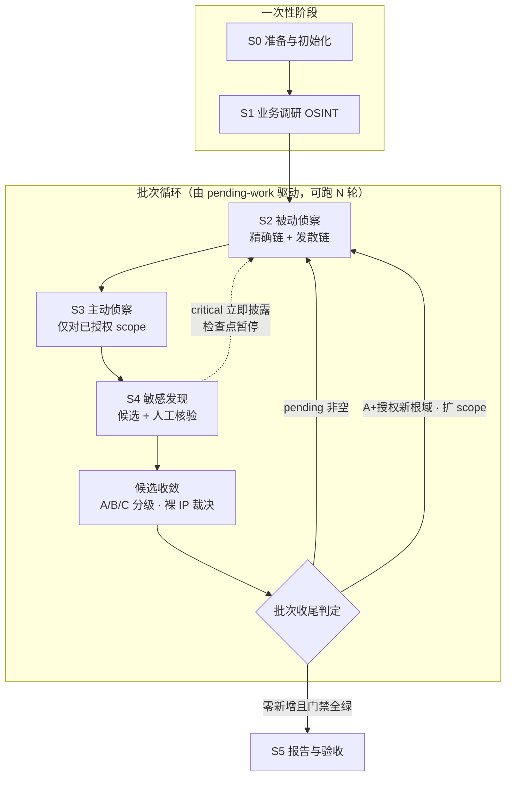

# external-pentest-recon

外网渗透前期侦察（OSINT / footprinting）Skill。从**根域名 / IP / 公司名 / ICP / GitHub org** 出发，按 **S0 准备 → S1 业务调研 → S2 被动 → S3 主动 → S4 敏感发现 → S5 报告验收** 六个阶段执行，产出业务画像、资产 CSV、敏感发现清单与摘要报告。

**执行真相以 [`SKILL.md`](SKILL.md) 为准**；本 README 只做步骤、流程与收集点的总览说明。

## 核心思路：多轮收集 × 每轮发散

整个侦察不是"跑一遍工具"，而是一个**批次循环（batch loop）驱动、逐轮扩张攻击面**的过程：

1. **多轮收集（循环）**：S0/S1/S5 各执行一次；S2-S4 由待处理工作队列（`pending-work`）驱动多轮执行。每轮一个 batch，批次号单调递增。只有 `pending` 队列清空、`recon_converge` 零新增、收敛门禁（`--gates collect`）全绿时才判收敛。
2. **每轮发散（扩张）**：每一轮 batch 不是机械重复上一批查询，而是把本轮新入库的资产（子域、IP、URL、证书、公司线索）**全部消费并转化为下一轮的发散输入**——新根域候选走 A/B/C 分级，确认 `A+授权` 后扩 scope，下一轮对新根域**重跑完整 S2-S4 精确链**；新 IP 形成裸 IP / C 段候选；新 URL 进入爬取、指纹、目录扫描队列。
3. **发散 ≠ 入库**：发散查询结果（divergent raw）只进入关联候选与 triage，**禁止直接 normalize/merge/回写**；必须经过主体证据补证、独立授权、CDN/云校验"收敛"为 A 类后，才在下一轮进入权威（authoritative）精确链。发散与收敛在每轮内成对出现。



## 每轮 batch 的固定节拍

无论第几轮，循环内的顺序固定：

```text
恢复 state
 → 执行一轮 batch_run（--max-batches 1 起步）
 → batch 返回 0/4 后读取 .artex/emit_<run>_<batch>.json
 → 逐批 insert_assets 回写资产图
 → 登记真实回执 raw/writeback_receipts.jsonl
 → 按需 record_fact（分级 / 受限 / 授权事实）
 → batch_triage.py pending-work 重算待处理
 → 有 pending 继续下一轮，否则收尾
```

---

## 各阶段收集点清单

模式标注：**AUTO** = 工具自动执行；**MANUAL** = 人工/LLM 证据（confirm 模式走人在环路，full 模式 agent 依证据自动确认）；**COND** = 条件触发；**GAP** = 实现缺口（无自动 wrapper）。

### S0 准备与初始化（一次，不采集目标数据）

| # | 收集/检查点 | 工具/来源 | 模式 | 落盘 |
|---|---|---|---|---|
| 1 | 参数与授权固化（target/scope/depth/授权级别） | `recon_init` | — | `recon_<target>_<ts>/`、state |
| 2 | 工具链自检 | `krun --check`；失败唯一修复路径 `install_toolchain.sh` | AUTO | 自检结果 |
| 3 | API key 自检（FOFA/Shodan/Hunter/Quake/ZoomEye/0.zone/DayDayMap/Censys/Serper/GitHub/SecurityTrails/企查查） | `recon_key_check` | AUTO | key 状态（不输出完整 key） |
| 4 | 数据源开关派生 | `recon_profile_resolve`（注册表 `assets/recon_sources.json` + `config/sources.yaml`） | AUTO | `profile_resolved.json` |
| 5 | 独立源健康检查（HTTP/auth/quota/schema/transport） | 注册表 health_check | AUTO | `source_health_<run>.json` |

### S1 业务调研 + OSINT（一次）

| # | 收集点 | 具体内容 | 工具/来源 | 模式 | 落盘 |
|---|---|---|---|---|---|
| 1 | WHOIS | 注册主体、注册邮箱、NS、时间线 | `recon_whois` | AUTO（domain/url 种子） | `raw/authoritative/whois*` |
| 2 | 官网特征 | 首页、About/产品、`security.txt`、联系页、页脚备案 | `http_request.py` 统一 helper | AUTO（domain/url 种子） | `raw/authoritative/homepage.html` 等 |
| 3 | 工商主体 | 公司全称/统一信用代码/股东/对外投资 | `recon_qcc_company`（企查查 FuzzySearch）；海外按国别企业登记局 | MANUAL(API) | `raw/manual/qcc_*.json` |
| 4 | 主业画像 | 主营业务、产品线、行业归属、战略方向 | 官网产品页、年报/公告、证券披露平台（SEC EDGAR/公开资讯观测站/DART 等）、招聘 JD | MANUAL | 业务画像「目标概述」节 |
| 5 | 组织架构 | 上级单位、下属/直属单位、子公司/合资、挂靠机构 | 官网机构设置页、年报公告、Crunchbase/OpenCorporates/GLEIF、备案反查、WHOIS 注册人比对 | MANUAL | 线索包 `org_hierarchy` |
| 6 | 合作方与中标情报 | 项目名、采购方/供应商角色、金额、日期 | 按国别采购平台（台 pcc、美 SAM.gov、英 Contracts Finder、欧 TED、日 官公需、韩 KONEPS、新 GeBIZ、澳 AusTender）；中国走 cn_osint 专项 | MANUAL | 线索包 `partners` |
| 7 | 人物四轴 | A 邮箱发现（API/免费渠道/格式推断）；B 泄露反查（商业库/免费库）；C 用户名拓线（多平台交叉）；D 工商人物（国内天眼查类/海外登记） | `recon_people` + people_osint.md | AUTO+MANUAL | `raw/people_raw.json` → `unified/people.json` |
| 8 | APP/小程序 | 包名、签名、后端域名、敏感候选 | mobile_and_mini.md 专项 | COND | inventory（kind=app/miniapp） |
| 9 | 关联主体分级调研 | 子公司/品牌/收购/供应链主体定向核验 | `recon_related_entities`（targeted/profile/extended 三深度） | COND | `related_entities/<id>/report.md` |
| 10 | 线索包 | 公司全称/简称/ICP/keywords/品牌词/邮箱后缀/icon_hash | `recon_clues_init` 后持续维护 | — | `clues_<target>.yaml` |
| 11 | 业务画像四节 | S1 阶段交付 | 模板 report_templates.md | MANUAL | `business_profile_<target>.md` |
| 12 | S1 就绪校验 | 最低线索、画像四节、people.json、人工源终态 | `s1_readiness.py` | AUTO | `s1_ready.json` |

### S2 被动侦察（每轮）—— 精确链 + 发散链

**精确链（authoritative，对已授权 scope）：**

| # | 收集点 | 具体内容 | 工具/来源 | 模式 |
|---|---|---|---|---|
| 1 | CT 证书日志四源 | 子域、SAN 关联域 | CertSpotter / crt.sh / Anubis / HackerTarget（`recon_ct`） | AUTO |
| 2 | 子域双件套 | 被动聚合 + 爆破 | subfinder + ksubdomain（`recon_subdomains`） | AUTO |
| 3 | 当前 DNS | MX/NS/TXT/SPF/DMARC；SPF 递归展开提取 `ip4/ip6`；DMARC `rua/ruf` 关联域 | `recon_dnsrec` | AUTO |
| 4 | 测绘精确查询 | `domain=` / `hostname:` 精确 scope | FOFA / Shodan / Hunter / Quake / ZoomEye / 0.zone / DayDayMap | AUTO（有 key） |

**发散链（divergent，七轴 + 补充关联轴）：**

| 轴 | 收集点 | 具体内容 | 工具/来源 | 模式 |
|---|---|---|---|---|
| A | 域名与证书 | CT 关联、`domain*/host*` 品牌模糊、`cert=/cert.subject=` 证书反查、icon_hash 反查 | `recon_fofa_domain` / 各测绘引擎 `--no-merge` | AUTO |
| B | 公司/备案主体 | `title=` 简称、`body=` 公司全称、`cert.subject=` 组织名、ICP 反查（Hunter `icp=`）、企查查工商主体证据 | `recon_fofa_company` / `recon_fofa_all` / `recon_qcc_company`；中国专项 cn_osint.md | AUTO+MANUAL |
| C | Google dork | ≥3 条：2 条 `site:` 种子 + 1 条公司名/filetype | Serper（`recon_gdork`）；dork 文件生成 ≠ 已执行 | AUTO（有 key）/MANUAL |
| D | GitHub 代码 | code-search dork 命中 | GitHub API（full+token 自动）/ 浏览器人工 | MANUAL |
| D2 | Wayback CDX | 历史 URL/快照 | `recon_wayback_cdx`（默认关闭，显式开启） | COND |
| E | 人员/邮箱/WHOIS | WHOIS 反查、邮箱后缀关联 | whois_reverse 等 | MANUAL |
| F | IP/ASN/C 段 | 测绘纯 IP 提取、ASN/组织、同 `/24` 线索 | `recon_bareip` + 各测绘 `ip:`/`net:` | AUTO |
| G | 移动/小程序/供应商 | 包名反查后端、供应链域名 | 条件触发 | COND |
| 补 | 补充关联轴 | GA/统计 ID、icon hash、邮件设施、历史站点特征、授权渠道泄露库查询 | ga_id / historical_site / leak_lookup | MANUAL |
| 补 | 历史 DNS | 历史解析记录（独立必跑轴，当前 DNS/gau/CDX 均不能替代） | SecurityTrails API（required）；无 key 记 disabled | AUTO(API)/MANUAL |

**候选收敛（发散→收敛，每轮收口）：**

| # | 收集点 | 内容 | 工具 | 模式 |
|---|---|---|---|---|
| 1 | 关联根域分级 | 全部 OOS 根域自动初判 B/C → 第三方被动补证（WHOIS/ICP/CT/官网引用）→ confirm 升 A / C 留 `reject_reason` | `batch_triage.py` evidence/confirm | AUTO 初判 + MANUAL 确认 |
| 2 | 裸 IP 裁决 | 五要素：主体 A、≥2 条归属证据、逐 IP 授权、排除 CDN/云/任播 | `recon_bareip_confirm` | MANUAL |
| 3 | A 类扩 scope | 新 `A+授权` 根域持久化进 pending，下一轮重跑完整 S2-S4 链 | state + pending-work | 循环驱动 |

### S3 主动侦察（每轮，仅已授权 scope）

| # | 收集点 | 具体内容 | 工具/来源 | 模式 |
|---|---|---|---|---|
| 1 | 探活 | 状态码、标题、技术栈、服务头、A/CNAME、跳转链、非标 Web 端口 | dnsx → httpx（`recon_probe`） | AUTO |
| 2 | 裸 IP 全端口 | TCP 1-65535 + 服务详情；零端口也写成功 marker | RustScan + Nmap（`recon_portscan`） | AUTO（裁决合格后） |
| 3 | URL 双轴 | katana 主动爬取 + gau 历史 URL，相互独立都必须成功 | `recon_crawl` | AUTO |
| 4 | 指纹加深 | Web 指纹、CDN/CNAME 与源站判断 | EHole + WhatWeb（`recon_fingerprint`） | AUTO（增量） |
| 5 | 指纹补识别 | 空/unknown 指纹：响应头/body/favicon/证书/banner 研判 | `recon_annotate` 写回 | MANUAL/LLM（GAP） |
| 6 | CVE 待核提示 | 有版本指纹时生成待核映射，人工逐条评审 | `recon_cve_prep` → `recon_cve_apply` | AUTO+MANUAL |
| 7 | C 段扩展 | 同 `/24` 有确认 IP 触发：先测绘拉全（FOFA `ip="x/24"`、Shodan `net:`）逐 IP 展开 host/domain/title/ports，再 rustscan 常见端口（邻域 ±10 或整段）；命中域名回流 related_roots | `recon_cseg` | AUTO |
| 8 | 截图 | 视觉画像 | `recon_shot` | ON-DEMAND |
| 9 | SPA 接口深枚举 | 高价值 SPA 站点路由/API/参数级枚举 | 交接 `api-recon` skill | ON-DEMAND |

### S4 敏感发现（每轮）

| # | 收集点 | 具体内容 | 工具/来源 | 模式 |
|---|---|---|---|---|
| 1 | 目录/敏感路径扫描 | 目标集 = 全部 live URL ∪ critical/high 候选 ∪ 历史失败目标；三档 small/api/full；404/catch-all 基线剔除伪命中 | dirsearch（`recon_dirscan`） | AUTO |
| 2 | 目录命中验证 | 状态、重定向、响应内容、归属；文件类核对 magic bytes | 人工核验 | MANUAL |
| 3 | JS 端点/secret/source map/桶 URL | 广度层全覆盖存活主机；低内存自适应 `-jc` 分块 | katana `-jsl`（`recon_js`）；fallback xnLinkFinder/jsfinder | AUTO + MANUAL 核验 |
| 4 | GitHub 泄露核验 | 命中必须打开文件/仓库核验内容、上下文、有效性、归属 | GitHub dork 结果 | MANUAL |
| 5 | 云存储桶 | 公司名/品牌/域名/产品名/环境名组桶名，公开性 HEAD/GET/list（逐目标授权后） | read_only adapter | MANUAL |
| 6 | 网盘/文库/社区 | 中国大陆主体必做；海外可记 N/A 须写明 | 浏览器渠道 | MANUAL/GAP |
| 7 | 源码/VCS 泄露 | `.git`（对象/pack magic bytes 验证即止）、`.svn`、`.DS_Store`、备份文件；source map 只发现不还原 | 目录命中 + 人工 | MANUAL |
| 8 | 资产回灌 | 从 crawl URL、JS endpoint、httpx chain、dirsearch redirect、RustScan XML、历史 DNS/CDX 提取候选 → inventory → 下一轮发散输入 | `recon_extract_assets --batch` | AUTO |
| 9 | 人工敏感报告 | 全部候选的误报/影响/证据/归属判断 | — | MANUAL |
| 10 | critical 流程 | 当场披露 → `record_fact` → `batch_critical_ack` → 检查点恢复；证据永不删除 | issues `CRITICAL_IMMEDIATE` | AUTO 流程 |

### S5 报告与验收（收敛后一次，不采集新数据）

| # | 动作 | 内容 |
|---|---|---|
| 1 | 批次收尾检查点 | pending 快照固化、特征回填、triage、收敛扫描与门禁、`settle-batch` |
| 2 | 报告生成 | 摘要（S0 置顶、「启用来源」节、受限项）、业务画像、敏感发现、裸 IP 报告（0 候选也必写） |
| 3 | 固定验收链 | 报告门禁 → `recon_accept` → `recon_qa`；`accept_check --gaps` 判 complete/degraded |
| 4 | 一致性复核 | 计划 × ledger × artifact × inventory ↔ manifest/CSV/writeback 回执交叉核对 |
| 5 | 收敛事实回写 | `record_fact` 收敛结论 + asset_ids 关联 |

---

## 数据边界：四分区物理隔离

| 分区 | 内容 | 合法去向 |
|---|---|---|
| `raw/authoritative/` | 对已授权 scope 的**精确**查询 | parser → normalize → unified → merge → 主 CSV |
| `raw/divergent/` | 公司名/证书/图标/模糊域名等**发散**查询 | 只进关联根域/裸 IP 候选与 triage |
| `raw/manual/` | 人工浏览器、平台导出证据 | `recon_manual_record` → `manual_done` |
| `raw/limited/` | key/配额/能力受限证据 | issues 与摘要受限项 |

**发散→收敛的权威规则（A/B/C）：**

- **A 同主体**：备案主体/WHOIS 注册人/GA ID/官方关系说明一致且有原始证据。自动 triage **永远不得判 A**；必须 `batch_triage.py confirm --evidence` 人工/LLM 确认。只有 `A+授权=是` 才扩 scope。
- **B 待确认**：favicon/title/品牌近似等弱信号，自动初判最高到 B；必须第三方被动补证，默认不扫描。
- **C 噪声**：CDN/云/公共 SaaS/无关 SAN，必须保留 `reject_reason`；新证据只能先 reopen 为 B。

## 授权红线（fail closed）

- 「开始/执行」只取得**被动授权**；探活、端口、目录、爬取等主动动作需显式全流程授权（`--authorized-full-recon`；`RECON_AUTONOMY=full` 启动即视为已授予，但证据门禁逐条保留）。
- 未授权的根域/IP/ASN/网段不得做任何主动动作；「相关」「同品牌」不能替代授权。
- `recon_ct/probe/crawl/dirscan` 等入口内置物理 scope 核验，B/C 候选误传也会被拒。
- 裸 IP 全端口扫描 = 主体 A + ≥2 条归属证据 + 逐 IP 授权 + 排除 CDN/云/任播，四条件缺一不可。

## 核心交付物

```text
recon_<target>_<ts>/
├── business_profile_<target>.md      # 业务画像
├── assets_<target>.csv               # 16 列主资产表（仅 authoritative+in-scope）
├── sensitive_findings_<target>.md    # 人工敏感发现报告
├── clues_<target>.yaml               # 线索包（发散链燃料）
├── related_roots_<target>.{txt,triage.md,evidence.jsonl}
├── extended_assets_<target>.jsonl    # app/小程序/公众号/桶等非网络资产
├── bare_ip_report_<target>.md
├── divergence/plan+report_<run>_<batch>.json   # 每轮发散计划与执行报告
├── raw/{authoritative,divergent,manual,limited}/
├── raw/asset_inventory.jsonl         # 全部候选/确认资产的权威台账
├── raw/execution_ledger.jsonl        # 执行真相账本
├── raw/writeback_receipts.jsonl      # ARTEX 回写真实回执
├── acceptance_report_<target>.md
└── summary_report_<target>.md
```

## 在 artex-ld 中创建外网侦察 agent

本 skill 不自带 agent 运行时，需在你的 artex-ld 控制台中创建一个**会话 agent** 来驱动它。平台侧字段名以 artex-ld 实际界面为准（下文用占位符标注）；agent 侧的全部取值均来自本仓库事实，可直接照抄。

### 前置条件

1. `artex-recon` 镜像已构建可用（工具链随镜像预装，见 `s0-preparation/references/tool_runtime.md`）。
2. 本 skill 目录经 ARTEX `./skills` 绑定挂载，容器内路径为 `skills/external-pentest-recon/`（`SKILL_ROOT` 由 `recon_run.sh` 自定位，无需手工 export）。
3. （可选）准备数据源 API key：FOFA / Shodan / Serper / GitHub Token / Hunter / Quake / ZoomEye 等。缺 key 不阻塞创建——对应来源自动记 `limited` 降级。

### 创建步骤（Web 控制台）

1. **进入创建入口**：artex-ld 控制台 → Agents → 新建 agent（菜单路径以实际界面为准）。
2. **名称**：填 `recon_scout`（与流程图集和 SKILL.md 中的约定名一致）。
3. **主提示词**（`<系统提示词 / System Prompt>` 字段）：粘贴 [`recon-agent-prompt（外网侦察agent提示词）.md`](recon-agent-prompt（外网侦察agent提示词）.md) **全文**。
4. **收尾提示词**（`<收尾 / Wrap-up Prompt>` 字段）：粘贴 [`recon-agent-wrapup（外网侦察agent收尾提示词）.md`](recon-agent-wrapup（外网侦察agent收尾提示词）.md) **全文**。
5. **Skill 绑定**（`<Skills>` 字段）：启用/挂载 `external-pentest-recon`。
6. **工具绑定**（`<Tools>` 字段）：**仅绑定以下 4 个平台工具，不多不少**：
   - `insert_assets`（逐批回写资产图）
   - `list_assets`、`list_companies`（查重与主体核对）
   - `record_fact`（分级 / 受限 / 授权 / critical 事实）
   
   本 agent **只生成事实**：不创建 hint、不做任务/公司 scope 交接，故不授予其他写类工具。
7. **环境变量**（`<Env>` 字段，可选）：
   
   | 变量 | 取值 | 说明 |
   |---|---|---|
   | `RECON_REGION` | `cn`（缺省）/ `overseas` | 区域画像，影响来源与 OSINT 专项选择 |
   | `RECON_AUTONOMY` | `confirm`（缺省）/ `full` | `confirm`=人在环路逐项确认；`full`=agent 依证据自动确认并以 `--confirmed-by autonomous-llm` 留痕 |
   | `FOFA_KEY` / `SHODAN_KEY` / `SERPER_KEY` / `GITHUB_TOKEN` / `HUNTER_KEY` / `QUAKE_KEY` / `ZOOMEYE_KEY` … | 各平台 key | 环境变量注入；`config/api_keys.yaml` 为可选覆盖 |

8. **模型与运行参数**（`<模型 / 超时 / 并发>` 等字段）：按 artex-ld 界面默认值即可；安装工具链与长批次建议给足超时（安装耗时数分钟）。
9. **保存并启用** agent。

### 创建后验证（冒烟，约 1 分钟）

向新 agent 发起对话，要求只做 S0 环境自检：

```text
对本 skill 做环境自检：依次执行 krun --check 与 recon_key_check，报告结果，不进入任何收集。
```

通过判据：`krun --check` 全绿（未通过时 agent 应走 `install_toolchain.sh` 确定性修复路径并复检，而不是散装补装）；`recon_key_check` 如实报告各源 yes/no（全 no 属合法状态，后续 keyed 源自动 `limited`）。随后可用一个已授权的小目标走 confirm 模式验证「任务失败处置」与人工确认链路。

### 使用注意

- **confirm 模式（默认）**：授权确认、裸 IP 逐 IP 授权、泄露人工核验等环节会暂停等人工输入；**full 模式**由 agent 依证据自动确认并留痕。
- **任务失败处置（强制）**：任何任务失败时 agent 不调用 `record_fact`、停止动作链、如实报告阻塞原因与现场路径；同一失败命令在无新信息时不得重跑，WAF 全路径 403 等结构性失败走契约终态（`limited`+`waf_challenge`+canary 证据）。
- 详细行为契约以 [`SKILL.md`](SKILL.md) 与两份提示词文件为准；本节节律（批次循环、回写、回执）与上文「每轮 batch 的固定节拍」一致。

## 目录导览

| 路径 | 说明 |
|---|---|
| `SKILL.md` | 唯一文字总执行文件（全局契约：顺序/授权/数据边界/批次循环/收敛/验收） |
| `s0-preparation/` ~ `s5-reporting-acceptance/` | 六阶段入口文档 + 各阶段脚本与专项 refs |
| `assets/recon_sources.json` | 数据源注册表（能力/adapter/默认开关/模式） |
| `assets/clues.template.yaml` | 线索包模板 |
| `tests/` | 批次驱动、triage、发散、收敛等自动化测试 |
