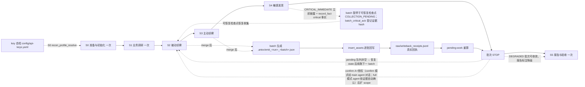

# 外网渗透前期侦察 Skill

本文件是本 skill **唯一的文字总执行文件**，统一定义 S0-S5 顺序、授权、数据边界、证据真相、批次循环、重试、监控、收敛、验收和交付。六个阶段入口负责各阶段的目标、步骤、产物与专项引用；专项 refs 只维护领域细节，不得覆盖本文件的全局契约。

S0/S1 在一次侦察生命周期中各完成一次；S2-S4 按批次循环；无新增 `A+授权`、收敛扫描零新增且收敛门禁（`--gates collect`）全绿后才判收敛；S5 在最终收敛后完成一次。工具调用经 `krun` / `recon_*` 封装，authoritative 结果经 normalize/merge 确定性入库。

## 总览



> **主链契约摘要**：S0/S1/S5 各执行一次，S2-S4 由待处理工作（`pending-work`）驱动多轮循环；阶段名与下表执行入口一一对应，各阶段入口开头为四段式路由器图（入口条件 → 自动轴 → 条件专项/MANUAL/GAP → 出口产物）。每轮固定顺序：恢复 state → 执行一轮 `batch_run` → 读取 emit JSON → 逐批 `insert_assets` → 登记真实回执 → 按需 `record_fact`（分级/受限/授权等事实）→ 重新计算 pending → 继续或收尾。会话绑定工具仅 `insert_assets`/`list_assets`/`list_companies`/`record_fact`，本 agent 只生成事实：不创建 hint、不做任务/公司 scope 交接；人工环节均经（confirm 模式：main agent 人在环路对话；full 模式：agent 依证据自动确认，`--confirmed-by autonomous-llm` 留痕）；divergent 结果只进 inventory/triage，禁止直接 normalize/merge/`insert_assets`；详见文末「双图回写检查清单」。

唯一详细可视化参考：[`详细流程图集`](s0-preparation/references/workflow_diagrams.md)。其中 `[AUTO]`、`[MANUAL]`、`[ON-DEMAND]`、`[GAP]` 用于区分当前自动覆盖、人工证据、条件执行和实现缺口；文字执行真相仍以本文件和对应阶段入口为准。

## ARTEX 执行语境

- 本 skill 由 ARTEX worker 经 Skill 元工具调用；worker 的 Bash 在 ARTEX 容器内执行，工作目录为每意图独立的 `tasks/<taskID>/i<intentID>/`（即 `$PWD`）。
- 工具链由 `artex-recon` 镜像预装；本 skill 脚本经 ARTEX `./skills` 绑定挂载在容器内可用，`SKILL_ROOT` 由 `recon_run.sh` 自定位。`krun` 默认 `RECON_EXEC=local` 本机直跑；`recon_init` 输出父目录默认为 `$PWD`，state 默认 `$PWD/.state`（runDir 级隔离，在 `$OUTPUT_DIR` 之外）。同一 target 同时只跑一个批次链。
- 工具链修复契约：`krun --check` 未通过 → 执行 `bash $SKILL_ROOT/s0-preparation/scripts/install_toolchain.sh`（确定性：固定版本 + sha256 校验、幂等，需 root 与出网）→ 重新 `krun --check` 复检；仍失败判环境阻塞、记 `limited`、不得进入 S1。`install_toolchain.sh` 之外的散装补装一律视为冒充通过，禁止。安装耗时数分钟，用 `recon_bg` 后台原语或足长 timeout 执行，不得以超时为由跳过复检。
- 标「人工」的环节（confirm A+授权、裸 IP 逐 IP 授权、泄露人工核验、MANUAL 来源证据等）经（confirm 模式：main agent 人在环路对话；full 模式：agent 依证据自动确认，`--confirmed-by autonomous-llm` 留痕）后，再执行对应 `confirm`/`recon_manual_record` 命令；授权与 fail-closed 条款不变。
- 思考与过程留痕由 ARTEX transcript/activity 自动承担；原 pi session 耦合的思考日志导出工具（`dump_recon_log.py`）已剔除，不再保留对应产物文件名。
- 产物遵循当前 snake_case 命名契约；双图回写为纯增量动作，见文末「双图回写检查清单」。

## 输入与授权

执行前确认并记录以下输入；目标、范围或授权不明确时先询问，不得猜测或启动网络动作。

| 输入 | 默认/规则 |
|---|---|
| `target` | 必填；根域名、IP、URL、公司名、ICP 或 GitHub org |
| `scope` | 默认等于已授权的 target；新增根域必须单独确认授权 |
| `depth` | 默认 `2`；批次调度范围 `1..2` |
| 阶段范围 | 默认 S1-S4；用户缩减阶段时只执行对应阶段入口，不使用固定包含主动动作的完整 `batch_run` |
| `output_dir` | 默认由 `recon_init` 创建 `recon_<target>_<ts>/` |
| 数据源开关 | 注册表 `assets/recon_sources.json` 定义能力/adapter/默认状态；可选 `config/sources.yaml` 仅覆盖 `enabled: true|false`。S0 `recon_profile_resolve` 统一派生：显式 false=`disabled_profile_off`；keyed 无 key=`disabled_no_key`；keyless 未显式配置时读取 `default_enabled`，未声明则 `disabled_default`。写 `$OUTPUT_DIR/profile_resolved.json`；未知源/schema/非布尔配置 fail closed |
| 授权级别 | 两种状态，必须分开记录：①**允许开始被动侦察**（S1 业务调研 + S2 被动链）——用户在对话中表示"开始/执行"仅取得此级别；②**明确的全流程主动授权**——探活、端口、目录、爬取等主动动作需用户明确给予，`batch_run` 显式传 `--authorized-full-recon`。**RECON_AUTONOMY=full** 时启动即视为已给予全流程主动授权，并对满足证据门的 A 类根域/裸 IP 预授权；`--authorized-full-recon` 由驱动 agent 在 full 模式下直接携带 |
| 实验目标 | `example.com`、`.test`、`.invalid`、`.localhost` 等还需 `--allow-lab --lab-ticket <id>` |

种子经 `normalize_seed`（`recon_init`/`batch_run` 的 `--seed-type auto|domain|url|ip|company|icp|github_org`）归一化后按类型路由：domain/url 种子归出的根域须在授权 SCOPE 中才进入 S2；IP 种子进入精确测绘/RDAP/PTR 与裸 IP 候选链；**company/icp/github_org 种子先执行 S1 被动发现，若尚无已授权根域，状态为 `unresolved_seed`**——持久化在 recon state 而非 asset state，`pending-work` 单列未解析种子并计为 `manual_pending`；`unresolved_seed` 禁止把原始字符串交给 CT、子域爆破或首页请求。

"开始/执行"≠全流程主动授权：仅有被动授权时只执行 S1/S2 与 MANUAL 来源，不得启动 S3/S4 主动动作；CIDR、裸 IP、新根域仍按各自独立授权门处理（`--authorized-full-recon` 不代表邻段或裸 IP 授权）。全流程 fail closed：

1. 未授权的根域、IP、ASN、网段或第三方资产不得探活、爬取、扫目录或扫端口。（full 模式下由 agent 依证据判定，`--confirmed-by autonomous-llm` 留痕。）
2. 关联根域的“同主体”和“已授权”是两列独立事实。**B/C 都必须先完成第三方被动补证**（WHOIS/RDAP、ICP/工商、CT、官网引用等，不直连候选主机）；favicon、title、品牌相似最多自动判 B。只有补证完成后，人工/LLM 才能通过 `batch_triage.py confirm --evidence` 把 B 确认为 A；C 必须保留 `reject_reason`，新证据只能先 `reopen` 为 B。只有 `A+授权=是` 才扩 scope。（full 模式下由 agent 依证据判定，`--confirmed-by autonomous-llm` 留痕。）
3. 裸 IP 只有在主体 A、至少两条归属证据、逐 IP 授权且排除 CDN/公共云/任播后，才有全端口扫描资格。（full 模式下逐 IP 授权由 agent 依证据判定并留痕。）
4. 发现 scope 外候选只登记、补证、分级和请求授权，不得用“相关”“同品牌”或工具命中替代授权。（full 模式下授权由 agent 依证据判定，不得以自动确认代替证据。）
5. `recon_ct`、`recon_probe`、`recon_crawl`、`recon_dirscan` 等域名/URL 入口会先执行物理 scope 核验；B/C 候选即使误传给命令也会在网络动作前被拒绝。（full 模式同样受此硬门禁约束，`--confirmed-by autonomous-llm` 留痕。）

### 自主模式（autonomy）

`RECON_AUTONOMY` 取 `confirm`（默认）或 `full`；`full` 时 `recon_profile_resolve` 导出 `RECON_AUTONOMOUS=1`。两种模式**只换确认主体，不降证据标准**——上述 fail-closed 条款 1-5 与所有证据门禁（B/C 补证、两证据、非 CDN/云验证、required 语义）逐条保留。

- **confirm 模式**：所有「人工」环节经 main agent 人在环路对话取得确认后执行。
- **full 模式**：由驱动 agent 依证据自动完成确认——满足证据门时直接执行对应 `confirm`/`recon_manual_record`，统一携带 `--confirmed-by autonomous-llm` 留痕；证据不足仍 fail closed，不得降级放行。
- **MANUAL 源自动执行边界**：能经 API/HTTP 自动执行的（GitHub dork API、历史 DNS、Wayback CDX、云桶公开性 HEAD/GET、企查查工商 `recon_qcc_company`）由 agent 直接执行并留证 `manual_done`；浏览器类（网盘/文库/社区、无 key 泄露库、云桶内容人工研判）统一记 `disabled(reason=autonomy_browser_only)` 并写理由。
- **critical 上报**：full 模式保留「当场披露 + `record_fact` + `batch_critical_ack` + 检查点恢复」全链，披露不等待用户回复。
- **留痕**：每次自动授权/确认（B→A、扩 scope、裸 IP）执行后 `record_fact` 一条 `autonomy_decision` 事实（summary=决策+依据，evidence=证据路径）；manifest run 头记录 `autonomy=full`。`disabled` 是合法终态，MANUAL 源的 required 由已登记的终态满足。

## S0-S5 执行顺序

顺序固定，不得跳过前置门禁或把后阶段产物倒推为前阶段已完成。

| 阶段 | 执行入口 | 总执行要求 |
|---|---|---|
| S0 准备与初始化 | [`preparation.md`](s0-preparation/preparation.md) | 明确参数/授权，完成环境检查、`recon_init`、`krun --check`、key 自检、state 与证据目录初始化 |
| S1 业务调研 | [`business_osint.md`](s1-business-osint/business_osint.md) | 完成主体、业务、组织、人物、条件专项、业务画像和线索包；`recon_related_entities` 管理关联主体分级调研，关系不继承授权 |
| S2 被动侦察 | [`passive_recon.md`](s2-passive-recon/passive_recon.md) | 完成精确被动链、发散查询、MANUAL 来源、关联根域与裸 IP 候选闭环 |
| S3 主动侦察 | [`active_recon.md`](s3-active-recon/active_recon.md) | 只对已授权 scope 完成探活、合格裸 IP 端口、URL 双轴及阶段规定的补充项 |
| S4 敏感发现 | [`sensitive_findings.md`](s4-sensitive-findings/sensitive_findings.md) | 完成自动候选、人工核验、人工敏感报告和资产回灌；critical 发现立即上报 |
| S5 报告与验收 | [`reporting_acceptance.md`](s5-reporting-acceptance/reporting_acceptance.md) | 报告门禁后执行 accept → QA，形成最终交付结论（思考留痕由 ARTEX transcript/activity 承担） |

S1-S4 默认全部必做；移动端、中国主体、C 段、截图等按阶段入口的条件触发。首轮 S2 前由 `s1_readiness.py` 校验线索包 target/scope、最低发散线索、业务画像四节、`unified/people.json` 和适用人工源终态，写 `s1_ready.json`。普通路径仅 `ready|degraded` 可继续；仅已授权 domain/url 种子允许 `cold_start=true`，可先采首页特征再复核，缺失业务叙述始终记 degraded，不得豁免授权或 scope。续跑重新计算 clues sha256，变化时重新评估 readiness。

阶段入口标明的 MANUAL/GAP 不会因 `batch_run` 返回成功而自动变成已完成。高价值 SPA 站点的接口级深度枚举可在 S3 交接处经 `api-recon` skill 做 ON-DEMAND 专项（详见 S3 交接节），属条件专项，不改变各阶段职责划分。

## S0 全局门禁

读到本 skill 后先执行 S0。工具链由 `artex-recon` 镜像预装，**无 bootstrap 流程**：环境自检 = `krun --check`（`RECON_EXEC=local` 模式，检查关键工具是否在 PATH）+ `recon_key_check`；`krun --check` 未通过前，不得进入 S1 或启动目标网络收集。失败时的**唯一合规修复路径**是执行 `bash $SKILL_ROOT/s0-preparation/scripts/install_toolchain.sh`（确定性安装：固定版本 + sha256 校验、幂等，需 root 与出网），完成后必须重新 `krun --check` 复检；复检仍失败判环境阻塞、记 `limited`、不得进入 S1。**`install_toolchain.sh` 之外的任何散装补装（手搓 `apt`/`pip`/`go install` 单个工具）一律视为冒充通过，禁止**。执行提示：安装耗时数分钟，按 skill 的 `recon_bg` 后台原语或足长 timeout 执行，不得以超时为由跳过复检。API key 只通过 `recon_key_check` 或绝对路径的 `load_api_keys.py` 自检，不使用 cwd 相对路径，不输出完整 key，不用占位符发请求。

key 缺失、配额不足或能力受限记 `limited`；`limited` 不是 `ok`、`empty` 或已执行。只要 FOFA/Shodan artifact 或 CSV 已证明使用了对应来源，报告必须写“已使用配置 key”，不得同时写“无 key”。完整初始化、state、I/O 和 key 规则以 S0 入口及 [`api_keys.md`](s0-preparation/references/api_keys.md)、[`tool_runtime.md`](s0-preparation/references/tool_runtime.md) 为准。

## 数据隔离与确定性入库

四类 raw 必须物理隔离，不得通过复制、改名或报告叙事绕过边界：

| 分区 | 内容 | 合法去向 |
|---|---|---|
| `$RAW_DIR/authoritative/` | 对已授权 scope 的精确查询 | 注册 parser 后 normalize → unified → merge → 主 CSV |
| `$RAW_DIR/divergent/` | 公司名、证书、图标、模糊域名等发散查询 | 只进入关联根域/裸 IP 候选与 triage |
| `$RAW_DIR/manual/` | 人工浏览器、平台导出、截图/API 证据 | `recon_manual_record` 后成为 `manual_done`，供人工报告与验收 |
| `$RAW_DIR/limited/` | key、配额、能力或执行受限证据 | issues、摘要受限项和后续重试 |

发散候选必须经过主体证据、独立授权和 CDN/云校验；晋升后由下一次批次对新 scope 重新执行 authoritative 精确链。禁止把 divergent raw 直接 normalize/merge 进主 CSV。

工具 raw 由注册 parser 处理后进入统一结构和 16 列 CSV；人物、业务叙述和人工 finding 写对应人工报告；自动 findings 只写 `generated/sensitive_findings_auto_<target>.md`，不得覆盖或替代根目录 `sensitive_findings_<target>.md`。字段、parser 和合并规则见 [`normalization.md`](s0-preparation/references/normalization.md)。

## 执行真相与状态

“生成计划”“打印日志”“文件存在”和“报告自述”都不等于执行完成。所有阶段和 S5 的完成真相统一为：

**查询/执行计划 × `$RAW_DIR/execution_ledger.jsonl` × 可校验 artifact**

- 自动项只有 ledger 为 `ok|empty`，且 artifact 存在、可读并通过哈希/结构校验，才算完成。
- 人工项必须先把证据写入 `$MANUAL_RAW_DIR`，再执行 `recon_manual_record`；计划内查询还必须带对应 `query_id`，最终状态为 `manual_done`。
- `failed|limited|not_executed|disabled` 均不等于完成；是否阻断由计划中的 required 语义和阶段门禁决定。
- `$RAW_DIR/tool_runs.log` **仅是兼容执行摘要**，不得单独作为 S5 验收或“已执行”的证据。
- `batch_manifest.tsv` 证明批次控制状态，但不能替代计划、ledger 或 artifact。
- 全部发现与待处理状态的权威是 `$RAW_DIR/asset_inventory.jsonl`：候选/确认资产统一登记，pending 只由 `asset_inventory.py pending` / `batch_triage.py pending-work` 计算；`related_roots` 与裸 IP 文件是由 inventory 派生的只读审计视图，禁止绕过 inventory 直接编辑或追加。

MANUAL 来源（以 `assets/recon_sources.json` 中 `mode:manual` 条目为准，如 GitHub dork、历史 DNS）逐项登记终态，只允许四种：适用且已完成记 `manual_done`（证据先入 `$MANUAL_RAW_DIR` 再 `recon_manual_record`，计划内查询带 `query_id`）；适用但未做记 `not_executed` 并写明原因；受 key/配额/能力限制记 `limited`；确认不适用记 `disabled` 并写判断依据。不得把所有可选项一律写成 `not_executed`，不得以“做了相近查询”顶替。dork 文件生成不等于 Google/GitHub 搜索已执行；历史 DNS 是独立 MANUAL 来源，当前 DNS、gau、Wayback/CDX 均不能替代其完成状态。

## 重试与失败传播

1. 每次尝试使用临时产物；成功后才原子替换正式 artifact，失败不得留下可冒充成功的新正式文件。
2. 工具封装仅对 timeout/瞬时 transport 返回码有界重跑同一工具、同一目标、同一查询。默认重跑 1 次，`RECON_TIMEOUT_RETRIES` 最大为 5。
3. HTTP 只由标准 helper 对 timeout、明确瞬时 transport 和其列出的瞬时 HTTP 状态有界重试。语法、鉴权、配额、解析和业务错误不重跑。
4. 重试耗尽保留原步骤 `failed`。不得换另一工具或来源后声称原步骤完成；katana 与 gau 是独立必跑轴，gau 失败不触发 CDX 作为降级。
5. 当前批必需生产者、计划对账、ledger/artifact 校验、triage 或计数失败时，批次返回失败并禁止收敛和 S5。旧 artifact、旧 manifest 或日志无增长不得冒充本批成功。
6. S0 关键门禁失败立即停止；S1-S4 的高危已核验发现按阶段入口写 `CRITICAL_IMMEDIATE`（**full 模式同样保留当场披露 + `record_fact` + `batch_critical_ack` + 检查点恢复全链，披露不等待用户回复**）：会话 agent 在对话中**立即完整披露**（不等待收尾、不展示明文凭据），随后 `record_fact` 写入 critical 事实（`facts[]` 带证据指针、`confidence` 如实；`intent_id` 仅运行时已知真实探索图 intent node id 时传入，否则省略），当前 batch 在 S4 后立即暂停（跳过 checkpoint/triage/converge），manifest 写 paused 行、本轮 emit 照常生成且 `next_batch` 推进，返回 `COLLECTION_PENDING(reason=critical_immediate)`（exit 4）；`raw/critical_immediate.jsonl` 证据**永不删除**；emit 失败属 batch 控制面错误（exit 1），不得留下虚假的可回写承诺。`report_finding` 不由本 agent 调用（漏洞级登记走平台任务侧流程，本 agent 只负责事实与当场披露）。**禁止删除或清空 critical 证据**——`record_fact` 完成后调用 `batch_critical_ack` 把当前 `critical_immediate.jsonl` 的 sha256 登记到 `.batch_critical_ack` 作为已确认游标，相同证据不再触发暂停，再从检查点恢复收集；恢复后出现 hash 变化的新 critical（含空队列恢复时）会再次暂停并重复本流程。续跑时 S0/S1 只核验完成状态（不重复 S0/S1/key 检查，仅核验 state 与 `clues_<target>.yaml`，缺失为控制面错误 exit 1）；`--max-batches` 是单次 invocation 上限，待处理队列为空时重跑直接判门禁返回 COMPLETE/DEGRADED/PENDING，不新增批次、不生成新 emit。
7. WAF 契约终态：dirsearch canary ≥90% 同码判定 WAF 拦截（环境性不可达）时记 `limited` + `error_class=waf_challenge` + canary 证据文件（`raw/dirsearch_waf_<slug>.txt`）即终态——不重试、不阻断批次；目录成功游标与 S4/S5 覆盖门禁按同款口径放行，逐条 WARN 并写入摘要「受限项」。结构性拦截（如 Google Frontend 全路径 403）禁止在无新信息时反复重跑。

## 批次循环与收敛

`batch_run` 用于已获得全流程主动授权的完整编排（仅被动授权时只跑 S1/S2 与 MANUAL 轴）。S0/S1/S5 在一次侦察生命周期中各执行一次：S1 由 agent 在首个 batch 前完成，续跑只核验其完成状态；S2-S4 由待处理工作驱动多轮执行。同一 `OUTPUT_DIR` 的一次完整收集只创建并持久化一个 `RUN_ID` 与 `next_batch`，每次从 `next_batch` 继续，批次号在整个 run 内单调递增。

每轮固定顺序：恢复 state → 执行一轮 `batch_run`（`--max-batches 1` 起步）→ batch 返回 0 或 4 后读取 `.artex/emit_<run>_<batch>.json` → 逐批 `insert_assets` → 把真实结果登记到 `raw/writeback_receipts.jsonl` → 按需 `record_fact`（分级/受限/授权事实）→ `batch_triage.py pending-work` 重算 pending → 有自动/人工待处理则继续下一轮，否则收尾。每轮必须把全部新 inventory 产物消费并进入发散，不是机械重复同一批查询。自动 triage 不产生 A；B/C 缺第三方被动证据时批次 fail closed，不得收敛。确认 B 为 `A+授权`（confirm 模式：main agent 人在环路对话；full 模式：agent 依证据自动确认并留痕）后，由 pending 队列持久化扩 scope，下一轮对新增根域重跑完整 S2-S4 链（新 A root 与初始 SCOPE root 同标准）。

批次收尾按以下逻辑验收：

1. 固化本批开始时的 `raw/pending_snapshot_<run>_<batch>.json`，再回填本批 web 特征并更新发散输入。
2. 每轮生成 `divergence/plan_<run>_<batch>.json`；执行前按 query_id 校验 engine/root/query 与 artifact sha256，仅复用已闭合成功，失败/失效项单独重试。disabled 源写当前批 source/manual 台账，不记 q_fail。
3. 从 crawl、JS、httpx、目录和端口产物先 upsert `asset_inventory.jsonl`，再派生关联根域与裸 IP 候选视图；divergent raw 不得直接 normalize/merge/insert_assets。
4. 自动初判 B/C 时 root 与关联 OOS FQDN 经 `transition_many()` 原子级联；B/C 补证后，confirm 同样原子执行 root exact_collect 与 FQDN probe 分流。
5. 核对本批生产者、per-batch 计划、ledger、artifact、manifest、triage 和计数；真实查询 `failed|limited` 留 PENDING/降级，缺记录、坏 artifact 或坏报告才是控制面错误。
6. 执行 `recon_converge`；checkpoint 非控制错误后调用 `batch_triage.py settle-batch`。只有成功 root 回执且当前批证据门闭合，才把 A+授权、scope=in 的 root 结算为 `collected/none`；OOS FQDN 跟随 root，IPv4/IPv6 只转 `pending/manual_confirm`。
7. 每轮写 `divergence/report_<run>_<batch>.json`，记录 discovery/maintenance、planned/executed/cached、disabled/limited、unconsumed_subjects 和 terminal_state；维护轮 `executed=0` 必须有 `no_new_clues=true`。
8. 重新计算 `pending-work`，再写 manifest/emit 和真实 ARTEX 回执；`.batch_collected_roots`、`.clues_run.hash`、`.gdork_run.hash` 仅为兼容审计，不参与完成判定。
9. 只有上述检查正常、没有自动/人工待处理、`recon_converge` 零新增且 `accept_check.py --gates collect` 全绿（或显式 N/A 且 manifest 写明理由）时才判收敛；生产者或计数异常必须 fail closed。

**结束状态与退出码**（以 batch 输出与 manifest 终态为准）：

| 状态 | 条件 | exit |
|---|---|---|
| `COLLECTION_COMPLETE` | 无 pending/manual_pending/limited/未授权项，converge 零新增，collect gates 全 PASS/SKIP | 0 |
| `COLLECTION_DEGRADED` | 同上且无自动/人工待处理；唯一剩余项同时满足注册表 `required=false` 与 `error_class∈{quota,auth}`；报告不得写“完整覆盖” | 0 |
| `COLLECTION_PENDING` | 仍有自动待处理、人工确认、未授权项，或达到 `max_batches/max_depth`；manifest 写出具体 pending，禁止 finalize | 4 |
| 控制面错误 | 必需生产者失败、缺查询终态、artifact/hash 损坏、坏报告、triage/计数异常等；真实查询 `failed|limited` 已留台账时属于 PENDING/降级重试，不混入此类 | 1 |
| 参数错误 | 用法、非法 seed-type、非法 CIDR 等 | 2 |
| 授权拒绝 | 未授权主动动作/seed 被 fail-closed 拒绝 | 3 |

首组批次必跑；后续批次只在存在 `exact_collect/probe/passive_expand` pending 时继续——`new_a_count` 只负责扩 scope，不再是循环条件；同 scope 新 FQDN、新 IP、converge 新增和失败必需项均可触发下一轮。B 类人工候选计 `manual_pending`，不自动扫描，也不形成无限自动循环。测绘源配额耗尽或 key 缺失（`error_class` 为 `quota`/`auth`）且计划 `required=false` 时记 `limited`，批次可收敛为 `degraded`；其他 optional、manual、解析失败或平台回写失败不得降级。

单次 invocation 的保护上限按调度器参数执行：`max_batches` 不超过 3，`max_depth` 不超过 2（按各 root 的扩 scope 代数持久化，不以全局批次号代替），先到先停，达到上限即 `COLLECTION_PENDING` 而非正常收敛。新 invocation 会重置单次上限，因此人工确认后的重新运行不是跨 run 累计深度证明；授权和 state 仍必须持久化并复核。

收集正常结束必须同时满足：进程退出码为 0、当前 run 有 `STOP/stopped`、最后一个数字批次为 `complete`，并出现 `COLLECTION_COMPLETE`/`COLLECTION_DEGRADED`；判定 = 上述批次收尾 7 步 + `recon_converge` 零新增 + `--gates collect` 全绿（或显式 N/A 且 manifest 写明理由）。`batch_run` 完成只代表 S0-S4 收集控制流结束，不代表 MANUAL/GAP 或 S5 已完成。emit 生成与 ARTEX 回执不改变 batch 收集终态，禁止另设“等待 receipt 的 batch PENDING”状态。

## 历史 run 迁移与恢复

`batch_triage.py reconcile <out_dir> <target> --run-id R --batch N` 先把 inventory、ledger、批次 state、兼容游标、旧计划和 profile 复制到 `raw/migration_backup_<run>_b<N>/`，再补建 OOS FQDN 的 root 实体、按 root B/C/A 级联、将遗留裸 IP 转为人工确认，并重建 per-batch 计划。只有 legacy 游标中的 root 同时具备 A+授权、scope=in 和可验证当前批证据才自动结算；其余转人工待核。迁移报告为 `raw/reconcile_<run>_b<N>.json`。回滚代码不得删除新证据；状态恢复只能使用迁移前备份，critical/high 和真实 ARTEX 回执不得清除。

## 批次监控

人工持续监控与 agent 状态检查是两种不同模式：

- **人工持续查看**：在独立终端加载 `recon_run.sh` 和 `batch_driver.sh`，使用 `batch_follow "$OUTPUT_DIR" 100` 阻塞式持续跟随。`Ctrl-C` 只停止监控终端，不应终止批次进程。
- **agent 有界快照**：把 `batch_run` 作为可追踪的独立进程/任务启动，保留 PID、句柄或任务 ID；轮询时使用 `batch_snapshot "$OUTPUT_DIR"`，并同时核对当前 run 的 manifest 和实际进程状态。快照只描述采样时刻，不能因日志暂时不增长而判定结束。
- **快速档（强制，单批目标 ≤10 分钟）**：每次 `batch_run` 前确保已导出 `RECON_TIMEOUT_RETRIES=0`、`RECON_HTTP_TIMEOUT_SECONDS=30`、`RECON_DIRSCAN_TIER=micro`；`batch_run` 一律 `--max-batches 1 --max-depth 1`。gau/katana/wayback 等易长尾步骤由脚本内 300s 硬顶兜底，超时按 skill 契约记 `limited` 继续，不得重试、不得手动放宽超时。

禁止使用 `batch_run ... | tail -N`、`batch_run ... 2>&1 | tail -N` 或普通 `tail -N` 伪装实时监控。这会等待上游结束、可能掩盖退出码，也不能证明当前 run 的 manifest 状态。

执行期间想看实时进度，按三层查看（`recon_wait` 是 10s 轮询机制，由 `RECON_BG_POLL_SECONDS` 控制，只打印日志尾部快照；想看实时流用方式 ①②，不要等它）：

1. **单工具实时输出**：`tail -f work/<target>/raw/*.live`（即 `$RAW_DIR/*.live`）。工具执行期间 stdout/stderr 实时镜像，含 dirsearch 分片输出；每片开始截断重写、分片结束即删，文件消失代表该片已收尾。
2. **progress 心跳**：`tail -f work/<target>/raw/tool_runs.log`。结构化进度行：dirsearch_shard 分片进度（shard=i/n）、ksubdomain 档位、katana_js 分块。
3. **批次级日志流**：`batch_follow '<OUTPUT_DIR>'`（同上文的人工持续查看约定）。

## 产出

每个目标的核心交付物如下；目录和命名由 `recon_init`、阶段入口及 S5 模板共同约束：

```text
recon_<target>_<ts>/
├── business_profile_<target>.md
├── assets_<target>.csv
├── sensitive_findings_<target>.md
├── generated/sensitive_findings_auto_<target>.md
├── clues_<target>.yaml
├── clue_expansion_plan.json
├── google_dorks.txt / github_dorks.txt
├── related_roots_<target>.txt
├── related_roots_<target>.triage.md
├── related_roots_<target>.evidence.jsonl
├── extended_assets_<target>.jsonl
├── web_features_extracted.yaml
├── bare_ip_report_<target>.md
├── raw/authoritative|divergent|manual|limited/
├── raw/asset_inventory.jsonl
├── raw/root_collect_receipts.jsonl
├── raw/bare_ips_candidates.txt / bare_ip_verdicts.jsonl
├── raw/execution_ledger.jsonl
├── raw/tool_runs.log
├── raw/writeback_receipts.jsonl
├── divergence/plan_<run>_<batch>.json + report_<run>_<batch>.json
├── source_health_<run>.json（执行过健康检查时）
├── s1_ready.json
├── .artex/emit_<run>_<batch>.json
├── unified/（含 people.json）
├── acceptance_report_<target>.md
└── summary_report_<target>.md
```

主 CSV 只接收 authoritative、in-scope 且通过 normalize/merge 的资产，保持 16 列契约；已确认归属的 app/miniapp/official_account/saas_tenant/cloud_bucket/code_repo/api_endpoint 等非网络资产写入 `extended_assets_<target>.jsonl`（候选与已确认分文件，未知平台类型只经报告和 `record_fact` 归属事实留档，不伪造 `insert_assets` 成功）。`related_roots` 和裸 IP 文件是由 inventory 派生的候选/裁决审计视图，不因存在而自动扩 scope。人工报告与 generated 自动报告必须分离维护。核心交付物由本清单、阶段入口和 S5 模板共同约束；[`assets/deliverables.json`](assets/deliverables.json) 是验收器的**补充注册表**，覆盖 `unified/people.json`、逐 root `historical_clues_<root>.md`、条件触发的 `generated/sensitive_findings_auto_<target>.md` 和 `extended_assets_<target>.jsonl`，不是完整产物清单。

## S5 验收与交付

收敛后先按 S5 入口生成或更新根目录人工报告，再执行固定顺序：**报告门禁 → `recon_accept` → `recon_qa`**（原 `recon_dump_log` 为 pi session 耦合工具，已剔除；思考留痕由 ARTEX transcript/activity 自动承担）。优先使用 `batch_finalize` 保持顺序；局部阶段手工收尾也不得改变门禁逻辑。

S5 验收的唯一事实基础是**计划 × execution ledger × artifact × asset_inventory**，并与当前 run manifest、CSV 和 writeback 回执做一致性核对；`tool_runs.log` 只作兼容摘要。重点检查：

- 必做自动项为 `ok|empty` 且 artifact 可校验；必做人工项有 `raw/manual` 证据和 `manual_done`。
- 每个数字批次均有独立 plan/report；discovery 必须有实际新查询，maintenance 零执行必须有 `no_new_clues`；cached artifact 失效、disabled 台账缺失或 unconsumed subject 冒充 complete 均为 FAIL。
- 裸 IP verdict、inventory 与主 CSV 必须一致：A+授权合格=`collected/none`，C=`rejected/none` 且不得有 `bareip_verified` CSV 行；任一跨文件部分提交不得验收。
- `source_health_<run>.json` 中的真实健康检查分别报告 HTTP/auth/quota/schema/transport；离线测试不得冒充在线连通性。
- inventory pending、writeback 回执、A/B/C、IPv4/IPv6、key、critical/high 与实际文件/ledger 一致；pending 计数与 `pending-work` 输出一致。
- `business_profile_<target>.md`、`sensitive_findings_<target>.md`、`summary_report_<target>.md` 位于输出目录根部且非空；generated 文件不能替代人工报告。
- 摘要中的资产数、active 数、A/B/C、裸 IP、key 状态、critical/high、执行声明与 CSV/ledger/artifact 一致。
- `limited`、GAP、失败和未授权项逐条进入 issues/摘要“受限项”，不得静默改写为已完成或零发现。
- `recon_accept` 有 FAIL 时立即停止，不运行 QA；WARN 必须按 S5 入口处理并写入摘要 `## 受限项` 表格的 `验收 WARN` 列（值为 `S阶段 / 检查项`，例如 `S2 / MANUAL 来源闭环`）后复验。

完成判定口径：`recon_accept` exit 0 本身不构成完整覆盖证明；完整完成 = `recon_accept` exit 0 且 `python3 accept_check.py --output-dir <OUTPUT_DIR> --target <target> --gaps` 输出 `complete=true`（零 FAIL/WARN）。降级完成 = 无 FAIL 且全部 WARN 均同时满足 `required=false` 与 `error_class∈{quota,auth}`，输出 `degraded=true` 且 WARN 已全部写入摘要“受限项”——只能声明降级完成，报告不得写“完整覆盖”；其余情况 complete/degraded 均为 false，任一缺口存在即不算完成。`batch_finalize` 只接受 COMPLETE 或显式 DEGRADED，PENDING/控制面错误/授权拒绝一律禁止收尾。

最终汇报固定包含：target/scope、阶段范围、完整/降级/部分状态、各类型 pending 数、子域/资产/active 数、关联根域 A/B/C、裸 IP 候选与 A 类、critical/high、key 使用状态、ARTEX 已回写/跳过/失败数（来自 `raw/writeback_receipts.jsonl`）、未使用种子、未授权项、覆盖边界、PASS/WARN/FAIL、受限项和输出路径。FAIL 时只汇报阻塞项，不声明完成。

## 专项引用

按需读取，不在本文件复制逐工具操作：

- S0：[`api_keys.md`](s0-preparation/references/api_keys.md)、[`normalization.md`](s0-preparation/references/normalization.md)、[`tool_runtime.md`](s0-preparation/references/tool_runtime.md)、[`tool_commands.md`](s0-preparation/references/tool_commands.md)、[`tool_priority.md`](s0-preparation/references/tool_priority.md)
- S1：[`people_osint.md`](s1-business-osint/references/people_osint.md)、[`mobile_and_mini.md`](s1-business-osint/references/mobile_and_mini.md)
- S2：[`divergent_osint.md`](s2-passive-recon/references/divergent_osint.md)、[`roots_and_bare_ips.md`](s2-passive-recon/references/roots_and_bare_ips.md)、[`cn_osint.md`](s2-passive-recon/references/cn_osint.md)、[`dorks_and_syntax.md`](s2-passive-recon/references/dorks_and_syntax.md)、[`ksubdomain.md`](s2-passive-recon/references/ksubdomain.md)
- S5：[`report_templates.md`](s5-reporting-acceptance/references/report_templates.md)、[`transcript_privacy.md`](s5-reporting-acceptance/references/transcript_privacy.md)

## 双图回写检查清单

文件产物遵循本技能的统一命名契约（snake_case 文件名、16 列 CSV、raw 分区与 ledger）。双图回写是**纯增量动作**——emit 只读 CSV，`insert_assets`/`record_fact` 只向 ARTEX 双图写入平台参数与事实，不回写、不改名、不移动任何文件产物。

**会话绑定工具（能力真相，只有这 4 个）**：`insert_assets`、`list_assets`、`list_companies`、`record_fact`。本 agent（recon_scout）只生成事实：**不创建 hint、不做任务/公司 scope 交接**；平台其余任务侧工具（hint/任务 scope/公司 scope/traffic 回查/finding 登记类）不在会话绑定清单内，不得被写成任何流程的完成前置条件。

`record_fact` schema：`facts[]`（一次调用可带多条事实——一次探索内的多项观察先本地汇总再写入，禁止逐条碎片化）、`summary`、`detail`、`evidence`（文件路径指针/证据摘要）、`topology`（可选关联结构）、`asset_ids`（关联已回写资产）、`intent_id`、`confidence`。**`intent_id` 是探索图 node id**：仅当运行时已知真实探索图 intent node id 时才传，否则省略（fact 仍落任务探索图，但无 intent→fact 边）；**严禁把任务 id/会话 id 当 intent_id**。任务创建触发只 `CreateConversation`（附 task id/desc/goal），不创建 intent、不提供 intent_id；recon_scout 无 `add_intent`/`list_intents`，触发后在对话中输出建议的首个侦察意图配置文本（意图目标/范围/成功判据），供 planner/main agent 采纳。

| recon 产物/事件 | 会话动作 | 时机 |
|---|---|---|
| 每轮 merge 后的资产变更 | batch 生成 `.artex/emit_<run>_<batch>.json` → 逐批读取 `arguments` 调 `insert_assets` → 用 `artex_receipt.py record` 把真实结果追加到 `raw/writeback_receipts.jsonl`（ok 要求 rejected=0；部分成功记 limited 并进入缺口）；回写前可用 `list_assets`/`list_companies` 去重与核对归属 | batch 返回 0 或 4 之后，每轮必做 |
| 业务画像 / 组织架构 / 人物结论 | `record_fact`：facts[] 每条一个结论，evidence 带 `business_profile_<target>.md`、`clues_<target>.yaml`、`unified/people.json` 路径指针 | S1 完成时 |
| 关联根域 A/B/C 分级结论 | `record_fact`：facts[] 按 root 分条，含分级、证据摘要与授权状态；A+授权经人工确认后把授权事实一并写入（scope 扩由 state 持久化、下一轮 batch 消费） | triage 完成时 |
| 受限项 / 降级（limited） | `record_fact` + 最终报告「受限项」节 | 发生时 |
| critical 已核验发现 | 对话中立即完整披露 → `record_fact` 写 critical 事实 → `batch_critical_ack` 登记证据 hash（流程见「重试与失败传播」第 6 条） | 发现当场，不等任何收尾 |
| extended 未知平台类型资产 | 不伪造 `insert_assets` 成功；`record_fact` 写归属事实 + 报告留档 | 收尾时 |
| 收敛状态（COLLECTION_COMPLETE / DEGRADED 与 S5 验收结论） | `record_fact`：summary 写结论，asset_ids 关联已回写资产 | S5 |
| autonomy 自动决策（**full 模式**） | `record_fact` 一条 `autonomy_decision` 事实：summary=决策+依据（B→A / 扩 scope / 裸 IP 授权 / MANUAL 源自动执行），evidence=证据路径；manifest run 头已记 `autonomy=full` | 每次自动授权/确认执行后 |

每轮只调用 emit JSON 中列出的批次，不得只跑一批输出就宣称全表回写完成；只有相同 key+hash 且已有 ok 回执的资产可跳过（`summary.unchanged`），新增/变化/无回执/失败必须重发，同一 emission 以最后一次回执为有效状态。平台成功响应未返回计数时 accepted 取本批 emitted、rejected=0；回执内容必须来自实际工具响应，禁止凭自述写 ok。S5 验收由 `_gate_writeback_receipts` 独立裁决（最新 CSV 的每个应发射 emission 都有匹配 ok 回执；skipped>0、rejected、缺失、hash 不匹配、旧 run 回执或部分成功均 FAIL），该 gate 不在 batch 的 `--gates collect` 中。

上表中「人工确认」一律经（confirm 模式：main agent 人在环路对话；full 模式：agent 依证据自动确认，`--confirmed-by autonomous-llm` 留痕）后，再执行对应命令与回写。
