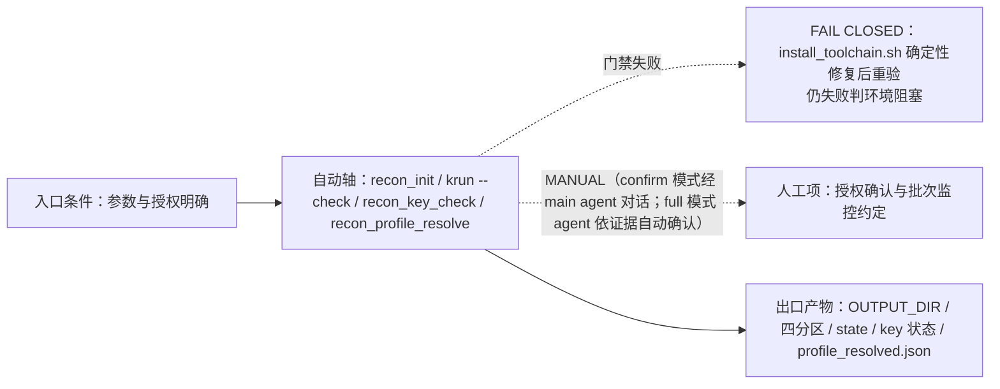

# S0 准备与初始化

> 本文件是 S0 的唯一权威入口。S0 每个目标、每次执行都必须完成；任一强制门禁未通过时，不得进入 S1 或启动目标网络收集。S1-S5 分别以各自阶段入口为权威，跨阶段总控、阶段范围映射与授权边界以 [`SKILL.md`](../SKILL.md) 为准。

## 目标

S0 将用户输入、授权边界、当前机器环境和每目标证据目录固化为可恢复、可验收的执行上下文。完成后必须同时满足：

- `target`、`scope`、`depth`、阶段范围和授权口径明确，不由执行者猜测。
- ARTEX 容器内的工具链（`artex-recon` 镜像预装）与 `krun`（`RECON_EXEC=local` 本机直跑）已经实测可用。
- 每目标 `OUTPUT_DIR`、稳定 state、四类 raw 分区和归一化目录已经建立。
- API key 状态来自权威自检，后续调用与报告口径一致。
- 计划、`execution_ledger.jsonl` 和 artifact 的证据闭环，以及 I/O、重试、监控和失败语义已经确认。



> **本阶段契约摘要**：输入 `TARGET`/`SCOPE`/`DEPTH`/阶段范围与授权口径；输出 `$OUTPUT_DIR` 骨架、raw 四分区、`execution_ledger.jsonl`、稳定 state 与 key 自检 yes/no；验收门禁见下文「验收」，任一未过不得进入 S1 或启动网络收集。
> bootstrap 已由镜像预烘焙取代：环境自检 = `krun --check`（local 模式）+ `recon_key_check`；`krun --check` 失败的唯一合规修复路径是 `bash $SKILL_ROOT/s0-preparation/scripts/install_toolchain.sh`（确定性：固定版本 + sha256 校验、幂等，需 root 与出网），修复后必须重新 `krun --check` 复检，仍失败判环境阻塞、记 `limited`；此外任何散装补装一律视为冒充通过，禁止。会话隔离与 I/O 契约见「执行顺序」；详细门禁流转与批次状态机见 [`workflow_diagrams.md`](references/workflow_diagrams.md#2-s0-初始化与授权门禁)。

## 进入条件

1. 已获得明确的种子目标；目标不明确时先询问，不执行探测。
2. 已确认允许的根域/IP 范围和所需阶段。`scope` 默认可取 `target`，`depth` 默认 `2`，但必须显式记录采用了默认值。
3. 已区分被动任务与主动任务。`batch_run` 固定包含探活、爬取、目录和合格裸 IP 全端口收集，只有用户明确授权后才能传 `--authorized-full-recon`；执行者不得代用户推定授权。
4. `example.com`、`.test`、`.invalid`、`.localhost` 等测试目标还必须具备 `--allow-lab --lab-ticket <id>`，否则不得启动网络动作。
5. 本 skill 脚本经 ARTEX `./skills` 绑定挂载在容器内可用，`SKILL_ROOT` 由 `recon_run.sh` 自定位（`BASH_SOURCE` 推导，无需手工 export）；worker 的 Bash 在 ARTEX 容器内执行，无需 Docker daemon 与 pi。历史安装与迁移资料不属于运行包。

## 输入

| 输入 | 必需 | 默认/约束 |
|---|---|---|
| `TARGET` | 是 | 根域名、IP、URL、公司名、ICP 或 GitHub org；不得假设 |
| `SCOPE` | 是 | 默认 `TARGET`；逗号分隔多个已授权根域 |
| `DEPTH` | 是 | 默认 `2`；批次调度允许 `1..2` |
| 阶段范围 | 是 | 依据用户话术映射；只做局部阶段时使用对应 `recon_*`，不用 `batch_run` |
| 主动授权 | 条件必需 | 使用 `batch_run` 时必须明确授权并传 `--authorized-full-recon`。**autonomy: full** 时视为启动即已给予全流程主动授权，由驱动 agent 直接携带该参数 |
| `OUTPUT_DIR` / state | 否 | 通常由 `recon_init` 建立；固定恢复点时在 source 前设置 `RECON_STATE_FILE` |
| API key 配置 | 否 | 可缺失，但必须完成自检并按 `no`/`limited` 语义留痕 |
| 数据源开关 | 否 | `assets/recon_sources.json` 为能力/adapter 注册表；可选 `config/sources.yaml` 仅写 `schema: 1` 与各源 `enabled: true|false`。未知源、未知字段、坏 schema 或非布尔值均为控制错误 |
| `RECON_TIMEOUT_RETRIES` | 否 | 默认 `1`，最大 `5`；只控制允许重试的同一工具/请求 |

## 执行顺序

顺序固定为：工具链自检（镜像预装）-> 加载封装 -> `recon_init` -> `krun --check` -> API key 自检 -> 读取 profile（`recon_profile_resolve`）-> S0 验收。

### 1. 固化参数与环境

使用绝对路径，先记录采用的显式值或默认值。不同目标不得共用同一个 raw 目录。

```bash
# SKILL_ROOT 由 recon_run.sh 的 BASH_SOURCE 自定位，通常无需手工 export；
# 仅在自定位失败（报错“找不到 SKILL_ROOT”）时才显式设置：
# export SKILL_ROOT=/absolute/path/to/external-pentest-recon
export TARGET=example.org
export SCOPE="${SCOPE:-$TARGET}"
export DEPTH="${DEPTH:-2}"
```

工具链由 `artex-recon` 镜像预装，**无 bootstrap 流程**。环境自检只跑 `krun --check`（`RECON_EXEC=local`，检查关键工具是否在 PATH）；失败的唯一合规修复路径是 `bash $SKILL_ROOT/s0-preparation/scripts/install_toolchain.sh`（确定性安装：固定版本 + sha256 校验、幂等，需 root 与出网），完成后必须重新 `krun --check` 复检；复检仍失败判环境阻塞、记 `limited`。`install_toolchain.sh` 之外的任何散装补装（手搓 `apt`/`pip`/`go install` 单个工具）一律视为冒充通过，禁止。安装耗时数分钟，按 `recon_bg` 后台原语或足长 timeout 执行，不得以超时为由跳过复检。未取得成功退出码前不得继续。

```bash
krun --check
# 等价直调：bash "$SKILL_ROOT/s0-preparation/scripts/krun.sh" --check
# 失败修复（唯一合规路径）：bash "$SKILL_ROOT/s0-preparation/scripts/install_toolchain.sh" && krun --check
```

### 2. 初始化每目标上下文

```bash
source "$SKILL_ROOT/s0-preparation/scripts/recon_run.sh"
recon_init "$TARGET"
krun --check
recon_key_check --live
```

`recon_init` 必须创建或恢复当前目标的 `OUTPUT_DIR`，设置 `RAW_DIR`、`AUTHORITATIVE_RAW_DIR`、`DIVERGENT_RAW_DIR`、`MANUAL_RAW_DIR`、`LIMITED_RAW_DIR`、`UNIFIED_DIR`、`ASSET_CSV`、`RELATED_ROOTS_FILE` 和 `RECON_LEDGER`，并持久化带目标标识的 state。

`recon_init` 在 ARTEX 容器内本机直跑（`krun` 默认 `RECON_EXEC=local`，无 `kali-recon` sidecar 容器、无会话容器派生）；输出目录命名与内部结构遵循当前 snake_case 命名契约，父目录默认 `$PWD`（worker 意图工作目录）。原宿主机共享容器/会话拓扑见 `tool_runtime.md` §2b（历史参考）。

`recon_init` 末尾调用 `recon_profile_resolve`（幂等）：从注册表读取全部 source，从 `config/sources.yaml` 读取显式启停，再按统一真值表派生。显式 false 永远为 `disabled_profile_off`；keyed 源有 key 才 enabled，无 key 为 `disabled_no_key`；keyless 源显式 true 才强制启用，否则使用注册表 `default_enabled`，未声明则为 `disabled_default`。结果写 `$OUTPUT_DIR/profile_resolved.json` 并 export `RECON_PROFILE_RESOLVED`；`RECON_AUTONOMY=full` 时 export `RECON_AUTONOMOUS=1`。legacy 四源不再享有拔 key 特例。

state 默认位于 `${RECON_STATE_HOME:-$PWD/.state}/states/`（runDir 级隔离，在 `$OUTPUT_DIR` 之外，不污染交付目录；每意图独立 state）。需要跨 shell 固定恢复点时，必须在 source 前设置 `RECON_STATE_FILE`；旧 `$WORK_DIR/.recon_state` 只允许兼容读取，不作为新写入位置。恢复的 `STATE_TARGET` 与本次目标不一致时立即停止。

### 3. 确认执行与证据契约

- `krun` 默认不转发 stdin；有管道或文件输入时显式使用 `krun --stdin`，交互终端使用 `krun --tty`。
- 工具封装只对 timeout 返回码按同一工具、同一查询有界重跑。HTTP 只由 `http_request.py` 重试 timeout、明确瞬时 transport 和 `408/429/500/502/503/504`；耗尽记 `failed`，不得换来源冒充原步骤完成。
- 自动完成只认 ledger 中可由 artifact 校验的 `ok|empty`；人工完成必须先把证据写入 `$MANUAL_RAW_DIR`，再用 `recon_manual_record` 登记为 `manual_done`。
- `limited`、`failed`、`not_executed`、`disabled` 都不等于完成。完成口径始终是查询计划 x `$RAW_DIR/execution_ledger.jsonl` x artifact；`tool_runs.log` 只用于兼容摘要。
- 精确 scope 原始结果写 `raw/authoritative/`，可进入 normalize/merge；公司名、证书、图标和模糊域名等结果写 `raw/divergent/`，只能进入候选与 triage；人工和受限证据分别写 `raw/manual/`、`raw/limited/`。

### 4. 确认 API key 口径

只使用 `recon_key_check`，或以绝对路径调用 `load_api_keys.py`。禁止用 cwd 相对路径探测，禁止在命令或报告中出现完整 key，禁止使用 `<FOFA_KEY>`、`<SHODAN_KEY>` 等占位符发请求。

- `FOFA=yes`、`Shodan=yes`、`GitHub=yes` 或 `Serper=yes` 表示已发现配置；不得报告为“无 key”。
- FOFA/Shodan 后续分别使用 `recon_fofa_domain` / `recon_shodan_domain`；Google 自动 dork 使用 `recon_gdork`；GitHub 请求必须带 Bearer 和 User-Agent。
- 自检为 `no` 才记录 `missing_api_key:<platform>`。缺 key、配额或能力受限按来源记 `limited`；是否阻断后续批次由查询计划的 required 语义决定。
- 只要 FOFA/Shodan artifact 非空或 CSV 已含对应来源，报告就必须写“已使用配置 key”，不得与“无 key”并存。

### 5. 独立源健康检查

key 存在不代表可用。需要对某源做真实在线 smoke 时执行 `recon_source_check <id>`；适配器使用官方 account/quota 或最小只读查询，分别记录 DNS/TLS/connect/HTTP/auth/quota/schema 与有界重试，写 `$OUTPUT_DIR/source_health_<run>.json` 和单源侧车。健康失败不得写成目标零结果，默认离线单元测试不得访问真实源，也不得用 fake server 结果冒充在线证明。

### 6. 约定批次监控

`batch_run` 的业务日志是 `$OUTPUT_DIR/batch_driver.log`，结构化批次状态是 `$OUTPUT_DIR/batch_manifest.tsv`。日志内容、manifest 和实际进程状态缺一不可。

人工在另一个终端加载两个脚本后，用 `batch_follow` 阻塞式持续查看；`Ctrl-C` 只应停止这个独立监控终端，不应终止运行批次。

```bash
source "$SKILL_ROOT/s0-preparation/scripts/recon_run.sh"
source "$SKILL_ROOT/s0-preparation/scripts/batch_driver.sh"
batch_follow "$OUTPUT_DIR" 100
```

agent 应把 `batch_run` 作为一个可追踪的独立进程或任务启动并保留其进程句柄、PID 或任务 ID；轮询时使用 `batch_snapshot "$OUTPUT_DIR"`，同时检查当前 `run_id` 的 manifest 和该进程状态：

- 进程仍在运行：即使日志暂时不增长，也不得判定完成或擅自重启。
- 进程退出码为 `0`：还要确认当前 run 有 `STOP/stopped`，最后一个数字批次为 `complete`，并出现 `COLLECTION_COMPLETE`（其判定含 `recon_converge` 零新增 + `--gates collect` 全绿或显式 N/A 写明理由），才算正常收集结束。
- 进程非零退出，或 manifest 当前批为 `failed`：按失败处理。
- 进程已消失但当前 run 没有正常 `STOP/stopped`：视为崩溃或控制面中断，不得把旧 manifest、旧日志或“无新增”解释为成功。

禁止使用 `batch_run ... | tail -N` 或 `batch_run ... 2>&1 | tail -N` 监控。普通 `tail -N` 不是实时跟随器，会缓冲到上游结束，且管道状态可能掩盖 `batch_run` 的退出码；agent 必须使用 `batch_snapshot` 加 manifest/进程状态，人工持续查看必须使用 `batch_follow`。

- **快速档（强制，单批目标 ≤10 分钟）**：source 环境后导出 `RECON_TIMEOUT_RETRIES=0`、`RECON_HTTP_TIMEOUT_SECONDS=30`、`RECON_DIRSCAN_TIER=micro`；`batch_run` 一律 `--max-batches 1 --max-depth 1`。gau/katana/wayback 等易长尾步骤由脚本内 300s 硬顶兜底，超时按 skill 契约记 `limited` 继续，不得重试、不得手动放宽超时。

执行期间想看实时进度而不是轮询快照，按三层查看（`recon_wait` 是 10s 轮询机制，只打印日志尾部；实时流用方式 ①②）：

1. `tail -f work/<target>/raw/*.live`：单工具实时输出镜像（含 dirsearch 分片；每片开始截断重写，分片结束即删）。
2. `tail -f work/<target>/raw/tool_runs.log`：progress 心跳——dirsearch_shard 分片进度、ksubdomain 档位、katana_js 分块。
3. `batch_follow '<OUTPUT_DIR>'`：批次级日志流（即上文的人工持续查看方式）。

## 产物

S0 完成时至少应存在或已导出：

| 产物 | 含义 |
|---|---|
| `$OUTPUT_DIR` | 当前目标唯一输出目录 |
| `$RAW_DIR/authoritative/` | 精确 scope 自动来源，可归一化 |
| `$RAW_DIR/divergent/` | 发散候选来源，禁止直接入主 CSV |
| `$RAW_DIR/manual/` | 人工证据，需 `recon_manual_record` |
| `$RAW_DIR/limited/` | key、配额、能力或执行受限上下文 |
| `$RAW_DIR/execution_ledger.jsonl` | 结构化执行真相与 artifact 哈希 |
| `$RAW_DIR/tool_runs.log` | 兼容执行摘要，不单独证明完成 |
| `$UNIFIED_DIR` / `$OUTPUT_DIR/generated/` | 归一化输出与自动候选目录 |
| `$ASSET_CSV` / `$RELATED_ROOTS_FILE` | 后续阶段的确定性入库目标与候选根域文件 |
| 稳定 state | 当前 target、scope、目录和批次上下文的恢复点 |
| key 自检结果 | `FOFA_OK`、`SHODAN_OK`、`GITHUB_OK`、`SERPER_OK`、`HUNTER_OK`、`QUAKE_OK`、`ZOOMEYE_OK`、`ZONE0_OK`、`DAYDAYMAP_OK`、`QCC_OK`、`SECURITYTRAILS_OK` 等 yes/no 状态，不含密钥值 |
| `profile_resolved.json` | 注册表 + 显式配置 + key 派生的 region/autonomy/全部源状态（enabled / disabled_no_key / disabled_profile_off / disabled_default） |

## 验收

满足以下全部条件才允许从 S0 交接：

- [ ] `TARGET`、`SCOPE`、`DEPTH`、阶段范围和授权来源已记录；主动授权没有被推定。
- [ ] 当前环境刚刚执行的 `krun --check`（`RECON_EXEC=local`）成功；不是依据历史文档或旧日志推断。工具链由 `artex-recon` 镜像预装或经 `install_toolchain.sh` 确定性修复，无 bootstrap 环节。
- [ ] `recon_init` 成功，当前 shell 的目录变量全部指向同一个目标的 `OUTPUT_DIR`。
- [ ] stable state 可恢复且 `STATE_TARGET` 匹配；扩展 scope 后具备立即重写 state 的路径。
- [ ] `raw/authoritative|divergent|manual|limited`、`unified/`、`generated/` 和 `execution_ledger.jsonl` 已建立且可写。
- [ ] `krun --check` 成功；stdin、TTY 和重试边界已按本入口确认。
- [ ] `recon_key_check --live` 已完成并保留 yes/no 与 `key_live` 结果；失效（invalid）key 已剪除（`$OUTPUT_DIR/.key_live_invalid`）并如实报告用户；无相对路径假阴性、无 key 泄露、无相互矛盾的报告口径。
- [ ] `profile_resolved.json` 已生成，启用源清单已回显且与 key 自检一致（`disabled_no_key` 的源不得出现在查询计划里）。
- [ ] autonomy 模式已记录（`confirm` 默认 / `full` 全自主），且与 `RECON_AUTONOMY` 一致；full 模式已 export `RECON_AUTONOMOUS=1`。
- [ ] 查询计划、ledger、artifact 的闭环和四类 raw 数据边界已明确。
- [ ] 若将使用 `batch_run`，已选定人工或 agent 的正确监控方式，并能获取实际进程退出状态。

## 失败

- `krun --check`、`recon_init` 或 `recon_key_check` 命令本身失败属于 S0 门禁失败：立即停止，修复同一环境后从失败步骤重验，禁止进入 S1。
- `krun --check` 报缺工具说明工具链不完整：唯一合规修复路径是 `bash $SKILL_ROOT/s0-preparation/scripts/install_toolchain.sh`（确定性：固定版本 + sha256 校验、幂等，需 root 与出网），修复后必须重新 `krun --check` 复检；复检仍失败判环境阻塞、记 `limited`。`install_toolchain.sh` 之外的散装补装一律视为冒充通过，禁止；容器整体网络不可用时交人工处理；不得伪造通过状态。
- API 自检命令执行失败必须修复；单个平台正确返回 `no` 不等于 S0 初始化失败，但必须记录 `disabled_no_key` 和当前批 disabled 台账，不得写成已执行、零结果或实际执行后的 `limited`。
- state 目标不匹配、目录跨目标复用、raw 分区不可写或 ledger 无法建立时，按控制面失败处理，不得继续收集。
- `batch_run` 返回 `3` 是授权或实验目标门禁，必须补齐真实授权/票据；不得移除参数检查。返回 `1` 是控制面或必需生产者失败，禁止进入 `batch_finalize`。返回 `2` 是参数错误，修正后重跑。
- timeout 重试耗尽后保留原步骤 `failed`。不得通过替换工具、读取旧 artifact、只看日志尾部或只看旧 manifest 把失败改写成成功。

## 交接

S0 通过后，进入 [`business_osint.md`](../s1-business-osint/business_osint.md) 完成 S1 业务画像和线索包。S2 前必须生成 `s1_ready.json` 且状态为 `ready|degraded`；普通路径缺最低线索/画像/人物/人工终态会停止。只有已授权 domain/url 可显式冷启动：先采首页 title/favicon/tech，再复核可用线索，缺口始终记 degraded。续跑重新校验 clues sha256。

阶段范围先按 [`SKILL.md`](../SKILL.md#输入与授权) 的输入约定和 [`SKILL.md`](../SKILL.md#s0-s5-执行顺序) 的阶段入口映射确定；只需局部阶段时调用对应 `recon_*`，不要用固定包含主动动作的 `batch_run` 代替局部执行。

已获得全流程主动授权时，可以加载调度器并启动收集。`--authorized-full-recon` 只能在授权真实存在时传入；测试目标另加实验参数和票据。

```bash
source "$SKILL_ROOT/s0-preparation/scripts/batch_driver.sh"
batch_run "$TARGET" --scope "$SCOPE" --max-depth "$DEPTH" --authorized-full-recon
```

`batch_run` 正常结束只表示 S0-S4 收集完成。B/C 候选均须先完成第三方被动补证；缺 evidence、C 缺 `reject_reason` 或 evidence 与当前分级不一致时，收集门禁 fail closed。人工确认 B 类候选为 `A+授权` 后需发起新一次 `batch_run` 扩展；最终报告与 S5 验收单独执行 `batch_finalize`。

交接信息至少包含：`TARGET`、`SCOPE`、`DEPTH`、阶段范围、授权口径、`OUTPUT_DIR`、state 路径、key 自检 yes/no、profile 启用/停用源清单与 autonomy 模式、S0 验收结论，以及尚未解决的 `limited`/issue。

## References

### 总控与阶段入口

| 文档 | 权威范围 |
|---|---|
| [`SKILL.md`](../SKILL.md) | S0-S5 总控制流、输入与范围映射、授权边界、批次闭环和阶段入口索引 |
| `preparation.md`（本文件） | S0 准备、初始化、监控语义与交接门禁 |
| [`business_osint.md`](../s1-business-osint/business_osint.md) | S1 业务调研、业务画像与线索包 |
| [`passive_recon.md`](../s2-passive-recon/passive_recon.md) | S2 被动侦察与关联资产候选 |
| [`active_recon.md`](../s3-active-recon/active_recon.md) | S3 主动侦察、探活、画像与合格裸 IP 扫描 |
| [`sensitive_findings.md`](../s4-sensitive-findings/sensitive_findings.md) | S4 敏感发现核验与资产拓展 |
| [`reporting_acceptance.md`](../s5-reporting-acceptance/reporting_acceptance.md) | S5 报告、验收和交付 |

### S0 专项参考

| 文档 | 用途 |
|---|---|
| [`workflow_diagrams.md`](references/workflow_diagrams.md#2-s0-初始化与授权门禁) | S0、批次状态机和证据链的详细图示 |
| [`api_keys.md`](references/api_keys.md) | API key 查找、自检、调用、挂载和报告规则的唯一权威版本 |
| [`tool_runtime.md`](references/tool_runtime.md) | ARTEX 运行时（`RECON_EXEC=local`）、`krun`、state、I/O 和运行环境约束；Docker 章节为历史参考 |
| [`normalization.md`](references/normalization.md) | raw 四分区、normalize/merge 与证据状态语义 |
| [`tool_commands.md`](references/tool_commands.md) | `recon_*` 封装、命令与产物速查 |
| [`tool_priority.md`](references/tool_priority.md) | 后续阶段工具选择、组合和优先级 |
