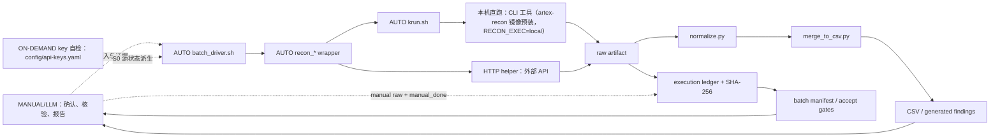
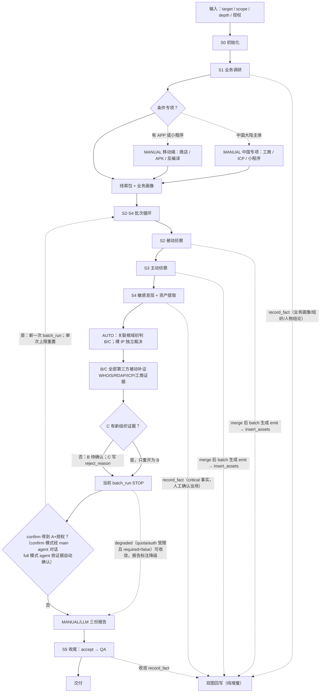
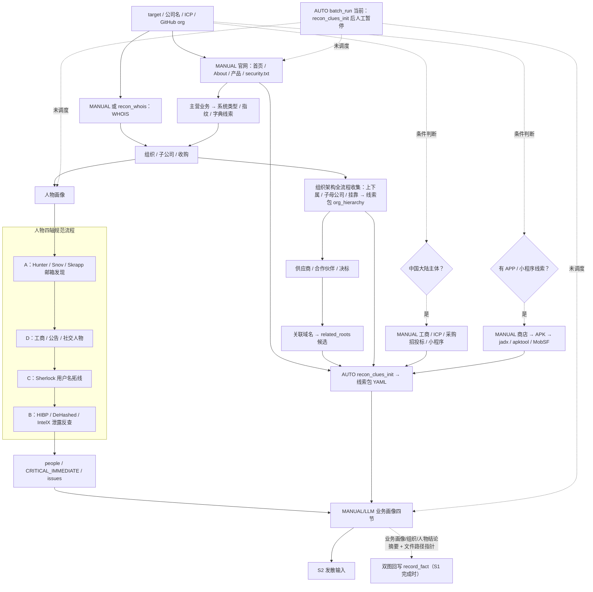
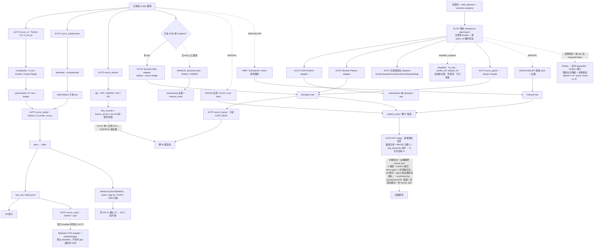
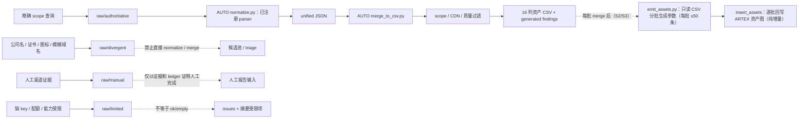
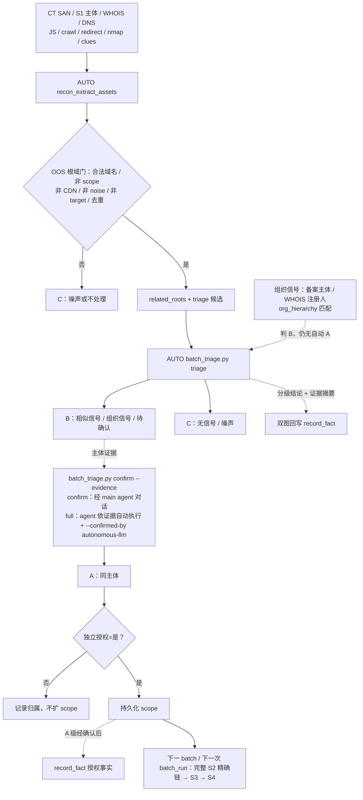
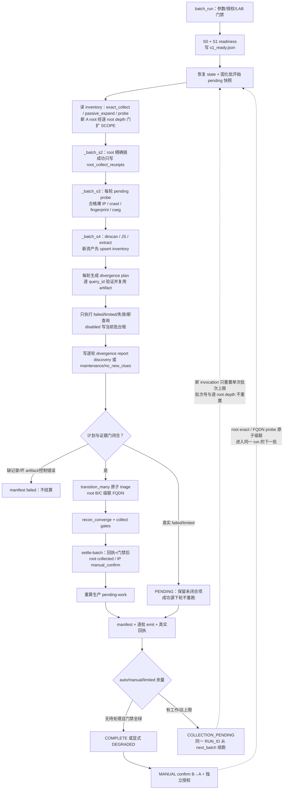
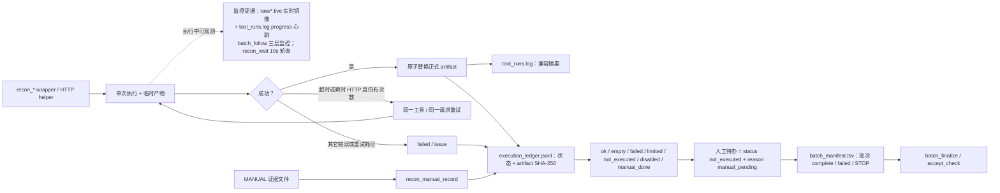
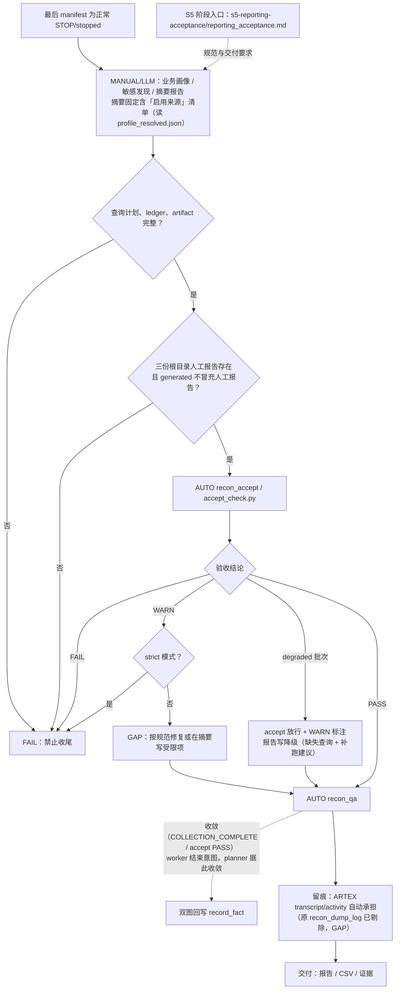

# S0-S5 唯一详细可视化参考

> 本文件是本 skill 的**唯一详细可视化参考**，集中维护 S0-S5 的工具调用链、数据流、门禁以及规范-实现双视角。阶段入口只保留阶段简图并链接到本文件，避免重复维护工具级流程；文字执行规则、全局契约和最终裁决以 [`../../SKILL.md`](../../SKILL.md) 为总执行权威。
>
> **阅读规则**：节点标签是语义权威。`[AUTO]` 是当前脚本自动调用的步骤；`[MANUAL]` 是必须由人工/LLM 留证的步骤；`[ON-DEMAND]` 是满足条件后按需执行；`[GAP]` 是规范要求但当前 `batch_run` 尚未调度的步骤。实线表示正常顺序或数据依赖，虚线强调人工触发、按需或未接入调度；边型本身不替代节点标签。`FAIL CLOSED` 表示当前批或收尾被阻断。
>
> **范围**：图以当前工作树的 [`../../SKILL.md`](../../SKILL.md)、六个阶段入口、`batch_driver.sh`、`recon_run.sh` 和 Python helper 为准。它描述流程，不改变授权边界；所有网络动作仍须满足授权和 scope 门禁。

阶段入口：[`S0 准备与初始化`](../preparation.md) · [`S1 业务调研`](../../s1-business-osint/business_osint.md) · [`S2 被动侦察`](../../s2-passive-recon/passive_recon.md) · [`S3 主动侦察`](../../s3-active-recon/active_recon.md) · [`S4 敏感发现`](../../s4-sensitive-findings/sensitive_findings.md) · [`S5 报告与验收`](../../s5-reporting-acceptance/reporting_acceptance.md)

## 图索引

| 图 | 内容 | 维护依据 |
|---|---|---|
| [0. 执行层级](#0-执行层级与图例) | 人工、调度器、wrapper、工具、数据和证据 | 全局执行契约 |
| [1. 总控制流](#1-总控制流) | S0-S5、条件专项与反馈闭环 | `SKILL.md`、`batch_driver.sh` |
| [2. S0 初始化](#2-s0-初始化与授权门禁) | 参数、环境、状态、key、profile 与授权 | `krun --check`（local）、`recon_init`、`recon_profile_resolve` |
| [3. S1 业务 OSINT](#3-s1-业务-osint) | 业务画像、人物、移动/中国专项、线索包 | `business_osint.md` |
| [4. S2 被动主链](#4-s2-被动侦察主链) | CT、子域、DNS、测绘与 MANUAL 来源 | `recon_run.sh` |
| [5. 数据可信度](#5-数据可信度与归一化链) | raw 隔离、normalize、CSV | `normalize.py`、`merge_to_csv.py` |
| [6. 根域分级](#6-关联根域-abc-分级与跨批次反馈) | A/B/C、确认、授权、扩 scope | `batch_triage.py` |
| [7. 裸 IP](#7-裸-ip-裁决与端口扫描资格) | 证据、CDN/云、授权、RustScan | `bareip_verdict.py` |
| [8. S3 主动](#8-s3-主动侦察) | 探活、端口、URL、画像 | `active_recon.md` |
| [9. S4 泄露与拓展](#9-s4-敏感发现与资产拓展) | 目录、JS、dork、资产回灌 | `sensitive_findings.md` |
| [10. 批次状态机](#10-批次状态机) | batch_run 的真实调度、停止与恢复 | `batch_driver.sh` |
| [11. 重试与证据](#11-超时重试日志与证据链) | timeout、ledger、manifest、状态 | `recon_ledger.py` |
| [12. S5 收尾](#12-s5-报告与最终验收) | 报告门禁、accept、QA、日志 | `accept_check.py` |
| [13. 差异清单](#13-规范与实现差异) | 图中已标注的关键差异 | 规范与实现对照 |

## 0. 执行层级与图例



- 实线表示正常顺序或数据依赖；虚线强调人工触发、按需或尚未接入自动调度的关系。
- 节点中的 `AUTO`、`MANUAL`、`ON-DEMAND`、`GAP` 才是执行属性的权威标识；边型和颜色都不单独承担流程语义。
- 外部 CLI 经 `krun` 本机直跑（`RECON_EXEC=local`，工具链由 `artex-recon` 镜像预装）；Python helper 和 HTTP API 同样直接在容器内执行。
- 标「人工」的环节：confirm 模式（默认）经（confirm 模式：main agent 人在环路对话；full 模式：agent 依证据自动确认，`--confirmed-by autonomous-llm` 留痕）后执行；full 模式由驱动 agent 依证据自动执行并以 `--confirmed-by autonomous-llm` 留痕（见 SKILL.md「自主模式」）。
- 源启用真相 = key 派生（无人工 profile 文件）：`recon_profile_resolve` 按 `api-keys.yaml` key 自检把源状态解析为 `$OUTPUT_DIR/profile_resolved.json`，源开关据此决定计划与执行。

## 1. 总控制流



## 2. S0 初始化与授权门禁

```mermaid
flowchart TD
    params[确认 target / scope / depth / 输出目录] --> mode{执行入口？}
    mode -->|batch_run| auth{有真实全流程主动授权<br/>且传 --authorized-full-recon？}
    auth -->|否| stop[FAIL CLOSED：batch_run 网络动作前返回 AUTH_REQUIRED]
    auth -->|是| lab{测试域？}
    lab -->|是| ticket[batch_run 还需 --allow-lab + --lab-ticket]
    lab -->|否| env[MANUAL 规范：krun --check（RECON_EXEC=local）]
    ticket --> env
    mode -->|局部阶段 recon_*| local{实际动作与目标<br/>已授权且在 scope 内？}
    local -->|否| localstop[FAIL CLOSED：不执行该局部网络动作]
    local -->|是| localentry[按对应阶段入口执行<br/>不要求 batch_run 专用 flag]
    localentry --> env
    env --> ready{工具链已就绪？}
    ready -->|否| imgfix[FAIL CLOSED：install_toolchain.sh 确定性修复后重验<br/>仍失败判环境阻塞记 limited<br/>禁止此外的散装补装]
    ready -->|是| init
    imgfix --> init[AUTO recon_init]
    init --> prof[AUTO recon_profile_resolve → profile_resolved.json]
    prof --> auto{autonomy：confirm | full}
    auto -. confirm（默认） .-> dirs
    auto -. full：RECON_AUTONOMOUS=1 .-> dirs
    dirs[创建 raw 分区 / unified / generated / CSV / 报告路径]
    dirs --> state[加载或持久化 state]
    state --> sess[AUTO 本机直跑<br/>krun 默认 RECON_EXEC=local<br/>输出父目录默认 $PWD<br/>state 默认 $PWD/.state]
    sess --> keys[recon_key_check / API key 状态]
    keys --> kruncheck[MANUAL 规范：krun --check]
    kruncheck --> begin[允许进入 S1]

    batchgap[GAP：batch_run 当前只自动执行 recon_init<br/>不执行 krun --check]
    init -. 当前 batch_run 入口 .-> batchgap
```

### S0 产物与门禁

- `recon_init` 建立输出目录、raw 分区、`execution_ledger.jsonl`、`tool_runs.log`、线索包和稳定 state。
- `--authorized-full-recon` 是固定包含主动动作的 `batch_run` 专用确认，不是所有 `recon_*` 网络动作的通用开关；局部阶段按对应入口、实际动作、目标 scope 和授权边界逐项判断。
- `krun --check`（`RECON_EXEC=local`）是规范前置门禁；`batch_run` 调用前必须由执行者完成，不能因为图中存在 `recon_init` 而视为环境已验证。工具链由 `artex-recon` 镜像预装，无 bootstrap 环节；`krun --check` 失败的唯一合规修复路径是 `install_toolchain.sh` 确定性修复（固定版本 + sha256、幂等）后重新复检，仍失败判环境阻塞、记 `limited`，此外任何散装补装一律禁止。
- API 缺失、配额或能力受限应保留 `limited` 证据和摘要受限项，不能声明对应来源已执行。
- `recon_profile_resolve` 在每个 `recon_init` 末尾执行（幂等）：按 key 自检派生 sources，region/autonomy 读 env `RECON_REGION`/`RECON_AUTONOMY`（缺省 cn/confirm），写 `profile_resolved.json` 并 export `RECON_PROFILE_RESOLVED`；`RECON_AUTONOMY=full` 时 export `RECON_AUTONOMOUS=1`。

## 3. S1 业务 OSINT



### S1 调用与交付

| 子阶段 | 主要工具/渠道 | 交付或回灌 |
|---|---|---|
| 官网与登记 | 官网、WHOIS、OpenCorporates、GLEIF、SEC EDGAR、Crunchbase/Wiki | 主营业务、组织、关联主体 |
| 人物画像 | `recon_people`、Hunter、Sherlock、HIBP、DeHashed、IntelX、工商/社交渠道 | `people`、公开邮箱、critical 信号 |
| 中国专项 | ICP、工商、采购/招投标、应用/小程序渠道 | `icp`、关联域名、品牌线索 |
| 移动端 | 应用商店、aapt、jadx、apktool、MobSF | 域名、IP、接口、密钥候选 |
| 阶段交付 | `recon_clues_init`、人工/LLM 模板填充 | `clues_<target>.yaml`（含 `org_hierarchy` 组织架构）、`business_profile_<target>.md` |

S1 完成时业务画像/组织/人物结论以 `record_fact`（摘要 + 文件路径指针）回写双图；图中 MANUAL 环节（官网核验、工商/ICP、移动端、人物渠道等）均经（confirm 模式：main agent 人在环路对话；full 模式：agent 依证据自动确认，`--confirmed-by autonomous-llm` 留痕）后执行。

## 4. S2 被动侦察主链



### S2 工具口径

- CT 四源和子域双件套属于同一被动主链；单一来源失败不应被其他来源冒充完成。
- 历史 DNS 在有 SecurityTrails key 时走真实 API adapter；其他渠道或无 key 的人工完成必须将证据放入 `raw/manual/` 并登记 `manual_done`。GitHub 在 full 模式且有 token 时逐 query_id 调 code-search API；confirm 模式或人工渠道使用 pending→manual_done 绑定，生成 dork 文件不算执行。
- 所有计划查询位于 `divergence/plan_<run>_<batch>.json`，每轮另有 report；`.clues_run.hash`/`.gdork_run.hash` 不再决定是否跳过。
- FOFA 主域精确查询可进入 authoritative；公司名、证书、图标、模糊域名和测绘扩展只能进入 divergent 候选。
- 源开关语义：显式 false=`disabled_profile_off`，keyed 无 key=`disabled_no_key`，keyless 未显式配置时按注册表 `default_enabled`（缺省 disabled_default）。禁用均零请求、写当前批台账、不计失败；`limited` 仅表示实际执行后受限。全部注册计划引擎 disabled → fail closed。
- 每批 normalize/merge 完成后（见图 5），batch 生成 `.artex/emit_<run>_<batch>.json`，逐批读取 `arguments` 调 `insert_assets` 回写资产图并登记 `raw/writeback_receipts.jsonl` 回执；分级结论 `record_fact`，A 级经（confirm 模式：main agent 人在环路对话；full 模式：agent 依证据自动确认，`--confirmed-by autonomous-llm` 留痕）后授权事实一并 `record_fact`（本 agent 不做任务/公司 scope 交接）。

## 5. 数据可信度与归一化链



### 数据边界

| 分区 | 可否直接入主 CSV | 合法去向 |
|---|---|---|
| `authoritative` | 可以，经 normalize/merge | unified、CSV |
| `divergent` | 不可以 | related_roots、裸 IP 候选、人工核验 |
| `manual` | 不作为自动来源替代 | `manual_done` 证据、人工报告 |
| `limited` | 不可以 | issues、摘要受限项、后续重试 |

## 6. 关联根域 A/B/C 分级与跨批次反馈



### 分级原则

- favicon、title、品牌近似最多证明 B 类；B/C 均须第三方被动补证。C 必须保留 reject_reason，新组织证据只能先重开为 B，不能自动升级为 A。
- 组织关系信号（候选备案主体 / WHOIS 注册人 / 线索包 `org_hierarchy` 匹配）同样最多自动判 B；confirm B→A 的主体证据与授权独立规则不变。
- A 类必须有主体证据；授权列独立于归属等级。只有 `A + 授权=是` 才能扩 scope。
- 自动 triage 初判 B/C 后必须补证；B 保持待确认，C 必须写 `reject_reason`。C 的新组织证据只能自动重开为 B；人工 confirm 后通常需重新运行 `batch_run`，由 `pending` 发现新增授权根域。

## 7. 裸 IP 裁决与端口扫描资格

```mermaid
flowchart TD
    candidates[FOFA / DNS / 页面 / JS / httpx / nmap<br/>提取的裸 IP 候选] --> valid{合法 IP 且非保留地址？}
    valid -->|否| reject[排除]
    valid -->|是| evidence{至少两条归属证据？}
    evidence -->|否| bclass[B/C：写无域名 IP 报告，待核验]
    evidence -->|是| cdn{非 CDN / 非公共云 / 非任播边缘？}
    cdn -->|否| exclude[不扫描]
    cdn -->|是| auth{逐 IP 授权？<br/>confirm：经 main agent 对话<br/>full：agent 依证据自动确认并留痕}
    auth -->|否| recorded[A 类归属记录，不扫描]
    auth -->|是| verdict[AUTO recon_bareip_confirm / bareip_verdict.py]
    verdict -. confirm 后回写 .-> wbip[insert_assets（ip）+ record_fact]
    verdict --> eligible{CSV 与 verdict 同时满足资格？}
    eligible -->|否| block[FAIL CLOSED：不进入端口队列]
    eligible -->|是| rust[AUTO recon_portscan]
    rust --> discover[RustScan TCP 1-65535 discovery]
    discover --> ports{有开放端口？}
    ports -->|否| noport[no_open_ports JSON + ledger 成功]
    ports -->|是| detail[按 8 KiB 端口分块；RustScan 后端 Nmap -sC -sV → XML 合并]
    detail --> http[AUTO 非标 HTTP(S) 端口回注 httpx/live_urls]
    http --> s3[进入 S3/S4]
```

## 8. S3 主动侦察

```mermaid
flowchart TD
    domains[in-scope 域名 / 子域] --> probe[AUTO recon_probe：Python CLI probe_run.py]
    probe --> dnsx[dnsx]
    dnsx --> httpx[PD httpx：状态 / 标题 / tech / CNAME / chain]
    httpx --> s3norm[normalize + merge]
    s3norm -. 每批 merge 后 emit_assets.py 生成参数 .-> wbs3[insert_assets 逐批回写资产图]
    s3norm --> live[live_urls / httpx.jsonl]

    bareips[仅合格裸 IP：CSV type=ip + A + 两证据<br/>+ 逐 IP 授权 + 非 CDN/云] --> eligibility[AUTO 资格复核]
    eligibility --> rustscan[RustScan → XML / no_open_ports]
    rustscan --> nonstd[非标 Web 回注 httpx]
    nonstd --> live

    live --> crawl[AUTO recon_crawl]
    crawl --> katana[katana 主动 URL 轴]
    crawl --> gau[gau 历史 URL 轴]
    katana --> urls[crawl_urls]
    gau --> urls
    urls --> s4input[S4 输入]

    live -. GAP：规范有资产即做 .-> fingerprint[recon_fingerprint：EHole + WhatWeb]
    fingerprint -. GAP / MANUAL：unknown 必做 .-> annotate[recon_annotate：LLM 补识别]
    fingerprint -. GAP / MANUAL：有版本必做 .-> cve[recon_cve_prep → 人工评审 → recon_cve_apply]
    csvips[同 /24 内 ≥1 已确认归属真实 IP<br/>（非 CDN 段）] --> cseg[AUTO recon_cseg<br/>_batch_s3 crawl 后自动调度<br/>无入选段自跳过]
    cseg -. 被动 .-> csegrep[FOFA ip=x.x.x.0/24 分页拉全 + Shodan net:<br/>→ cidr24_report_*.md 报表：逐 IP title/host/domain/ports<br/>品牌命中标注；「被动命中未存活」写专节<br/>验收 WARN 待人工裁决]
    cseg -. 主动 .-> csegscan[rustscan 常见端口：段内 =1 → ±10 邻域<br/>≥2 → 整段，剔除已知/网络/广播地址<br/>存活邻域入 CSV 标「C段扩展，归属待核」<br/>备注带测绘 host/domain/title]
    csegrep -. 带域名命中 .-> roots[related_roots 走 A/B/C 分级]
    csegscan -. 全端口/漏洞探测仍逐 IP 授权 .-> ceil[常见端口扫描 =<br/>邻域主动动作天花板]
    live -. ON-DEMAND 可选 .-> shot[recon_shot：gowitness]

    batchactual[AUTO batch_run 当前：probe + portscan + crawl + cseg]
    batchactual --> probe
    batchactual --> eligibility
    batchactual --> crawl
    batchactual --> cseg
```

### S3 规则

- `katana` 与 `gau` 是独立必跑轴，不能把任一方画成另一方的 fallback。
- RustScan 是默认 TCP 全端口唯一主力；UDP/NSE 属另行授权的特殊场景，不在批次默认链。
- C 段已由 `_batch_s3` 在 crawl 后自动调度（满足触发条件即跑，无入选段自跳过），不再是 GAP；指纹（有资产即做）、unknown 指纹 LLM 补识别、有版本指纹 CVE 标注仍是当前 `_batch_s3` 未自动调用的规范步骤。截图明确为可选。
- 每批 normalize/merge 完成后由 `emit_assets.py` 只读 CSV 分批生成参数（每批 ≤50 条），逐批 `insert_assets` 回写 ARTEX 资产图（纯增量，不改文件产物）。
- C 段统一流程：同 `/24` 内 ≥1 个已确认归属真实 IP（非 CDN）即触发 `recon_cseg`；先被动拉全测绘（FOFA `ip="x.x.x.0/24"` 分页 + Shodan `net:`）生成 `cidr24_report_<target>.md` 报表，再用 rustscan 扫常见端口（段内 =1 → ±10 邻域，≥2 → 整段，剔除已知 IP/网络/广播地址）；存活邻域 IP 的 CSV 备注附带测绘 host/domain/title 证据，「被动命中未存活」（测绘有记录、rustscan 未存活）IP 写入报表专节并以 WARN 提示人工裁决；测绘带域名命中进 `related_roots` 走 A/B/C 分级。条件化放行：满足触发条件的段允许 rustscan 常见端口扫描；无触发条件的盲扫 `/24` 仍禁止，全端口（`-p-`）与漏洞探测仍逐 IP 授权。

## 9. S4 敏感发现与资产拓展

```mermaid
flowchart TD
    targets[规范目标：全部 active URL<br/>+ critical/high 高价值候选] --> baseline[AUTO catch-all 基线检测 + 过滤<br/>（状态码 + 响应长度），原始件保留]
    baseline --> dir
    batchtargets[AUTO 批次目录目标：种子根 URL<br/>+ 新授权根域主站 + 历史失败目标] --> dir[AUTO recon_dirscan<br/>Python CLI dirscan_run.py]
    targets -. GAP：其余规范目标需人工补跑 .-> dir
    dir --> dirsearch[dirsearch：三档 small 默认 / api / full<br/>（RECON_DIRSCAN_TIER 覆盖）+ 分片词表 + manifest]
    dirsearch --> dirout[目录命中 / redirect / S0 候选]
    dirout -. MANUAL .-> magic[magic bytes / 内容 / 误报核验]
    magic -. .svn 命中 .-> svn[dvcs-ripper rip-svn.pl]
    magic -. .DS_Store 命中 .-> dsstore[ds_store_exp]
    magic -. .git 命中 .-> gitstop[发现即止，不还原]
    svn --> verified
    dsstore --> verified
    gitstop --> verified

    livejs[AUTO 批次 JS 目标：新增 live URL] --> js[AUTO recon_js]
    js --> katana[katana -jsl；低内存（<6G）自适应改 -jc 分块]
    katana --> endpoints[js_endpoints / js_secrets / source map 候选]
    katana -. 无端点或低资源 .-> xn[xnLinkFinder fallback（S0 冒烟）]
    xn --> endpoints
    endpoints -. MANUAL .-> sourceMap[.map / 密钥 / 接口内容核验]

    plan[GitHub dork 计划] -. MANUAL .-> gh[GitHub Web/API 逐条查询 + evidence]
    brand[品牌 / 域名] -. MANUAL .-> buckets[云桶公开性检查：curl HEAD/GET<br/>OSS Browser / CosCli / cloud_enum]
    brand -. MANUAL .-> chinese[网盘 / 文库 / 社区渠道]
    gh --> verified[人工核验]
    buckets --> verified
    chinese --> verified
    magic --> verified
    sourceMap --> verified
    verified --> report[MANUAL/LLM 敏感发现报告]
    verified --> s0[CRITICAL_IMMEDIATE 立即上报]
    verified -. 确认当场（confirm 模式：main agent 人在环路对话；full 模式：agent 当场披露不等回复）<br/>severity：critical / high / medium<br/>不等收尾 .-> wbs4[双图回写 record_fact critical 事实<br/>batch_critical_ack 登记证据 hash]

    dirout --> extract[AUTO recon_extract_assets]
    endpoints --> extract
    crawl[crawl_urls] --> extract
    httpx[httpx chain / A / CNAME] --> extract
    xml[RustScan / Nmap XML] --> extract
    extract --> roots[related_roots 候选]
    extract --> ips[裸 IP 候选]
    roots --> triage[进入 A/B/C 图]
    ips --> ipverdict[进入裸 IP 图]

    batchactual[AUTO batch_run 当前：dirscan + recon_js + extract_assets]
    batchactual --> dir
    batchactual --> js
    batchactual --> extract
```

### S4 规范与自动覆盖

| 子阶段 | 当前批次自动覆盖 | 仍需人工/LLM |
|---|---|---|
| 目录扫描 | `recon_dirscan` 仅覆盖种子根 URL、新授权根域主站和历史失败目标；catch-all 基线检测 + 过滤已自动内置，资源三档（small 默认 / api / full，`RECON_DIRSCAN_TIER` 覆盖） | 其余规范目标、magic bytes、内容结论 |
| JS | `recon_js`、katana、xnLinkFinder fallback | 密钥/接口/source map 的实际内容核验 |
| GitHub | 仅生成计划 | 逐条搜索、证据、`manual_done`、归属核验 |
| 云桶/网盘/文库/社区 | 不自动执行 | 检索、公开性验证、证据 |
| 报告 | generated 自动 findings | 根目录人工 `sensitive_findings_<target>.md` |
| 资产反馈 | `recon_extract_assets` | A 类主体证据和授权确认 |
| 双图回写 | —（批次不调用 ARTEX 接口） | 泄露人工确认当场 `record_fact` critical 事实（critical / high / medium）+ `batch_critical_ack` 登记证据 hash，经（confirm 模式：main agent 人在环路对话；full 模式：agent 依证据自动确认，`--confirmed-by autonomous-llm` 留痕）；`report_finding` 不由本 agent 调用 |

## 10. 批次状态机



### 正常停止与失败

- 后续批次由生产 `pending-work` 驱动，自动 triage 不直接判 A 不会使后续批不可达；B 经 confirm 升 A 后，同一 `RUN_ID` 从持久化 `next_batch` 继续。`max_batches` 仅限制单次 invocation，逐 root depth 持久化，二者均不在续跑时重置。
- 真实查询 `failed|limited` 已写台账时进入 PENDING/相应降级路径，下一轮只重试未闭合 query_id；缺终态、坏 artifact/hash、坏报告或计数异常才是控制面错误。
- 关键 producer、查询计划、ledger、artifact、triage 或计数异常均应 fail closed，不能解释为“无新资产”。
- `recon_converge` 挂在 `_batch_checkpoint` 尾部、收敛门禁之前：以全部结果文件为种子再发散，统一道门过滤后三出口（`related_roots` / `bare_ips_candidates` / `brand_host_candidates_<target>.txt` 待复核）；退出码 0=零新增、3=有新增、1=失败。
- checkpoint 非控制错误后才允许 `settle-batch`：root 必须有当前批成功回执且查询证据门闭合；OOS FQDN 跟随 root 级联，裸 IP 仅转人工裁决。`.batch_collected_roots`、`.clues_run.hash`、`.gdork_run.hash` 不再作为完成真相。
- `COLLECTION_COMPLETE` 还要求 `recon_converge` 零新增、`accept_check.py --gates collect` 全绿（或显式 N/A 留痕）以及 pending/manual 余量符合主文档口径；门禁输出 gaps（trigger/missing/remedy），禁止 LLM 主观宣布完成。
- 可选源实际执行后遇到 quota/auth 可记 `limited` 并按 required=false 评估降级；`disabled_no_key`、`disabled_profile_off`、`disabled_default` 均未执行，写当前批 disabled 台账且不计 q_fail，禁止与 limited 互换。

## 11. 超时、重试、日志与证据链



### 状态解释

| 状态 | 含义 | 对收尾的影响 |
|---|---|---|
| `ok` / `empty` | 自动步骤有可校验 artifact | 可通过对应自动门禁 |
| `manual_done` | 人工证据已落盘并登记 | 可通过对应人工门禁 |
| `not_executed` + `reason=manual_pending` | 已计划但尚未完成人工任务 | 阻断要求完成的收尾 |
| `limited` | key、配额或能力受限 | 不是成功；写 issues/摘要，必要时阻断 |
| `degraded`（批次/query check 第 4 状态，rc=4） | `quota`/`auth` 受限且 `required=false` 的降级收敛 | finalize 放行，报告必须标注降级 + 补跑建议 |
| `failed` | 执行或产物校验失败 | 当前批 fail closed 或收尾失败 |
| `disabled` / 其它 `not_executed` | 关闭或未执行 | 依计划 required 语义决定是否阻断 |

## 12. S5 报告与最终验收



### S5 交付门禁

1. 当前 run 的 manifest 必须正常停止，最后数字批次必须 complete。
2. 自动查询需要 `ok|empty` 与 artifact；MANUAL 查询需要证据与 `manual_done`。
3. `business_profile_<target>.md`、`sensitive_findings_<target>.md`、`summary_report_<target>.md` 是人工/LLM 根目录交付物，`generated/` 下自动稿不能替代它们。
4. `recon_accept` FAIL 时不得运行后续 `recon_qa`；WARN 的处理依当前 strict 模式和摘要受限项要求而定。（原 `recon_dump_log` 已剔除，思考留痕由 ARTEX transcript/activity 承担。）

## 13. 规范与实现差异

| 图中位置 | 规范要求 | 当前自动实现 | 使用图时的结论 |
|---|---|---|---|
| 双图回写 | S1 结论 `record_fact`；S2/S3 每批 merge 后 batch 生成 emit → 逐批 `insert_assets` + 回执登记；分级结论 `record_fact`、A 级经确认后授权事实一并 `record_fact`；裸 IP confirm 后 `insert_assets`(ip)+`record_fact`；S4 泄露确认当场 `record_fact` critical 事实 + `batch_critical_ack`；S5 收敛 `record_fact` | `batch_run` 不调用 ARTEX 回写接口，由会话 agent（recon_scout，仅 `insert_assets`/`list_assets`/`list_companies`/`record_fact` 四个绑定工具）在上述时机点执行；本 agent 只生成事实，不创建 hint、不做任务/公司 scope 交接 | 回写为纯增量动作（只写结论 + 文件路径指针），不影响文件产物与收敛判定 |
| S0 | `krun --check`（local）后才进入收集 | `batch_run` 仅自动 `recon_init` | 调用者必须先完成环境检查 |
| S1 | WHOIS、官网、人物、业务画像全部完成；人物轴为 A→D→C→B | `batch_run` 只初始化线索包并暂停；`recon_people` 当前为 A→B→C→D 单轮 | S1 大部分为人工/LLM 工作，人物轴需按实际证据核对 |
| S2 来源 | 文档对 CT/子域工具的 required 表述较强 | 批次、注册表和验收的失败判定并不完全一致 | 图按工具组呈现，不把单源成功扩大为全链成功 |
| S2 SPF IP | `is4:`/`ip6:` 应进入裸 IP 候选裁决 | `recon_dnsrec` 自动合并单个公网 IPv4；CIDR/IPv6 仅保留在 `dnsrec_ips.txt` | 单 IP 已闭环到候选；CIDR 禁止展开，IPv6 等待裁决链支持 |
| 测绘 key | 文档允许部分来源 `limited` | `quota`/`auth` 受限且 `required=false` 记 `limited` → 批次 `degraded`，finalize 放行但报告标注降级；其他失败仍 fail closed | 运行前核对 key/配额与本轮查询计划，降级批次按报告标注复跑 |
| S3 | 指纹、LLM 补识别、CVE、截图有规范步骤 | `_batch_s3` 编排 probe、portscan、crawl，并在 crawl 后自动调度 C 段统一流程（≥1 确认 IP 的 /24：被动测绘拉全段出 C 段报表 + rustscan 常见端口，=1 → ±10 邻域、≥2 → 整段；存活邻域 CSV 备注带测绘 host/domain/title，被动命中未存活写入报表专节 WARN）；指纹/CVE/截图仍未自动调度 | C 段已 AUTO；指纹/CVE 图中以 GAP 明示，不能视为已跑 |
| 批次收尾 | 收集完成 = 原 5 步 + `recon_converge` 零新增 + `--gates collect` 全绿（或显式 N/A 写明理由） | `_batch_checkpoint` 尾部挂 `recon_converge` 收敛扫描（全量种子再发散，rc=0/3/1），收敛门禁输出 gaps 清单（C段/邻域缺失为 FAIL，回关联/待裁决/品牌主机/被动未存活为 WARN） | LLM 不得主观宣布收集完成，必须引用门禁全绿输出；有缺口按 remedy 补跑/降级/N/A 论证后再迭代 |
| S4 | GitHub、桶、网盘/文库、magic bytes、人工报告必做 | 批次只做 dirsearch、JS、资产提取；dirsearch 已内置自动 catch-all 基线检测 + 过滤与三档资源（`RECON_DIRSCAN_TIER`） | 自动 findings 仅是人工核验输入 |
| A/B/C | B/C 均第三方被动补证；B 经主体证据可升 A，C 新证据只重开为 B，授权独立 | 自动初判 B/C → evidence；缺证据或 C 缺 reject_reason 时 collect FAIL | confirm 后重新运行以扩 scope |
| 数据源适配 | 注册表能力/adapter + `config/sources.yaml` 显式启停 + key 自检；无 key 或关闭均 disabled | `recon_profile_resolve` 写 profile；`recon_source_check <id>` 写真实健康报告；`recon_clues_run` 生成 per-batch plan/report 并登记 disabled | 禁用不得计 limited/degraded；未知配置 fail closed |
| autonomy 双模 | confirm 模式人工确认、full 模式 agent 依证据自动确认并留痕 | `--confirmed-by` 写入 inventory reason 与审计事件；manifest 记录 `autonomy=full`；full 模式不跳过任何证据门禁 | 只换确认主体，不降证据标准 |
| WARN | WARN 必须写入摘要受限项 | `accept_check.py` 按 `S阶段 / 检查项` 核对摘要 `## 受限项` 表格 | 未逐条承接会新增 FAIL，阻断 QA 和 `ACCEPTED` |

## 维护检查

修改工具封装、批次调度或验收门禁时，同时检查本图集：

1. 新 wrapper、helper、外部工具、artifact 和 ledger 状态是否有归属图。
2. 自动调用、MANUAL、ON-DEMAND、GAP 的标签是否仍准确。
3. 新增 fallback 是否确实是 fallback，而不是独立必跑轴。
4. `authoritative`、`divergent`、`manual`、`limited` 的数据边界是否保持不变。
5. `degraded` 降级语义（quota/auth + required=false → 收敛放行 + 报告标注）在状态机、S5 验收与阶段入口间是否一致。
6. 阶段入口中的简图是否只链接本文件，而没有复制出第二套工具级流程。
7. profile 源状态（enabled / disabled_no_key / disabled_profile_off / disabled_default）在计划生成、执行器、batch 消费面与报告摘要间是否一致；新增引擎/轴是否同时更新 `disabled_engines` 语义与「启用来源」清单。
8. 路由器图格式一致性：SKILL.md 主链图与各阶段入口开头图是否符合四段式路由器格式（入口条件 → 自动轴 → 条件专项/MANUAL/GAP → 出口产物；单图 ≤15 节点、节点文字 ≤12 字），图中引用的 `recon_*` 命令是否存在于 [`tool_commands.md`](tool_commands.md) CLI 清单——源码树由 `s0-preparation/scripts/test_document_structure.py` 的结构检查兜底（发布包不含测试）；改 `recon_*`/`batch_*` 行为时必须同步核图。
