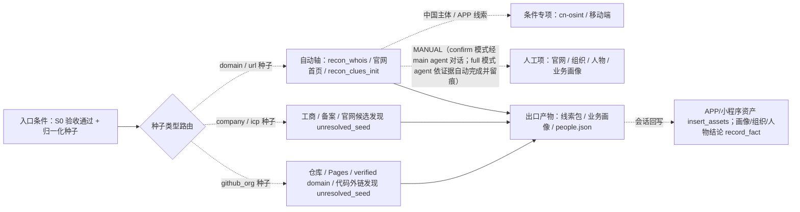

# 业务调研 + OSINT

## 阶段流程图



> **本阶段契约摘要**：输入 `TARGET`/`SCOPE`（经 `normalize_seed` 归一化后的种子）与 S0 目录、state、key 状态；输出 `clues_<target>.yaml`、`business_profile_<target>.md`、`unified/people.json` 与 `related_roots` 候选；验收门禁见「阶段契约 → 验收」。**种子路由**（plan 步骤 2.2）：只有 `domain`/`url` 种子执行 WHOIS/官网首页 authoritative 链；`company`/`icp` 种子走工商、备案和官网候选发现；`github_org` 种子走仓库、Pages、verified domain 和代码外链发现；公司/ICP/GitHub org 在尚未解析出已授权根域前状态为 `unresolved_seed`，只执行 S1 被动发现，**禁止**把原始字符串交给 CT、子域爆破或首页请求。出口产物以文件为准（APP/小程序资产 `insert_assets`）。
> 详细子阶段、工具/API、人工与当前批次覆盖差异见 [`workflow_diagrams.md`](../s0-preparation/references/workflow_diagrams.md#3-s1-业务-osint)。`batch_run` 自动初始化线索包，并在首轮 S2 前调用生产 `s1_readiness.py` 生成 `s1_ready.json`；`ready|degraded` 才可进入收集，自动初始化本身不代表 S1 完成。

## 阶段契约

本文件是 S1 的唯一执行入口。阶段目标是把域名种子扩展为可审计的主体、业务、组织、人物和技术线索包，为 S2 的精确收集与发散查询提供输入；详细专项方法保留在文末引用，不在其他入口重复维护。

### 目标与进入条件

- **目标**：确认目标主体和主营业务，识别组织/子公司/品牌/供应链/重点人物，形成线索包与四节业务画像。
- **进入条件**：S0 已完成环境检查（工具链由镜像预烘焙，`krun --check`（RECON_EXEC=local 本机直跑）+ `recon_key_check`）、`recon_init` 和 API key 自检；`TARGET`、`SCOPE`、`OUTPUT_DIR`、raw 四分区及稳定 state 已确定。
- **范围边界**：S1 只做公开信息发现和证据整理。关联域名先进入候选，不因品牌、供应商或相似页面自动扩 scope；人物泄露只记录风险信号，不做凭据验证或利用。

### 输入

- 必需：`TARGET`（S0 经 `normalize_seed` 归一化后的种子：domain/url/ip/company/icp/github_org）、当前授权 `SCOPE`、目标名称或品牌线索。
- 可选：公司全称/简称/英文名、ICP、GitHub org、已知子公司、应用或小程序名称、公开联系人。
- 条件判断：中国大陆主体才启用 [`cn_osint.md`](../s2-passive-recon/references/cn_osint.md)；存在 APP/小程序线索才进入移动端专项。

### 种子路由（按归一化种子类型分发，禁止跨路由）

| 种子类型 | S1 路由 | 说明 |
|---|---|---|
| `domain` | WHOIS + 官网首页 authoritative 链 + 画像 | 根域须在授权 SCOPE 中；否则只登记候选 |
| `url` | 同 domain（host 归一为根域后） | URL host 为 IP 时 root 为空，host 进入裸 IP 裁决链，不跑官网链 |
| `ip` | 精确测绘/RDAP/PTR 与裸 IP 候选链 | 不执行 WHOIS/官网链 |
| `company` | 工商、备案、官网候选发现 | 尚无已授权根域时状态 `unresolved_seed`，**不**执行 WHOIS/官网/CT/子域爆破 |
| `icp` | 备案反查、官网候选发现 | 同上，`unresolved_seed` 前禁止把原始字符串交给 CT、爆破或首页请求 |
| `github_org` | 仓库、Pages、verified domain、代码外链发现 | 同上；显式类型才接受规范化单组织路径段 URL |

### 执行顺序

1. **（仅 domain/url 种子）** 执行 `recon_whois "$TARGET"`，核对注册主体、注册邮箱、名称服务器和时间线。
2. **（仅 domain/url 种子）** 用统一 HTTP helper 获取官网首页；继续检查 About/产品、`security.txt`、联系页和页脚备案，禁止另写散装 curl 作为正式落盘路径。company/icp/github_org 种子本步跳过，改走工商/备案/候选发现或 GitHub 发现路由，直到解析出已授权根域。
3. 梳理主营业务、组织/直属单位、子公司/合资/品牌站、收购记录、供应商/决标/合作伙伴；关联域名只写入 `related_roots` 或待确认队列（先 upsert `asset_inventory.jsonl`，派生视图随之更新）；上下属单位、子母公司、挂靠机构按下文「组织架构全流程收集」写入线索包 `org_hierarchy`，合作方与中标记录按「主业画像 + 合作方与中标情报」写入 `partners`。
4. 按 [`people_osint.md`](references/people_osint.md) 完成人物四轴，结果落 `$RAW_DIR/people_raw.json`，normalize 后入 `unified/people.json` 并渲染业务画像人员节；没有公开人物时记录已查渠道和“未公开”。
5. 有 APP/小程序线索时按 [`mobile_and_mini.md`](references/mobile_and_mini.md) 提取包名、签名、后端域名和敏感候选；先 `recon_manual_record` 再 `asset_inventory.py upsert`（kind=app/miniapp）；scope 外或内网域名只保留画像/候选，不直接扫描。
6. 执行 `recon_clues_init`（通常已由 `recon_init` 完成），维护 `clues_<target>.yaml` 的主体名、简称、ICP、keywords、品牌、邮箱后缀和已确认技术特征。
7. 按计划后的 [`report_templates.md`](../s5-reporting-acceptance/references/report_templates.md)“业务画像模板”写 `business_profile_<target>.md` 四节，并附线索包摘要与来源链接。
8. 将 `recon_people`、qcc、官网 About、`security.txt` 和联系页纳入 `s1_tasks` 或 execution ledger 的逐源终态；`manual_done` 必须绑定 `raw/manual` 证据，未执行/受限/不适用分别记 `not_executed/limited/disabled`。最后运行 `python3 s0-preparation/scripts/s1_readiness.py --output-dir "$OUTPUT_DIR" --target "$TARGET" --run-id "$RUN_ID"`，取得 `s1_ready.json`。普通路径缺最低线索或非降级缺口即停止；已授权 domain/url 的冷启动由 batch 驱动先采样再复核。

### 官网 authoritative 落盘 recipe

官网是当前授权根域的精确来源，正式原始证据统一落 `$AUTHORITATIVE_RAW_DIR`。HTTP 超时、瞬时 transport 与 `408/429/500/502/503/504` 只由标准库 helper 按配置重试；重试耗尽仍保留失败/issue 口径，不用其他请求方式冒充成功。

```bash
recon_whois "$TARGET" || true
python3 "$SKILL_ROOT/s0-preparation/scripts/http_request.py" \
  "https://$TARGET/" --output "$AUTHORITATIVE_RAW_DIR/homepage.html" \
  --meta "$AUTHORITATIVE_RAW_DIR/homepage.meta.json" \
  --timeout 15 --retries "${RECON_TIMEOUT_RETRIES:-1}" || true
```

About/产品、`security.txt` 和联系页需要保存原始响应时沿用同一 helper，并使用可辨识文件名写入 `$AUTHORITATIVE_RAW_DIR`；人工浏览器证据则写 `$MANUAL_RAW_DIR` 并注明 URL、时间和操作者（ARTEX 中「人工」完成（confirm 模式：main agent 人在环路对话；full 模式：agent 依证据自动确认，`--confirmed-by autonomous-llm` 留痕）：人在对话中浏览/确认后回传，agent 再落盘）。

### 组织架构全流程收集（org_hierarchy）

组织架构（上下属单位、子母公司、挂靠机构）从 S1 起全流程收集，写入线索包 `org_hierarchy` 字段，供 S2 triage 组织信号（候选备案主体/WHOIS 注册人命中 → 判 B → 人工 confirm 升 A，ARTEX 中经（confirm 模式：main agent 人在环路对话；full 模式：agent 依证据自动确认，`--confirmed-by autonomous-llm` 留痕）后再执行 confirm）与 confirm 证据链消费——组织架构关系是「自动信号≠同主体」契约下最重要的 B 级线索来源。

收集对象与方法：

| 对象 | 收集方法 |
|---|---|
| 上级单位 / 所属机关 | 官网「机构设置 / 所属机关 / 关于我们」页；政府目标查政府门户网站机构名录 |
| 下属单位 / 直属事业单位 | 官网「机构设置 / 组织机构」页；上级单位年报/公告 |
| 子公司 / 合资 / 并表公司 | 年报、公告、Crunchbase / OpenCorporates / GLEIF；国内主体查工商股东与对外投资 |
| 挂靠 / 托管机构 | 备案主体反查（同 icp 主体的其他站点）、WHOIS 注册人（`recon_whois` 落盘的 `whois_<domain>.txt`）与目标注册人比对 |

产出格式（写入 `clues_<target>.yaml` 顶层，每项必须带证据来源）：

```yaml
org_hierarchy:
  - name: "衛生福利部疾病管制署"        # 机构全称（必填）
    domain: "cdc.gov.tw"               # 已知主域（可空）
    relation: "下属"                    # 上级 | 下属 | 子公司 | 挂靠
    evidence: "官网机构设置页 https://..."  # 证据来源（URL / 年报公告 / 备案反查 / WHOIS）
```

- 成员的已知域名同时写入 `related_roots` 候选（不代表已授权，仍走 A/B/C 分级）。
- 未找到任何架构信息时留空列表并在画像中写明已查渠道，禁止编造成员。

### 主业画像 + 合作方与中标情报（partners）

主业画像回答「目标是做什么的」，合作方与中标情报回答「目标和哪些公司有项目往来」；后者与组织架构同为 triage 组织信号数据源——候选根域的备案主体/WHOIS 注册人或域名命中合作方/中标相对方 → 判 B（判据带关系与项目名），confirm 升 A 契约不变。

主业画像（主营业务 / 产品线 / 行业归属）：

| 信息点 | 信息源 |
|---|---|
| 主营业务、产品线、解决方案 | 官网「关于我们 / 产品与服务 / 解决方案」页 |
| 行业归属、战略方向 | 年报 / 公告 / 投资者关系页（上市公司查对应证券披露平台，如美国 SEC EDGAR、台湾公开资讯观测站、韩国 DART） |
| 经营范围侧面印证 | 目标所在国的企业登记信息（见下表按国别查）；招聘 JD 侧面印证业务条线与技术栈 |

合作方与中标情报（项目名 / 采购方·供应商角色 / 金额 / 日期）——**先定位目标所在国家/地区（ccTLD、WHOIS 注册地、企业登记地），再选对应平台，禁止套用单一国家的网站**：

| 国家/地区 | 采购/中标平台 | 企业登记 |
|---|---|---|
| 台湾 | 政府电子采购网（web.pcc.gov.tw） | 经济部商工登记（gcis.nat.gov.tw）、公开资讯观测站（mops.twse.com.tw） |
| 美国 | SAM.gov、USASpending.gov | 各州 Secretary of State 企业登记、SEC EDGAR |
| 英国 | Contracts Finder、Find a Tender | Companies House |
| 欧盟 | TED（Tenders Electronic Daily） | 各国商业登记（如德国 Handelsregister） |
| 日本 | 官公需情报（入札情报サービス） | 国税厅法人番号公表サイト |
| 韩国 | 나라장터（KONEPS） | DART |
| 新加坡 | GeBIZ | ACRA BizFile |
| 澳大利亚 | AusTender | ABN Lookup |
| 通用补全 | Google 搜 `<主体名> + award / tender / contract / 中标`；OpenCorporates 跨国家企业登记 | 官网新闻稿 / 客户案例 / 合作伙伴页 |

> 中国主体不走本节，走 `s2-passive-recon/references/cn_osint.md` 中国专项（中国政府采购网、天眼查/企查查等）。
> 表中没有的国家：找「该国政府采购门户 + 企业登记局」两个对等站点（命名规律：national procurement portal / company registry），用 Google `site:` 或英文名检索定位。

产出格式（写入 `clues_<target>.yaml` 顶层，每项必须带证据来源）：

```yaml
partners:
  - name: "某建設集團有限公司"            # 合作方/中标相对方全称（必填）
    domain: "partner-example.com"        # 已知主域（可空）
    relation: "中标-供应商"               # 合作方 | 中标-采购方 | 中标-供应商 | 客户
    project: "某某平台建设项目"           # 合作/中标项目名（可空）
    evidence: "台湾政府电子采购网 https://..."  # 来源 URL 或出处
```

- 侦察价值：合作方/中标相对方是组织关系信号（triage 判 B 的证据），也是供应链视角的扩展面——其已知域名写入 `related_roots` 候选（不代表已授权，仍走 A/B/C 分级）。
- 主业画像结论写入业务画像「目标概述」节；未找到合作/中标记录时留空列表并在画像中写明已查渠道，禁止编造。

### 关联主体分级调研

默认仅做定向核验，不对所有关联主体重复全量调研。逐项设置 `research_depth`：

| 深度 | 行为 | 独立产物 |
|---|---|---|
| `targeted`（默认） | 主体身份、关系证据、有效期与授权核验 | `related_entities/<subject_id>/s1_task.json` 与 `report.md` |
| `profile` | 显式创建独立 S1 业务/公开资产画像任务 | 另含 `clues.yaml`、`business_profile.md` 待回填模板 |
| `extended` | 在 profile 上增加业务必要人物与供应链调研 | 同一独立 S1 任务链，禁止私人敏感字段与凭据验证 |

执行 `recon_related_entities plan` 生成/更新任务，执行 `recon_related_entities refresh` 从统一人工队列刷新真实状态。索引为 `related_entity_tasks_<target>.json`。关系或股权证据不等于授权；只有 inventory 中对应主体域名已是 A/in/authorized=yes 才生成定向资产核验任务。过期关系记 disabled；模板生成、任务生成均不算调研完成。

### 产物

- `$AUTHORITATIVE_RAW_DIR/whois*`、`homepage.html` 及按需保存的官网子页证据。
- `$OUTPUT_DIR/clues_<target>.yaml`：S2 查询计划的结构化输入；含 `org_hierarchy` 组织架构（上下属/子母公司/挂靠，带证据来源）与 `partners` 合作方/中标情报（项目名/角色/金额日期出处见 evidence）。
- `$UNIFIED_DIR/people.json`（由 `$RAW_DIR/people_raw.json` normalize 而来）：人物专项结果；无结果也要有渠道/受限说明。
- `$OUTPUT_DIR/business_profile_<target>.md`：S1 阶段交付物，四节完整。
- `related_roots_<target>.txt` 或待确认清单：子公司、品牌、收购和供应链域名候选，不代表已授权。

### 验收

- [ ] 种子已按「种子路由」分发：domain/url 种子 WHOIS 已执行并有 `raw` 证据（或失败原因已记入 issues）；company/icp/github_org 种子在未解析出已授权根域前保持 `unresolved_seed`，未把原始字符串交给 CT、爆破或首页请求。
- [ ] **（仅 domain/url 种子）** 官网首页、About/产品、`security.txt`、联系页和页脚备案均已检查；主页正式证据由 HTTP helper 落在 authoritative 分区。
- [ ] 主营业务、组织/直属单位、业务条线、子公司/合资/品牌站、收购记录已写入画像；缺项写明已查渠道。
- [ ] 上下属单位、子母公司、挂靠机构已按「组织架构全流程收集」写入线索包 `org_hierarchy`（每项带 name/relation/evidence，已知域名同步进 related_roots 候选）；无发现时写明已查渠道。
- [ ] 主业画像（主营业务/产品线/行业归属）已写入画像目标概述节；合作方与中标记录已按「主业画像 + 合作方与中标情报」写入线索包 `partners`（每项带 name/relation/evidence，有项目名带 project）；无发现时写明已查渠道。
- [ ] 供应商、决标和合作伙伴至少记录名称；发现的域名已进入候选（先 upsert inventory）而非直接扩 scope。
- [ ] 重点人物姓名/职位/公开邮箱已写入 people 表；无公开结果时明确写“未公开”和已查渠道。
- [ ] 公开 Wiki、GitHub org、应用商店/包名线索已检查；适用的中国或移动专项已执行，不适用时记录判断依据（MANUAL 终态四种：`manual_done`/`not_executed`/`limited`/`disabled`）。
- [ ] `clues_<target>.yaml` 存在且 target/scope 一致；公司名、ICP、关键词、品牌或可用网站特征至少一类有效；`s1_ready.json` 为 `ready|degraded`，degraded/cold_start 的缺口和 clues sha256 可审计。
- [ ] `business_profile_<target>.md` 按模板包含目标概述、组织架构及职能分工、人员信息、其他情况四节，且无空节。
- [ ] critical/high 敏感信号已按规则立即上报，报告中不展示明文凭据。
- [ ] 会话回写已完成：APP/APK/小程序资产 `insert_assets`；业务画像/组织架构/人物结论 `record_fact`（facts[] 带证据路径指针）。

### 会话回写节点（ARTEX，纯增量）

S1 通过验收后执行以下会话绑定回写——只向 ARTEX 双图写平台参数与事实，不改名、不移动、不替代任何文件产物：

- **业务画像 / 组织架构 / 人物结论**：`record_fact` 写入（facts[] 每条一个结论，evidence 带 `business_profile_<target>.md`、`clues_<target>.yaml`、`unified/people.json` 路径指针；intent_id 仅运行时已知真实探索图 intent node id 时传入，否则省略，严禁任务/会话 id 替代）。
- **APP / APK / 小程序资产**：先 `recon_manual_record` + `asset_inventory.py upsert`（结构化 manual JSON 证据），再 `insert_assets`（type=app / miniapp）；回写前可用 `list_assets`/`list_companies` 去重。人工截图/导出结论同样走 structured manual JSON → inventory → 报告的链路。
- **CRITICAL_IMMEDIATE 信号**：当场在对话中**立即完整披露**（severity=critical，不等 S4 或收尾），随后 `record_fact` 写入 critical 事实；当前 batch 暂停在可恢复检查点返回 `COLLECTION_PENDING(reason=critical_immediate)`。**禁止删除或清空 critical 证据**——`record_fact` 完成后调用 `batch_critical_ack` 登记当前 `critical_immediate.jsonl` 的 sha256，再从检查点恢复收集；恢复后新出现的 critical 会再次暂停并重复本流程。`report_finding` 不由本 agent 调用。

### 失败与降级

- 官网或 WHOIS 超时只重跑同一 helper/wrapper；耗尽后记 `failed`/issue，并在画像中说明缺失证据，不凭搜索摘要推定官网内容。
- API key、配额或渠道受限记 `limited`，不能写成“零结果”；人物轴按专项文档逐轴降级，保留未执行轴。
- 无法确认中国大陆主体时不启用中国专项；无 APP/小程序线索时移动专项记 N/A，不为满足形式制造资产。

### 交接到 S2

S1 通过验收后，将 `s1_ready.json`、`clues_<target>.yaml`、业务画像、people 结果、ICP/品牌/邮箱后缀、GitHub org、应用包名以及全部 `related_roots` 候选交给 [`passive_recon.md`](../s2-passive-recon/passive_recon.md)。候选仍须在 S2 按权威 A/B/C 规则分级，只有 A+独立授权才可进入下一轮精确链。

### 权威与专项引用

- **S1 阶段验收权威**：本文件“[验收](#验收)”节；进入条件、产物、失败和交接同样以本入口为准。
- 全局执行、授权、落盘与工具调用契约：[`SKILL.md`](../SKILL.md)
- 人物画像与泄露边界：[`people_osint.md`](references/people_osint.md)
- APP/APK/小程序：[`mobile_and_mini.md`](references/mobile_and_mini.md)
- 中国大陆主体专项：[`cn_osint.md`](../s2-passive-recon/references/cn_osint.md)

## 业务调研总览

### 2.1 情报信息

#### 调研原因
- 调研该目标的原因（红队授权背景 / 商业尽调 / 供应链安全审计 / 甲方资产盘点）
- 决定后续阶段的优先级权重

#### 组织架构
- 主营业务（产品线 / 业务条线 / 战略业务）
- 直属单位（事业部 / 中心）
- 部门架构（部门 / 处室 / 科室）

#### 子公司
- 名义子公司（收购并表）
- 参股公司（不并表但关联）
- 海外子公司

#### 官网
- 查看官方网站信息：主营业务、联系方式、解决方案、合作伙伴
- 获取供应链信息：荣誉客户、案例展示

> 中国资产专项（历史决标：中国政府采购网 / 中国招投标网）：见 [`cn_osint.md`](../s2-passive-recon/references/cn_osint.md) §2

#### 收购记录
- [Crunchbase](https://www.crunchbase.com/)
- 维基百科
- SEC EDGAR（上市公司）
- [OpenCorporates](https://opencorporates.com/)
- [GLEIF LEI 数据库](https://www.gleif.org/)

> 上市公司查 SEC EDGAR / 投资者关系页面；英国查 Companies House；全球架构用 OpenCorporates / GLEIF LEI。收购历史是关联主体的关键信号源，每发现一个关联主体都把其域名写入 `related_roots`（A/B/C 分级，仅 A 类扩 scope）。

#### 供应商
- 查看官方网站信息
- 获取供应链信息（采购公告 / 合作伙伴名单）
- 历史决标信息（政府采购网 / 招投标公共服务平台）

> 供应商资产较多时一般**暂不收集**（除非用户明确要），只做画像。

#### 重点人物画像
姓名 + 职位 + 电话 + 邮箱 + 社工库反查。

写到落盘的 `people` 数组：
```json
{
  "name": "张三",
  "title": "IT 运维总监",
  "email": "zhangsan@abc.com",
  "phone": "138xxxxxxxx",
  "source": "官网联系我们 / LinkedIn / 脉脉",
  "leaks": ["DeHashed: 2023 年某次泄露含该邮箱"]
}
```

### 2.2 开源情报（OSINT）

- [OSINT Framework](https://osintframework.com/)

#### 数据泄露平台
- [HackTricks — Database Leaks](https://hacktricks.wiki/en/generic-methodologies-and-resources/external-recon-methodology/database-leaks.html)
- DeHashed / HIBP / IntelX / Snusbase（与 passive-recon §9 重叠，那里偏被动收集渠道，这里偏业务画像）

## 业务调研执行步骤

### 1. 主营业务梳理
- 抓官网「关于我们 / 主营业务 / 产品与服务」
- 列出业务条线，每条业务线对应可能的 IT 系统类型（电商 / ERP / CRM / OA / 邮件 / 客服）
- 这一步决定了后续阶段扫描的指纹与路径字典方向

### 2. 组织架构 / 子公司 / 收购记录
- Crunchbase + 维基百科 + 上市公司公告
- OpenCorporates / GLEIF LEI 拿全球组织架构
- 海外子公司需查 SEC EDGAR / 当地公司注册处
- 官网「机构设置 / 所属机关」页、年报/公告、备案主体反查、`recon_whois` 注册人比对——上下属与挂靠机构一并收集
- 上下属/子母公司/挂靠机构全部写入线索包 `org_hierarchy`（格式见「组织架构全流程收集」）
- 关联公司域名全部写入 `related_roots`，A/B/C 分级后仅 A 类扩散收集

### 3. 供应商 + 合作伙伴梳理
- 官网「合作伙伴 / 客户案例 / 供应商名录」

> 中国资产专项（政府采购网 / 中国招投标网搜主体名）：见 [`cn_osint.md`](../s2-passive-recon/references/cn_osint.md) §2
- **决策**：供应商资产较多则**暂不收集**，经（confirm 模式：main agent 人在环路对话；full 模式：agent 依证据自动确认，`--confirmed-by autonomous-llm` 留痕）后再扩展

### 4. 重点人物画像
- 官网「联系我们 / 管理团队 / 团队介绍」
- LinkedIn

> 中国资产专项（脉脉 / 知乎 / 即刻人物与舆情渠道）：见 [`cn_osint.md`](../s2-passive-recon/references/cn_osint.md) §2
- 邮箱后缀 = 公司域名，邮箱反查：
  - DeHashed / HIBP / IntelX / Snusbase
  - Hunter.io / Snov.io 查邮箱可达性
- 找出的公开邮箱用于 S2 泄露反查和业务风险定级；本 skill 不做凭据碰撞或钓鱼投递

### 5. 人物画像自动化
- 跑一次 `recon_people`（四轴顺序 A → B → C → D 单轮：邮箱发现 / 泄露反查 / 用户名拓线 / 工商人物），方法详见 [`people_osint.md`](references/people_osint.md)
- 零 key 降级：无 key 时仍跑 C 轴（sherlock 本地拓线），不硬失败

### 6. 移动端与小程序专项（条件触发）

- 有 APP、APK、包名或小程序线索时，按 [`mobile_and_mini.md`](references/mobile_and_mini.md) 执行商店检索、包名/签名提取和按需反编译。
- 生产凭据等高敏感结果立即上报；内网域名和 scope 外后端只作候选/画像素材，不直接递归扫描。

## 产出落位（权威模板）

`business_profile_<target>.md` **严格按计划后的 [`report_templates.md`](../s5-reporting-acceptance/references/report_templates.md)“业务画像模板”节四节**填写：

| 模板节 | 对应本文件收集内容 |
|---|---|
| 1 目标概述 | 主营业务梳理（步骤 1）+ 官网/ICP/注册信息 + 调研背景 |
| 2.1 组织架构 | 组织架构 / 子公司 / 收购记录（步骤 2），每个主体必须记域名 |
| 2.2 职能分工 | 部门职能 + 供应商/合作伙伴（步骤 3）+ 各主体外网资产入口 |
| 3 人员信息 | 重点人物画像（步骤 4）+ 邮箱后缀规律 |
| 4 其他情况 | 线索包摘要（与 yaml 一致）+ 关联域名清单 + OSINT 摘要（步骤 5）+ critical 信号 |

- 四节全部必填；无数据字段写「未获取到（已查渠道：X）」，禁止空节/删节/编造
- 后续阶段发现的新人物/关联公司随时追加到对应节

## 与其他阶段的联动

| 阶段 1 发现 | 在后续阶段如何使用 |
|---|---|
| 子公司名单 + 域名 | 写入 `related_roots` → A/B/C 分级；仅 A 类扩 scope 交被动/主动收集递归 |
| 主营业务类型 | 决定指纹字典（电商 vs 政企 vs 金融） |
| 重点人物邮箱 | 阶段 2 数据泄露反查 |
| 供应商名单 | 决定是否扩展 scope（供应商资产较多暂不收集） |
| 收购时间线 | 关联域名注册时间窗口，验证子域归属 |

## 落盘约定

业务调研执行完成所有步骤后直接落盘：

- `people`：人物画像数组（见上 schema）
- `domains`：仅当前 scope 内、已确认归属的域名；其他关联公司域名进入 `related_roots` 候选，等待 S2 分级与独立授权
- `assets`：若发现旗下子公司主要 web 资产，写这里
- `findings`：数据泄露 / 工商信息关键发现，severity 取决于敏感度
- `issues`：缺装（如 recon_people 工具缺失）、quota 超限等

> **典型 critical 信号**：业务调研阶段直接发现某关键人物邮箱在社会工程数据库有明文密码记录 → 立即写 `issues` 字段 `CRITICAL_IMMEDIATE` 立即上报：对话中当场完整披露，`record_fact` 写入 critical 事实（无任务归属要求，本 agent 只生成事实）；**禁止删除或清空 critical 证据**——`record_fact` 后调用 `batch_critical_ack` 登记当前 `critical_immediate.jsonl` 内容 hash，再从检查点恢复，新 critical 再次暂停。`report_finding` 不由本 agent 调用。

## 工具自愈

| 主工具 | 降级链 |
|---|---|
| recon_people | A 轴无 hunter→dork 手挖；D 轴无 API→人工查 OpenCorporates/GLEIF；C 轴用 sherlock 保底；B 轴无泄露 key→手工渠道并记受限 |
| Crunchbase | 改维基百科（国内主体降级→百度百科，见 [`cn_osint.md`](../s2-passive-recon/references/cn_osint.md) §2） |
| Hunter.io | Snov.io / Skrapp |

## 关键注意事项

- 本阶段产出 `business_profile_<target>.md` 草案，后续阶段发现的新人物/关联公司随时追加。
- 业务画像输出格式权威：计划后的 [`report_templates.md`](../s5-reporting-acceptance/references/report_templates.md)“业务画像模板”节（四节结构，见上“产出落位”）。
