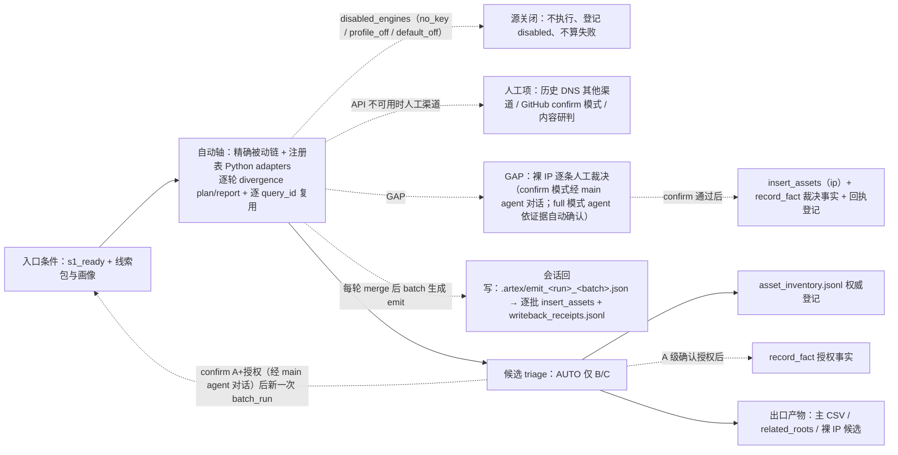

# 被动信息收集（Passive Recon）

## 阶段流程图



> **本阶段契约摘要**：输入 S1 线索包/画像、当前 `SCOPE`、raw 四分区与上批反馈；输出归一主 CSV、`related_roots` + triage、`bare_ips_candidates` 及发散/人工/受限证据；验收门禁见「阶段契约 → 验收」。
> 详细工具、raw 分区、MANUAL 证据、裸 IP 裁决和跨批次反馈见 [`workflow_diagrams.md`](../s0-preparation/references/workflow_diagrams.md#4-s2-被动侦察主链)；degraded 收敛语义见该图集 §10 批次状态机，本图不重复展开。图中 wb1/wb3/wb4 会话回写节点（每轮 batch 生成 `.artex/emit_<run>_<batch>.json` → 逐批 `insert_assets` + `raw/writeback_receipts.jsonl` 回执、A 级确认后 `record_fact` 授权事实、裸 IP confirm 后 `insert_assets`+`record_fact` 裁决事实+回执登记）的执行口径见「执行顺序」后「会话回写节点」；分级结论同时落 inventory 文件与 `record_fact` 事实。

## 阶段契约

本文件是 S2 的唯一执行入口。S2 的职责是完成 CT、子域、DNS、测绘、历史 DNS 和线索发散主链，把 in-scope 精确结果送入主资产链，把关联根域和裸 IP 保持为可审计候选；A/B/C 规则由 [`divergent_osint.md`](references/divergent_osint.md) 唯一维护，关联根域/裸 IP 的来源、裁决与验收由 [`roots_and_bare_ips.md`](references/roots_and_bare_ips.md) 唯一维护。

### 目标与进入条件

- **目标**：尽可能完整地发现授权根域的子域、DNS/IP/ASN、测绘与历史线索，同时隔离发散数据并形成下一阶段候选。
- **进入条件**：S1 已通过验收；`clues_<target>.yaml`、业务画像、当前 `SCOPE`、`AUTHORITATIVE_RAW_DIR`、`DIVERGENT_RAW_DIR`、`MANUAL_RAW_DIR`、`LIMITED_RAW_DIR` 和 `execution_ledger.jsonl` 可用。
- **范围边界**：S2 是被动/OSINT 阶段。除子域爆破等既定授权动作外，不对未确认根域或裸 IP 发起主动扫描；A/B/C 归属和授权是两道独立门。

### 输入

- S1 交接：公司全称/简称/英文名、ICP、品牌词、邮箱后缀、GitHub org、应用包名、人物与产品关键词、已有 `related_roots`。
- S0 状态：`TARGET`、`SCOPE`、`DEPTH`、API key 自检结果、稳定 state 与当前 run/batch 标识。
- 上批反馈：新增 A+授权根域、待复核 B 类、裸 IP 候选与未闭环的 `failed`/`limited`/MANUAL 项。

### 执行顺序

1. **CT 四源**：对每个授权根域运行 `recon_ct`；CertSpotter、crt.sh、Anubis、HackerTarget 分别留状态和产物，跨源去重后立即 normalize/merge。
2. **子域双件套**：运行 `recon_subdomains`，确保 subfinder、ksubdomain 各自完成或明确失败；结果立即 normalize/merge。
3. **当前 DNS**：运行 `recon_dnsrec`，采集 MX/NS/TXT/SPF/DMARC；递归展开 SPF `include:`，把 `is4:`/`ip6:` 写入 `$AUTHORITATIVE_RAW_DIR/dnsrec_ips.txt`，并提取 DMARC `rua`/`ruf` 关联域。单个公网 IPv4 经保留段和已知 CDN 过滤后自动合并到 `bare_ips_candidates.txt`；CIDR 和 IPv6 仅保留为证据，不展开、不授权、不扫描，须按 [`roots_and_bare_ips.md`](references/roots_and_bare_ips.md) 人工形成可裁决的逐 IP 候选。
4. **线索与测绘**：维护线索包后运行 `recon_clues_run`。每轮生成 `divergence/plan_<run>_<batch>.json`，执行前逐 query_id 验证并复用成功 artifact，只重试失败/失效项；Google 使用 Serper，其他测绘源走注册表 Python adapter。GitHub 在 full+token 时走 code-search API，confirm/人工渠道走 not_executed→manual_done 证据绑定；生成 dork 文件不算执行。
5. **解析、IP/ASN 与候选**：从子域和 DNS 结果形成 IP 集，区分 CDN，查 ASN/组织；同 `/24` 至少一条已确认 IP 即形成 C 段线索。测绘中的纯 IP 运行 `recon_bareip` 确定性提取并与 SPF/dnsx 已有候选合并，禁止覆盖其他来源。
6. **历史 DNS（API 或 MANUAL）**：有 SecurityTrails key 时由批次调用 `recon_sources.historical_dns` 真实 API adapter，写独立 artifact 和 query ledger；其他渠道的人工证据写 `$MANUAL_RAW_DIR` 并登记 `manual_done`。无 key/显式关闭为 disabled；gau、Wayback/CDX 和当前 DNS 均不能替代。
7. **补充关联轴**：执行 WHOIS 反查、GA/统计 ID、icon hash、邮件设施、历史站点特征和有授权渠道的数据泄露查询；各来源状态独立记录。
8. **候选收敛**：所有 OOS 根域交 [`divergent_osint.md`](references/divergent_osint.md) 分级；所有关联根域/裸 IP 交 [`roots_and_bare_ips.md`](references/roots_and_bare_ips.md) 做来源核验、五要素裁决和授权隔离。
9. **阶段交接**：in-scope 子域和已归一资产交 S3；A+授权根域须在下一次 batch 重新执行完整 authoritative 精确链，B/C 不进入探活目标。第三方被动查询闭合后，IPv4/IPv6 先转 `pending/manual_confirm`；`recon_bareip_confirm` 同步 verdict 与 inventory，合格后为 A/in/collected，拒绝为 C/rejected，主 CSV 与扫描资格由 S5 交叉核对。

> **会话回写节点（ARTEX，仅会话绑定工具）**：
> - 每轮 batch 返回 0/4 后，读取 batch 生成的 `.artex/emit_<run>_<batch>.json`，逐批调用 `insert_assets` 回写资产图（emit 只读 CSV、纯增量，不改任何文件产物），每次调用后用 `artex_receipt.py record` 把真实结果追加到 `raw/writeback_receipts.jsonl`（ok 要求 rejected=0，部分成功记 limited）；回写前可用 `list_assets`/`list_companies` 去重核对；
> - 候选收敛（步骤 8）的关联根域 A/B/C 分级结论以 inventory 与 evidence JSONL 为准，并 `record_fact` 写入分级事实（facts[] 按 root 分条，含分级、证据摘要与授权状态）；A 级经（confirm 模式：main agent 人在环路对话；full 模式：agent 依证据自动确认，`--confirmed-by autonomous-llm` 留痕）授权后把授权事实一并 `record_fact`（scope 扩由 state 持久化、下一轮 batch 消费）；
> - 裸 IP `recon_bareip_confirm` 通过后以 `insert_assets`（type=ip）回写 + `record_fact` 裁决事实，回执同样登记；未授权/B/C 裸 IP 只写候选 inventory。

### 产物

- `$AUTHORITATIVE_RAW_DIR`：CT、subfinder/ksubdomain、当前 DNS、FOFA 精确 scope 等可归一原始证据。
- `$DIVERGENT_RAW_DIR`：公司名/ICP/证书/图标/模糊域名、Shodan/Google 发散和其他候选原始证据。
- `$MANUAL_RAW_DIR`：历史 DNS、GitHub、CDX 和其他人工查询证据；ledger 终态必须为 `manual_done` 才算完成。
- `unified/` 与 16 列 CSV：只接收 authoritative、in-scope 且通过 normalize/merge 的资产。
- `$AUTHORITATIVE_RAW_DIR/dnsrec_ips.txt`：SPF `is4:`/`ip6:` 完整提取证据；仅其中单个公网 IPv4 自动进入候选，CIDR/IPv6 仍须人工形成逐 IP 证据，候选本身不代表归属或授权。
- `divergence/plan_<run>_<batch>.json`、`divergence/report_<run>_<batch>.json`、`raw/root_collect_receipts.jsonl`、`execution_ledger.jsonl` 和对应 artifacts：逐轮、逐查询闭环；全局 `clue_expansion_plan.json` 仅为兼容审计副本。
- `related_roots_<target>.txt`、`related_roots_<target>.triage.md`、`bare_ips_candidates.txt`、`bare_ip_verdicts.jsonl`、`bare_ip_report_<target>.md`。

### 验收

- [ ] CT 四源均已尝试，CertSpotter 主力结果已处理；任何单源失败均保留自身状态，未被其他来源冒充完成。
- [ ] subfinder、ksubdomain 双件套均已执行或有明确失败记录；in-scope 子域已 normalize/merge 入库。
- [ ] `recon_dnsrec` 已覆盖 MX/NS/TXT、SPF include、SPF IP 和 DMARC `rua`/`ruf`；单个公网 IPv4 已合并到候选且来源为 `extract:spf`，CIDR/IPv6 已留证据并未被展开或视为授权。
- [ ] 线索包、查询计划、ledger 和 artifacts 闭环；FOFA/Shodan/Google/GitHub 的自动、人工、受限状态与证据一致。
- [ ] IP 集已形成并至少有一组 ASN/组织结果，或明确记录无可解析 IP；CDN 与源站候选有区分，同 `/24` 扩展满足“至少一条已确认 IP”条件。
- [ ] 历史 DNS 已有 API artifact+query ledger，或人工 `$MANUAL_RAW_DIR` 证据+`manual_done`；无 key/关闭为 disabled，实际受限为 `limited`，均不得写成零结果或已执行。
- [ ] WHOIS 反查、GA/统计 ID、icon hash、历史 URL/站点特征、邮件设施和泄露库已按适用性处理；`recon_crawl` 的 katana 与 gau 两轴均有独立终态，未做项有原因。
- [ ] [`divergent_osint.md`](references/divergent_osint.md#7-最小必做集合发散底线) 的发散底线已完成，所有 `related_roots` 已按权威 A/B/C 规则分级。
- [ ] [`roots_and_bare_ips.md`](references/roots_and_bare_ips.md)“与阶段的关系 & 最小必做”中的根域/裸 IP 最小集合已完成；0 候选也已在摘要和 `bare_ip_report_<target>.md` 明示。
- [ ] 每个工具后已立即 normalize/merge；OOS 和 divergent 数据未直接进入主 CSV。
- [ ] 每轮 batch 返回 0/4 后已按 `.artex/emit_<run>_<batch>.json` 逐批 `insert_assets` 回写资产图并把真实结果登记到 `raw/writeback_receipts.jsonl`；A/B/C 分级结论已写入 inventory/evidence 并 `record_fact` 分级事实；A+授权根域已经人工确认后已 `record_fact` 授权事实；confirm 通过的裸 IP 已 `insert_assets`（type=ip）+ `record_fact` 裁决事实并登记回执。

### 失败与降级

- timeout 只重跑同一工具/请求；语法、鉴权、配额、解析和业务错误不重跑，耗尽保持 `failed`。
- 缺 key、配额或能力受限写 `limited` 和 issues；合法执行且响应可解析才可记 `empty`。
- 测绘源配额耗尽或 key 缺失（`error_class` 为 `quota`/`auth`）且计划 `required=false` 时批次记 `degraded`：可收敛、`batch_finalize` 放行，但报告必须标注降级（缺失查询 + 补跑建议）；其他失败仍 fail closed。
- crt.sh 失败不阻塞其他 CT 源，但不能改写 crt.sh 状态；gau 失败不触发 CDX，当前 DNS 不冒充历史 DNS。
- 候选无法证明主体、CDN/云状态或授权时停留在 B/C 或待裁决，禁止为了推进 S3 直接晋升。

### 交接

- 交给 S3：当前 `SCOPE` 内已归一的域名/子域、解析 IP、CDN 标记、live/probe 输入，以及完成裁决且逐 IP 授权的裸 IP。
- 留在 S2：B/C 根域、未授权 A 根域、B/C 裸 IP、MANUAL pending、`failed`/`limited` 查询和超 depth 候选。
- 新确认的 A+授权根域不走轻量增量；重启下一次 batch 后依次执行 CT、子域、DNS、FOFA 精确查询与探活。

### 权威与专项引用

- **S2 阶段验收权威**：本文件“[验收](#验收)”节；执行顺序、产物、失败和交接同样以本入口为准。
- 全局执行、授权、落盘与工具调用契约：[`SKILL.md`](../SKILL.md)
- 发散轴、查询矩阵、A/B/C 与晋升：[`divergent_osint.md`](references/divergent_osint.md)
- 关联根域、裸 IP 来源/五要素/裁决：[`roots_and_bare_ips.md`](references/roots_and_bare_ips.md)
- 中国大陆主体专项：[`cn_osint.md`](references/cn_osint.md)
- dork 语法：[`dorks_and_syntax.md`](references/dorks_and_syntax.md)
- ksubdomain 运行细节：[`ksubdomain.md`](references/ksubdomain.md)

## 执行与数据边界

- 工具封装只对 timeout rc `28/124/137` 有界重跑同一工具；默认重跑 1 次，最大 5 次。HTTP 请求只在标准库 helper `http_request.py` 内重试 timeout、明确瞬时 transport 和 `408/429/500/502/503/504`。语法、鉴权、配额、解析和业务错误不重跑；另一来源即使成功，也不能把原工具写成成功。
- 精确 scope 来源落 `$RAW_DIR/authoritative/` 并可 normalize/merge；公司名、证书、图标、模糊域名等发散结果落 `$RAW_DIR/divergent/`，只能进入候选池。候选经主体证据确认、独立授权和非 CDN/云校验后晋升 scope，下一批重新跑 authoritative 精确链；禁止直接搬运 divergent raw 入主 CSV。
- FOFA 证书查询只用 `cert.subject="..."` 或 `cert="*brand*"`，禁止对 `cert` 字段使用 `*=` 操作符。
- 历史 DNS 有 SecurityTrails key 时走真实 API adapter；其他人工渠道须落 `$MANUAL_RAW_DIR` 证据并登记 `manual_done`。gau、Wayback/CDX 和当前 DNS 均不能替代。
- 无 key/显式关闭/默认关闭记 `disabled`，不是 `limited`；实际执行后因 key 鉴权、配额或分页受限才记 `limited`，并进入 issues 和摘要受限项。

## 子项总览

执行主链以“阶段契约”的顺序为准：**CT 四源 → 子域双件套 → 当前 DNS → 测绘/线索发散 → IP/ASN → 历史 DNS → WHOIS/GA/历史站点/泄露补充 → 候选收敛**。下列编号沿用既有方法章节，便于引用，不表示新的执行顺序。

## 1. 子域名收集

**重点**
- 爆破几层；被动查询 + 主动爆破结合使用。

### 在线子域名爆破
- https://phpinfo.me/domain/

### 在线子域名查询
- https://dnsdumpster.com/
- https://hackertarget.com/find-dns-host-records/
- community.riskiq.com
- opendata.rapid7.com
- https://securitytrails.com/

### 子域名工具（被动阶段必跑）
| 工具 | 角色 | 命令要点 |
|---|---|---|
| **subfinder** | 被动 API 聚合 | `krun subfinder -d $T -silent` |
| **ksubdomain** | **子域爆破主力**（高速爆破+验证，[boy-hack/ksubdomain](https://github.com/boy-hack/ksubdomain) v2） | 经 `recon_subdomains` 封装：**字典=seclists 5k**（镜像自带，弃用 Assetnote 百万级）；**带宽内存自适应**（≥3.5G→`-b 1M` / <1.5G→`-b 50K`，防 1G VPS OOM；详见 ksubdomain.md） |
| oneforall | 可选补充 | `krun oneforall --target $T run` |

```bash
# 推荐一键（subfinder + ksubdomain）
source {SKILL_ROOT}/s0-preparation/scripts/recon_run.sh
recon_init "$TARGET"
recon_subdomains "$TARGET"
```

> 字典：`recon_subdomains` 主爆破默认 **seclists 5k**（`/usr/share/seclists/Discovery/DNS/subdomains-tos1million-5000.txt`，镜像自带，弃用 Assetnote 百万级）；seclists 缺失时回退自动生成的 49 词小字典 `$RAW_DIR/wordlist_sub_small.txt`，手敲小字典时 `-f` 必须指向该生成位置。`--small` 只强制最低带宽档，字典仍为 seclists 5k（详见 ksubdomain.md）。
> 安装：工具链由 ARTEX 镜像预烘焙（含 ksubdomain）；`RECON_EXEC=local` 下 `krun` 本机直跑、不自动安装，缺工具时 WARN 并记 `issues`/`limited`。  
> normalize parser：`subfinder` / `ksubdomain`（均为每行域名 + scope/质量过滤）。

## 2. IP / ASN 归属与扩展（必做）

### 流程（优化后）
1. 收集 in-scope 子域解析 IP（dnsx / 被动 A 记录）
2. **先判 CDN**（CNAME/已知 CDN 段）→ CDN IP 不做全端口
3. 查 ASN / 组织（bgp.he / ipinfo / FOFA）
4. 非 CDN 源站：留给阶段 3 全端口（`recon_portscan`，rustscan 1-65535，常驻）
5. 同 **/24 且已确认归属 IP ≥1**：即触发 C 段流程（FOFA `ip="x.x.x.0/24"` 被动拉全段出报表 + rustscan 常见端口）；结果再校验是否 in-scope
6. **新 IP 不当域名递归种子**（只旁站/端口/指纹）

### ASN
- bgp.he.net / robtex.com / fofa

### 多 C 段聚合
- bgp.he.net / ipinfo.io / asnlookup / metabigor  
- merge 自动：同 C ≥2 IP 填 `IP段(C段)`

> IP 写入资产表（type=ip 或挂在域名行）的候选来源、五要素、裁决、授权和入库规则见 [`roots_and_bare_ips.md`](references/roots_and_bare_ips.md)“无域名 IP：来源 → 提取 → 验证 → 入表”。

## 3. 历史 DNS

> **结论（API + MANUAL 通道）**：SecurityTrails key 存在时由批次调用真实 API adapter；其他渠道按下列人工路径补证。无 key/显式关闭为 disabled，不得以 gau、Wayback/CDX、当前 DNS 或“无 wrapper”冒充完成。人工完成须将导出/截图等证据保存到 `$MANUAL_RAW_DIR` 并登记 `manual_done`：
>
> ```bash
> QUERY_URL="https://securitytrails.com/domain/$TARGET/history/a"
> OPERATOR="${USER:-operator}"
> RECORDS=0
> EVIDENCE="$MANUAL_RAW_DIR/securitytrails_historical_dns.json"
> # 完成人工查询并把导出或截图保存为 "$EVIDENCE"；按实际发现更新 RECORDS
> recon_manual_record securitytrails historical_dns "$TARGET" \
>   "$QUERY_URL" "$OPERATOR" "$RECORDS" "$EVIDENCE"
> ```
>
> 台账写入 `status=manual_done` 后才可报告完成。无法访问、无账号或配额不足时记 `limited` 和具体原因；仅列链接、仅口头说明或只有 gau URL 都不算历史 DNS 证据。
>
> 受限时用封装登记 `limited`（`error_class` 取值 `transport|http_transient|auth|quota|syntax|provider|parse|control`）：
>
> ```bash
> recon_manual_limited historical_dns "$TARGET" \
>   --error-class auth --reason "SecurityTrails 需登录且无账号"
> ```

- https://securitytrails.com/
- https://community.riskiq.com/ (PassiveTotal)
- https://www.domaintools.com/products/iris/
- https://www.farsightsecurity.com/solutions/dnsdb/
- https://github.com/blechschmidt/massdns
- https://github.com/projectdiscovery/dnsx

> 历史 DNS 价值：找 CDN 后面的真实 IP、找已下线但曾暴露的服务。

## 4. SSL 证书透明度（CT 四源，certspotter 主力）

证书透明度日志是子域名收集的核心数据源，但单源（尤其 crt.sh）经常 502/超时/被墙。skill 已固化 **CT 四源一键采集**，直接跑封装即可：

```bash
# 一键（推荐）：先 recon_init，再 recon_ct 四源全跑
source {SKILL_ROOT}/s0-preparation/scripts/recon_run.sh && recon_init "$TARGET"
recon_ct "$TARGET"
```

| 源 | 角色 | 说明 | 是否需 key |
|---|---|---|---|
| **certspotter** | **主力（必跑）** | `https://api.certspotter.com/v1/issuances?...&expand=dns_names` | 否（免费有额度） |
| crt.sh | 补充 | 常年被墙/过载，**失败不阻塞**，由其他源覆盖 | 否 |
| anubis | 补充 | `https://jldc.me/anubis/subdomains/<domain>`（JSON 域名数组） | 否 |
| hackertarget | 补充 | `https://api.hackertarget.com/hostsearch/?q=<domain>` | 否 |

> **产出**：`$AUTHORITATIVE_RAW_DIR/{certspotter,crtsh,anubis,hackertarget}.json/txt` → `recon_ct` 自动逐个 `recon_tool_normalize`（已带 `--target`），merge 阶段跨源去重合并。
>
> ⚠ **必须传 `--target`**（`recon_tool_normalize` 已带）：in-scope 进 assets；OOS 只进 `related_roots`，**默认不进主 CSV**。

其他 CT/证书源（可选补充，不进默认链）：

| 源 | 调用方式 | 是否需 key |
|---|---|---|
| Censys | API（需 ID:SECRET） | 是 |
| Facebook CT | `https://developers.facebook.com/tools/ct/`（手动） | — |
| sslScrape | `https://github.com/cheetz/sslScrape`（本地工具） | — |
| chaos | ⚠ 未安装（可选，PD 子域数据集）；key 经 `load_api_keys.py chaos` 读取 | 是 |

> **手搓兜底**（无封装环境时的纯 curl 版；normalize 必须带 `--target`）：
> ```bash
> # certspotter（主力）
> python3 "$SKILL_ROOT/s0-preparation/scripts/http_request.py" \
>   "https://api.certspotter.com/v1/issuances?domain=$TARGET&include_subdomains=true&expand=dns_names" \
>   --output "$AUTHORITATIVE_RAW_DIR/certspotter.json" --meta "$AUTHORITATIVE_RAW_DIR/certspotter.meta.json" \
>   --timeout 20 --retries "${RECON_TIMEOUT_RETRIES:-1}"
> # crt.sh（补充，常年被墙，拿不到不阻塞）
> python3 "$SKILL_ROOT/s0-preparation/scripts/http_request.py" \
>   "https://crt.sh/?q=%25.$TARGET&output=json" \
>   --output "$AUTHORITATIVE_RAW_DIR/crtsh.json" --meta "$AUTHORITATIVE_RAW_DIR/crtsh.meta.json" \
>   --timeout 20 --retries "${RECON_TIMEOUT_RETRIES:-1}" || true
> # normalize（封装自动带 --target 做 scope 过滤）
> [ -s "$AUTHORITATIVE_RAW_DIR/certspotter.json" ] && recon_tool_normalize certspotter "$AUTHORITATIVE_RAW_DIR/certspotter.json"
> [ -s "$AUTHORITATIVE_RAW_DIR/crtsh.json" ] && recon_tool_normalize crtsh "$AUTHORITATIVE_RAW_DIR/crtsh.json"
> ```

## 4b. 关联根域与裸 IP 专项

CT SAN、WHOIS、GA/统计 ID、公司/备案/证书/图标测绘、官网外链、页面/JS 裸 IP 和 SPF IP 都是 S2 候选来源，但不在本入口维护第二套分级规则。

- 发散查询矩阵、A/B/C 阈值、`confirm` 与授权分离、下一批完整精确链：见 [`divergent_osint.md`](references/divergent_osint.md)。
- 关联根域提取、前端特征回灌、裸 IP 确定性提取、五要素、`recon_bareip_confirm` 与 `bare_ip_report_<target>.md`：见 [`roots_and_bare_ips.md`](references/roots_and_bare_ips.md)。
- 中国主体的 ICP 反查：见 [`cn_osint.md`](references/cn_osint.md)。

入口只保留两条硬边界：OOS 根域一律进入 `related_roots` 后分级，纯 IP 一律进入裸 IP 候选池后裁决；两者都不得从 divergent raw 直接 normalize/merge 进主 CSV。

## 5. WHOIS 反查

- https://community.riskiq.com/
- 通过 IP WHOIS 查注册人 / 邮箱 / 手机号，再通过这些反查其他域名或 IP。

> WHOIS 反查发现的关联域名一律写入 `related_roots` 并做 A/B/C 分级；只有携带主体证据确认的 A 且授权为是，才晋升 scope 并在下一批重新执行 authoritative 精确链。禁止直接入 `domains` 队列或从 divergent raw 盲扫。

## 6. Google Analytics ID 关联

- https://github.com/dhn/udon

> 同一个 GA ID（UA-XXXX-X）下往往绑定了同一主体名下的多个站点，是关联资产的高质量信号。

## 7. 邮箱服务器

- MX 记录（domain → mail 主机）
- `recon_dnsrec`（DNS 记录一键采集）：**SPF include 链递归展开**，`is4:`/`ip6:` 写入 `dnsrec_ips.txt`；单个公网 IPv4 自动合并到候选 TSV，CIDR/IPv6 留证据人工逐 IP 裁决；DMARC 的 rua/ruf 报告邮箱域名进入 `related_roots`。

### 资产测绘平台反查
- 在 FOFA / Hunter 里用 `mail`、`smtp`、`mx` 关键词反查目标邮件服务器，邮件系统常是 OWA/Exchange/各企业邮标配，是高价值入口。

## 8. 历史镜像站（历史网站 → 特征 → 现价 IP/域名）

> 资产测绘 / 搜索引擎显示目标**曾有**某站点（FOFA 历史收录、搜索快照、当前已关站/打不开）时，到 web.archive.org 收集**历史特征**，再用特征反查它**现在**的 IP 与域名——老站常迁到新域名/新 IP，这是根域名与裸 IP 的重要来源。

- https://web.archive.org/

### 8.1 发现历史记录

- FOFA/Shodan 结果里当前打不开的 host；搜索快照；Wayback 有收录但现已无解析的域名
- `recon_crawl` 的 gau 产物只表示聚合历史 URL，不能证明 Wayback 或 CommonCrawl 任一具体来源完成，也不能代替历史 DNS
- 需要独立 Wayback/CDX 时在 `config/sources.yaml` 显式设置 `wayback_cdx.enabled: true`，再逐 root 执行注册适配器；默认 `disabled_default`。gau 超时只重跑 gau，CDX 与 gau 的 artifact/ledger 独立，CDX 也不能替代历史 DNS。

```bash
QUERY="url=*.$TARGET/*"
QID="$(_recon_root_query_id wayback_cdx "$TARGET" "$QUERY")"
recon_source_runner_execute wayback_cdx "$QUERY" "$QID" "$TARGET"
# 产物：$DIVERGENT_RAW_DIR/wayback_cdx_<query_id 前 16 位>.json + 当前批 query ledger
# 人工浏览器渠道仍可将证据放 $MANUAL_RAW_DIR 并登记 manual_done；不得把 disabled 写成 empty。
```

### 8.2 抓历史页面提特征

取最近快照原始页面（`/web/2id_/` 前缀，不经过 wayback 渲染改写）：

```bash
krun bash -c 'curl -skL "https://web.archive.org/web/2id_/http://old.example.com/"' \
  > "$RAW_DIR/wayback_old.html"
```

从历史页面提取特征（与 `s2-passive-recon/references/roots_and_bare_ips.md` §1.2 同一套手法）：

| 特征 | 提取 | 反查语法 |
|---|---|---|
| title / 页脚公司名 | grep `<title>`、页脚正则 | `title="…"` / `body="公司名"` |
| 页脚 ICP 备案号 | ICP 正则 | → 中国专项 cn_osint.md §4.5 |
| favicon → icon_hash | 快照里的 favicon 下载算 mmh3（FOFA 有在线 hash 计算） | `icon_hash="…"` |
| GA ID | `UA-/G-/GTM-` 正则 | udon / analyzeid / `body="UA-…"` |
| 证书 / 老域 SAN | crt.sh 历史 + 快照 https 版本 | `cert="…"` |
| 页内外链 / JS 中的根域、API、裸 IP | 同 roots-and-bare-ips §1.2 ②③ | 候选根域 / 裸 IP |

### 8.3 用特征反查现在的 IP/域名

```bash
recon_fofa_query 'icon_hash="<历史 favicon hash>"' icon_wayback --no-merge
recon_fofa_query 'body="<历史页脚公司名>"' body_wayback --no-merge
# 历史页脚 ICP 备案号反查 → 中国专项 cn_osint.md §4.5
```

- 命中**新根域** → `related_roots` → A/B/C 分级（老站常已迁新域名）
- 命中**裸 IP** → 进 `recon_bareip` 候选做五要素验证；**历史 icon/title 与现价一致本身即强要素**
- 历史页面发现的**敏感路径 / 备份文件** → 记入线索，留阶段 4 对现站验证

## 9. 数据泄露与社工库

- [DeHashed](https://www.dehashed.com)
- [HaveIBeenPwned](https://haveibeenpwned.com)
- [IntelX](https://intelx.io)
- [Snusbase](https://snusbase.com)
- [HackTricks — 数据泄露方法论](https://hacktricks.wiki/en/generic-methodologies-and-resources/external-recon-methodology/database-leaks.html)

> 找到的账号/邮箱/密码 hash 全部写到 `findings` 字段，type=leak，severity=HIGH（含明文密码则 CRITICAL）。
> 与「业务调研 + 重点人物画像」联动：阶段 1 拿到的人物邮箱可在本步反查泄露记录。

## 10. 自动化信息收集工具

- [SpiderFoot — 自动化 OSINT](https://github.com/smicallef/spiderfoot)
- [theHarvester — 邮箱/子域名/IP 聚合](https://github.com/laramies/theHarvester)
- [Maltego — 图形化关联分析](https://www.maltego.com)

### theHarvester 用法示例

```text
theHarvester -d example.com -b all
# 抓邮箱 / 子域 / IP 一次性聚合
```

## 落盘约定

被动收集执行完成所有步骤后，把以下字段直接落盘（SKILL.md「落盘契约」）：

- `domains`：子域名 + SSL SAN + WHOIS 反查 + Wayback URL 提取的子域
- `ips`：被动渠道极少产出 IP，通常为空（IP 主要来自主动收集）
- `assets`：仅 authoritative、in-scope 且通过归一门的 web 资产入此处；divergent 命中先进入候选/triage
- `findings`：数据泄露记录入此处，severity=CRITICAL 或 HIGH
- `issues`：超时重跑耗尽、失败和 `limited` 情况记录在此；MANUAL 完成另由 `execution_ledger.jsonl` 的 `manual_done` 证明

## 工具自愈与状态

- **缺工具**：工具链由 ARTEX 镜像预烘焙；`RECON_EXEC=local` 下 `krun` 不再自动安装，缺工具时 WARN 并记 `issues`。若该来源是可选能力，台账记 `limited`；不能把其他工具的结果算作它已完成。
- **超时**：封装只重跑原工具且次数有界；耗尽后保持 `failed`。gau 失败不触发 CDX，subfinder 失败也不把 crt.sh 写成 subfinder 成功。
- **零结果**：工具合法执行且响应可解析才可记 `empty`；失败或受限不能记零发现。
- **缺 subfinder / ksubdomain**：优先修复 `recon_subdomains` 环境；其他 CT 来源可继续提供独立覆盖，但不替代缺失工具状态。

## 关键发现立即上报

被动阶段若直接命中（极少但可能）：
- `.git` 泄露的 GitHub 仓库链接 → critical
- 含明文密码的数据泄露 → critical

立即写到 `assets[].priority=critical` 并在 issues 字段标 `CRITICAL_IMMEDIATE`，当场在对话中完整披露并上报（confirm 模式：main agent 人在环路对话；full 模式：agent 依证据自动确认，`--confirmed-by autonomous-llm` 留痕），随后 `record_fact` 写入 critical 事实；当前 batch 暂停在可恢复检查点返回 `COLLECTION_PENDING(reason=critical_immediate)`；**禁止删除或清空 critical 证据**——`record_fact` 后调用 `batch_critical_ack` 登记当前 `critical_immediate.jsonl` 内容 hash，再从检查点恢复收集，新 critical 再次暂停；`report_finding` 不由本 agent 调用；留痕由 ARTEX transcript/activity 自动承担，无需导出思考日志。
