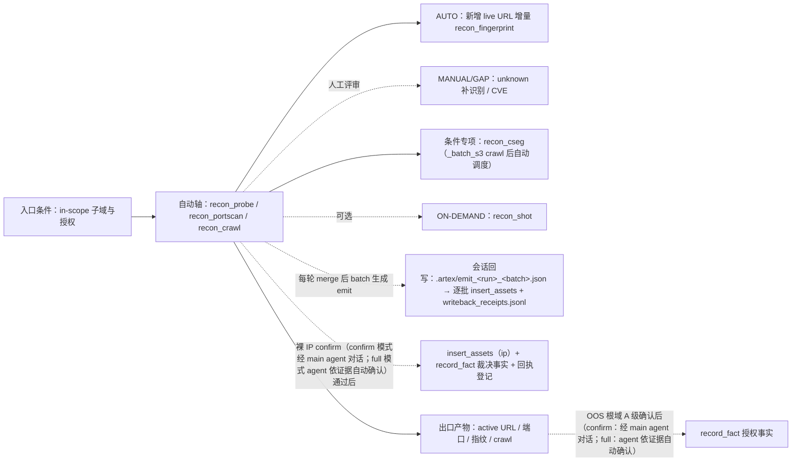

# 主动信息收集（Active Recon）

> 本文件是 S3 的唯一阶段入口。S3 的目标、条件、输入、执行顺序、产物、验收、失败语义和 S4 交接均以本文件为准；工具参数与运行坑只引用现有 refs，不在这里复制第二套手册。

## 目标

在已授权 scope 内完成域名/子域探活、合格裸 IP 的 RustScan 全端口扫描、URL 双轴发现和资产画像，并把存活 URL、端口、指纹、CVE 提示、C 段候选及截图交给 S4。S3 不执行敏感目录、GitHub dork 或泄露结论核验。

> **本阶段契约摘要**：输入 S2 归一域名/子域、`bare_ip_verdicts` 裁决与逐 IP 授权；输出 `httpx.jsonl`/`live_urls.txt`、RustScan XML、双轴 crawl 产物、指纹/CVE 标注与 C 段/邻域候选；验收门禁见「验收」。
> 裸 IP 全端口扫描受「A 类 + 两证据 + 逐 IP 授权 + 非 CDN/云」门禁；C 段触发条件与探测面规则、GAP 补跑口径见「条件与执行属性」表。工具级流程与实现差异见 [`workflow_diagrams.md`](../s0-preparation/references/workflow_diagrams.md#8-s3-主动侦察)。图中的 `AUTO`、`MANUAL`、`ON-DEMAND`、`GAP` 语义以该图集图例和下表为准；wb1-wb3 会话回写节点（emit→逐批 `insert_assets`+回执、裸 IP confirm 后 `insert_assets`+`record_fact` 裁决事实+回执、A 级确认后 `record_fact` 授权事实）的执行口径见「执行顺序」1/2 与「交接」。

## 条件与执行属性

档位制 L1/L2/L3 已取消。S3 默认包含探活和一轮 URL 发现；出现具备扫描资格的裸 IP 时，全端口扫描常驻，但仍受逐 IP 授权门禁约束。

| 子阶段 | 触发条件 | 当前 `batch_run` 覆盖 | 执行属性 |
|---|---|---|---|
| 探活 | 有 in-scope 域名/子域 | `_batch_s3` 调用 `recon_probe`；新 A+授权根域已在 S2 完整链探活 | **AUTO** |
| RustScan 全端口 | 裸 IP 同时满足 A 类、至少两条归属证据、逐 IP 授权、非 CDN/公共云/任播 | `_batch_s3` 对未成功扫描的合格 IP 调用 `recon_portscan` | **AUTO，但有资格门禁** |
| URL 发现一轮 | 有新增 live URL | `_batch_s3` 调用 `recon_crawl`，成功后才推进 crawl 游标 | **AUTO** |
| 指纹加深 | 有新增 live URL | `_batch_s3` 按 `.batch_fingerprinted_urls` 增量调用 `recon_fingerprint`；成功才推进 | **AUTO（增量）** |
| unknown 补识别 | 服务指纹为空或 unknown | 未自动调度 | **MANUAL/LLM：必做** |
| CVE 标注 | 指纹包含可核版本 | 未自动调度 | **GAP + MANUAL/LLM：必做** |
| C 段邻域 | 资产表中非 CDN 真实 IP 按 `/24` 分组，同一 `/24` 内至少一个已确认归属真实 IP | `_batch_s3` 在 crawl 后自动调用 `recon_cseg`（≥1 确认真实 IP 的 `/24` 即触发，无入选段自动跳过）；每个入选段被动拉测绘（FOFA `ip="x.x.x.0/24"` 分页拉全 + Shodan `net:`）生成 `cidr24_report_<target>.md` 报表，再用 rustscan 扫常见端口（段内恰 1 个确认 IP → 该 IP ±10 邻域；≥2 → 整个 `/24`；均剔除已知 IP/网络/广播地址） | **AUTO：`_batch_s3` crawl 后自动调度** |
| 截图 | 需要快速识别后台、控制面板或登录页 | 未自动调度 `recon_shot` | **ON-DEMAND：可选，不作为默认完成依据** |
| URL 深爬 | 需要多轮或全存活 URL 深入发现 | 批次只做增量一轮 | **ON-DEMAND：仍须 katana + gau 双轴成功** |

以下行为不属于 S3 默认链：未授权爆破、未授权扫描整个相关 ASN、对无 ≥1 确认真实 IP 的 `/24` 盲扫、把 FOFA/C 段命中的纯 IP 直接送入端口扫描（全端口）、用手搓 JS/HTML 或另一 URL 轴冒充失败轴完成。UDP/NSE 也不是批次默认 RustScan 链，须另行授权和登记。

## 输入

进入 S3 前应具备：

- 已确认的 `TARGET`、`SCOPE`、`OUTPUT_DIR`、`RAW_DIR`、`ASSET_CSV` 和网络动作授权。
- S2 汇总的 in-scope 域名/子域，以及 `related_roots` 已分级后的 A+授权扩域结果。
- `bare_ips_candidates.txt`、CSV 和 `bare_ip_verdicts.jsonl` 中的裸 IP 裁决信息；候选本身不等于扫描资格。
- S2 已生成或累积的 `httpx.jsonl`、`live_urls.txt`、DNS/CDN/CNAME 线索和历史 URL 输入。
- 当前 run/batch 的 `execution_ledger.jsonl`、批次游标及既有 artifact，用于增量执行和防止旧产物冒充本批成功。

## 执行顺序

1. **探活与入库（AUTO）**：`recon_probe` 汇总 in-scope 子域并补裸域/`www`，依次执行 dnsx、PD Go 版 httpx、normalize 和 merge。httpx 负责状态、标题、技术栈、服务头、CNAME、跳转链及常见非标 Web 端口；具体参数见工具 refs。**merge 完成后为会话回写节点**：本轮 batch 返回 0/4 后，读取 batch 生成的 `.artex/emit_<run>_<batch>.json`（只读 16 列 CSV，逐批 `arguments`），逐批调用 `insert_assets` 回写 ARTEX 资产图，并用 `artex_receipt.py record` 把真实结果追加到 `raw/writeback_receipts.jsonl`；本批后续步骤（端口扫描、C 段）再次 merge 出增量后，同样经下一轮 emit→回写。只有相同 key+hash 且已有 ok 回执的资产可跳过（`summary.unchanged`）。
2. **裸 IP 资格复核与 RustScan（AUTO，有条件）**：候选先经 `recon_bareip_confirm` 固化至少两条归属证据、非 CDN/云状态和逐 IP 授权；「逐 IP 授权」经（confirm 模式：main agent 人在环路对话；full 模式：agent 依证据自动确认，`--confirmed-by autonomous-llm` 留痕）后再执行 confirm。仅 CSV 与 verdict 同时满足条件的 IP 进入 `recon_portscan`。裁决 confirm 后的合格裸 IP 在批次内经 `insert_assets`（类型 ip）回写 + `record_fact` 裁决事实（证据摘要、CDN/云状态与授权状态），回执登记到 `raw/writeback_receipts.jsonl`；裁决结论同时以 inventory/evidence 文件为准。RustScan 发现 TCP `1-65535`；无开放端口写成功 marker，有端口则分块完成服务详情并合并 XML。非标 HTTP(S) 端口回注 httpx/live URL。
3. **URL 发现一轮（AUTO）**：对新增 live URL 执行 `recon_crawl`。katana 主动轴与 gau 被动历史轴相互独立且都必须成功；任一失败则本步失败。gau 在 ledger 只登记 engine=`gau` 单条，不能声称 Wayback/CommonCrawl 分别完成；Wayback CDX 是默认关闭、须显式启用的独立 adapter，不能作为 gau timeout 的自动降级。
4. **指纹加深（AUTO，增量）**：`_batch_s3` 对全部新增 live URL 调用 `recon_fingerprint`，成功后才推进 `.batch_fingerprinted_urls`；失败留下轮。以 EHole + WhatWeb 加深 httpx 技术栈结果，CDN/CNAME 状态须与源站判断一并写回资产画像。
5. **指纹补识别与 CVE（MANUAL/LLM + GAP）**：对空/unknown 指纹，研判响应头、body、favicon、证书或 banner，并通过 `recon_annotate` 写回，禁止直接手改 CSV。有版本指纹时运行 `recon_cve_prep`，人工逐条评审后写映射，再运行 `recon_cve_apply`；只标记“待核” CVE 提示，critical/high finding 可将资产优先级提升至 high；未经验证不得标 critical。
6. **C 段处理（AUTO，由 `_batch_s3` 在 crawl 后自动调度）**：资产表中的非 CDN 真实 IP 按 `/24` 分组，同一 `/24` 内至少一个已确认归属真实 IP 即触发 `recon_cseg`，无入选段自动跳过。每个入选段先被动拉测绘（FOFA `ip="x.x.x.0/24"` 分页拉全 + Shodan `net:`），逐 IP 展开 host/domain/title/server/ports 生成 `cidr24_report_<target>.md` 报表，品牌命中标注；再用 rustscan 扫常见端口（21,22,23,25,53,80,110,135,139,143,443,445,1433,1521,3306,3389,5432,5900,6379,8000,8080,8443,8888,9200,9443,27017）：段内恰 1 个确认 IP 时探测面为该 IP ±10 邻域，≥2 个时为整个 `/24`，均剔除已知 IP、网络地址和广播地址。存活邻域 IP 入 CSV 标注「C段扩展（邻域资产，归属待核）」，备注附带该 IP 的测绘 host/domain/title 证据；测绘有记录但 rustscan 未存活的 IP（「被动命中未存活」）写进 `cidr24_report_<target>.md` 专节，验收时以 WARN 提示需人工裁决。测绘带域名命中进 `related_roots` 走 A/B/C 分级，新 hostname 必须重新做 scope 校验，OOS 不能直接入主表。全端口扫描（`-p-`）与漏洞探测仍只对 A 类裁决 + 逐 IP 授权的 IP；常见端口 C 段扫描是邻域主动动作的天花板。
7. **截图与深爬（ON-DEMAND）**：需要视觉画像时运行 `recon_shot`；需要多轮 URL 发现时再次运行 `recon_crawl`，仍按双轴成功标准验收。截图不能替代探活、指纹或内容核验。
8. **阶段汇总**：检查本批 ledger 与 artifact，将 S3 新发现域名/IP 交给资产提取或 S4，记录蜜罐嫌疑、失败目标、未裁决 IP 和未覆盖的 GAP，不以旧文件或口头说明宣称完成。

## 产物与交付

| 类别 | 主要产物 | 交付含义 |
|---|---|---|
| 探活 | `raw/dnsx.txt`、`raw/httpx.jsonl`、`raw/live_urls.txt` | active URL、标题、状态、技术栈、A/CNAME、跳转链和非标 Web 入口 |
| 资产表 | `assets_<target>.csv`（实际路径以 `$ASSET_CSV` 为准） | `status=active`、服务指纹、IP、端口、CDN/CNAME、备注 |
| 端口 | `raw/rustscan_<ip>.xml` 或 `rustscan_<ip>.no_open_ports.json` | 仅证明合格且授权裸 IP 的全端口结果；零端口 marker 也是成功证据。`.ports` 只是发现阶段中间产物，不作验收证据 |
| URL | `raw/katana*.txt`、`raw/gau*.txt`、`raw/crawl_urls.txt` | S4 目录/JS/泄露检查输入；两轴产物不可互相替代 |
| 指纹/CVE | `raw/ehole.txt`、`raw/whatweb.json`、`cve_review_<target>.txt`、`cve_map_<target>.tsv`、CSV 备注 | 工具指纹、LLM 补识别和待核 CVE 提示 |
| C 段 | `raw/cseg_targets.txt`、`raw/cseg_segments.tsv`、`raw/rustscan_cseg_*.xml`（或对应 greppable 产物）、`cidr24_report_<target>.md`、CSV 备注、`related_roots` 候选 | 入选段测绘报表、常见端口探活结果与 OOS 候选 |
| 截图 | `$OUTPUT_DIR/screenshots/` 或 wrapper 实际截图目录 | 可选视觉画像，不单独证明漏洞或泄露 |
| 状态 | `raw/execution_ledger.jsonl`、`.batch_scanned_ips`、`.batch_failed_ips`、`.batch_crawled_urls` | 当前 run/batch 的完成、失败与重试依据 |

蜜罐规则保留：单 IP 开放端口异常多（尤其 >50 个高风险端口）且大量版本/漏洞指纹“过于完整”时，记录 honeypot 嫌疑并降优先级，不直接标为 critical。

## 验收

本节是 S3 的权威验收口径。S3 完成必须同时满足以下条件；不因 `batch_run` 返回成功而自动全部成立：

- 已汇总 in-scope `all_subs`，dnsx/httpx 探活已执行并立即 normalize + merge；active 至少 1 个，或已明确“全挂”并在 issues/摘要受限项留痕。每轮 batch 返回 0/4 后已按 `.artex/emit_<run>_<batch>.json` 逐批 `insert_assets` 回写并登记 `raw/writeback_receipts.jsonl` 回执。
- httpx 产物包含要求的状态、标题、技术栈、服务头、CNAME、跳转链和约定非标 Web 端口覆盖；只使用 PD Go 版，环境异常应修复原工具，不换工具冒充完成。
- katana 主动轴和 gau 被动历史轴均有当前 run/batch 的 `ok|empty` ledger 与可校验 artifact；任一轴 `failed|limited|not_executed` 均不得写成 URL 发现完成。
- 每个具备扫描资格的裸 IP 都有 RustScan XML 或 `no_open_ports.json`；成功目标进入成功游标，失败目标留在失败队列等待下次重试。
- 未裁决、证据不足、CDN/公共云/任播或未授权 IP 未被扫描，并在验收中列为待裁决 WARN，而不是端口扫描缺失的假成功。
- CDN/CNAME 与源站已区分；关键 IP 的 FOFA/Shodan 标题补充、旁站信息和 honeypot 嫌疑按实际证据记录。
- 有新增 live URL 时批次已自动完成指纹加深；空/unknown 指纹已由 LLM 研判并经 `recon_annotate` 写回。指纹工具的 AUTO 完成不能替代 unknown/CVE 的人工评审。
- 有版本指纹时已完成 CVE 待核评审与 `recon_cve_apply`；没有版本指纹时明确记录 N/A，不虚构 CVE 覆盖。
- 同一 `/24` 内有 ≥1 个已确认归属真实 IP（非 CDN）时已执行 C 段流程（`_batch_s3` crawl 后自动调度：被动测绘拉全段生成 `cidr24_report_<target>.md` 报表 + rustscan 常见端口探活）；「被动命中未存活」IP 已写入报表专节并以 WARN 提示人工裁决；不满足触发条件时记录 N/A。截图是可选项，未执行不阻断 S3，但不得声称已截图。
- 新域名已做 scope 校验：in-scope 入队/入库，OOS 进入 `related_roots` 分级；未把整个相关 ASN 或无依据 `/24` 当授权范围。
- 交付给 S4 的 active URL、crawl URL、指纹/端口/CDN 信息可从 CSV、ledger 和 artifact 互相核对，报告口径不大于证据。

## 失败与恢复

- `recon_probe`、合格 IP 的 `recon_portscan` 或 `recon_crawl` 失败会使当前 S3 批次失败；旧 artifact 不得冒充当前批次成功。
- timeout 仅有界重跑同一工具/同一目标；gau 失败不切 CDX，RustScan 失败不切 naabu/masscan/fscan，httpx 环境异常修复 PD Go 版。重试耗尽登记 `failed`。
- 单个裸 IP 端口扫描失败时，不写成功游标，写 `.batch_failed_ips`，在下一批或下一次 `batch_run` 重试；成功 IP 可保留已完成状态。
- 指纹工具失败时不推进 `.batch_fingerprinted_urls`，下批重试；unknown 补识别和 CVE 评审仍是 MANUAL/GAP，未补做时必须明确写“未完成/待补”，不能因 `_batch_s3` 成功而冒充人工完成。
- `limited`、未授权和待裁决均不是 `ok|empty`。无法补齐时写 issues，并在最终摘要“受限项”中承接；涉及授权边界时 fail closed。

## 交接

S3 向 S4 交付全部 active URL、critical/high 高价值候选、crawl URL、JS 输入、端口/服务、指纹、CDN/CNAME、截图（如有）及本批失败/受限项。S4 以 [`sensitive_findings.md`](../s4-sensitive-findings/sensitive_findings.md) 为唯一入口执行目录、JS、GitHub、云桶、网盘/文库、源码泄露核验和资产回灌。

存活 URL 中的高价值 SPA/大型 Web 站点，其接口级深度枚举可交接给 `api-recon` skill（若可见，经 Skill 工具调用）：api-recon 做静态 bundle harvest 与运行时 mock 登录态接口录制，产出 method+params 级接口清单，并经其自带 `insert_assets` 落同一 ARTEX 资产图。这是 ON-DEMAND 条件专项：仅针对高价值单站点深挖，不替代 katana/gau 双轴的广度爬取，也不改变 S4 `recon_js` 的 secret 扫描职责；是否调用由执行者按站点价值决定，未调用时记 N/A，不阻断流程。

S3 新发现的 OOS 根域和裸 IP 只是候选：根域先 upsert inventory 再进入 A/B/C triage，裸 IP 进入独立裁决。只有人工确认 A + 独立授权后（人工确认经（confirm 模式：main agent 人在环路对话；full 模式：agent 依证据自动确认，`--confirmed-by autonomous-llm` 留痕）；A 级确认后 `record_fact` 授权事实），才在新一次 `batch_run` 中扩 scope 并重跑完整 S2→S3→S4 链（本 agent 只生成事实，不做任务/公司 scope 交接）。

## Refs

- [`SKILL.md`](../SKILL.md)：全流程阶段边界、授权、批次循环和最终交付契约。
- [`divergent_osint.md`](../s2-passive-recon/references/divergent_osint.md)：关联根域 A/B/C 分级、主体证据和扩 scope 规则。
- [`workflow_diagrams.md`](../s0-preparation/references/workflow_diagrams.md#8-s3-主动侦察)：S3 工具级流程和 AUTO/MANUAL/ON-DEMAND/GAP 差异。
- [`tool_commands.md`](../s0-preparation/references/tool_commands.md)：`recon_probe`、`recon_bareip_confirm`、`recon_portscan`、`recon_crawl`、指纹/CVE/C 段/截图参数与产物。
- [`tool_runtime.md`](../s0-preparation/references/tool_runtime.md)：Docker 路径、PD httpx、RustScan ulimit、自愈和运行限制。
- [`tool_priority.md`](../s0-preparation/references/tool_priority.md)：S3 主力工具、并行/串行/fallback 口径。
- [`roots_and_bare_ips.md`](../s2-passive-recon/references/roots_and_bare_ips.md)：裸 IP 裁决、CDN/云排除与扫描资格。
