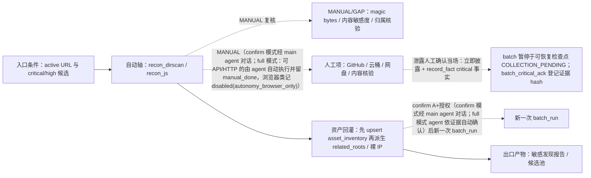

# 敏感发现（Sensitive Findings）

> 本文件是 S4 的唯一阶段入口。S4 的目标、条件、输入、执行顺序、产物、验收、失败语义、critical 立即上报和 S5 交接均以本文件为准；工具参数、dork 语法与安装细节只链接现有 refs。

## 目标

对全部 active URL 和 critical/high 高价值候选完成敏感目录、JS、GitHub、云存储、网盘/文库/社区及源码泄露检查，人工验证自动候选，形成根目录人工报告；同时将目录、JS、crawl、httpx 和端口产物中的新域名/IP 回灌到资产发现闭环。

> **本阶段契约摘要**：输入 S3 active URL/crawl/指纹/端口与线索检索词；输出根目录 `sensitive_findings_<target>.md`、`generated/` 自动候选、`related_roots`/裸 IP 回灌与 ledger 证据；验收门禁见「验收」，MANUAL 项须 `manual_done`/`not_executed`/`limited`/`disabled` 四种终态之一，generated 不替代人工报告。
> dirsearch 三档（`RECON_DIRSCAN_TIER`）与 katana 低内存自适应属参数契约，见 tool_commands.md 与「执行顺序」；资产回灌由批次调用 `recon_extract_assets --batch`（五路产物见「执行顺序」10），候选先 upsert `asset_inventory.jsonl` 再派生审计视图。divergent 结果只进 inventory/triage，禁止直接 normalize/merge/`insert_assets`。泄露人工确认当场**立即披露 + `record_fact` critical 事实**（severity 映射 critical / high / medium；`report_finding` 不由本 agent 调用），见「执行顺序」11 与「critical 立即上报」。工具级流程、人工证据门禁和自动覆盖差异见 [`workflow_diagrams.md`](../s0-preparation/references/workflow_diagrams.md#9-s4-敏感发现与资产拓展)。

## 条件与执行属性

S4 的规范目标集合是“全部 active URL + critical/high 高价值候选”。当前批次自动目录目标更窄，不能把有限自动覆盖写成全量完成。

| 子阶段 | 规范要求 | 当前 `batch_run` 覆盖 | 执行属性 |
|---|---|---|---|
| 目录/定点敏感路径 | 全部 active URL + critical/high 候选 | `_batch_dirscan_targets` 生成全集增量队列，逐目标 ledger 校验后才推进游标 | **AUTO（全集增量）** |
| JS 端点/secret | 有新增 live URL 或 S3 crawl/JS 输入即做 | `_batch_s4` 对新增 live URL 调用 `recon_js` | **AUTO（增量）** |
| 404/catch-all/magic bytes/内容结论 | 每个目录目标及每个候选都要核验 | `recon_dirscan` 已内置 catch-all 基线自动检测 + 过滤；magic bytes/内容结论未自动完成 | **AUTO（catch-all 基线）+ MANUAL（magic bytes/内容结论）：必做** |
| GitHub dork | 计划中的每条查询逐条执行并留证 | full+token 经注册适配器自动分页；confirm/人工渠道按 query_id 登记 pending→manual_done | **AUTO（full+token）/MANUAL（confirm）** |
| 云桶 | 按品牌/域名规则至少一轮，只验证公开可读 | 批次不默认访问；A+逐目标授权后可经 `read_only` adapter 做 HEAD/GET，内容研判仍人工 | **MANUAL/ON-DEMAND：必做** |
| 网盘/文库/社区 | 中国大陆主体必做；海外主体可记录 N/A | 未自动执行 | **MANUAL/GAP** |
| 源码/版本控制/备份泄露 | 对目录、JS、仓库、网盘等命中按纪律核验 | 仅产候选 | **MANUAL：必做；高危命中 critical** |
| 资产回灌 | 从五路产物提 OOS 根域和裸 IP 候选 | `_batch_s4` 调用 `recon_extract_assets --batch` | **AUTO；失败则批次失败** |
| 人工报告 | 根目录 `sensitive_findings_<target>.md` | 只生成 `generated/sensitive_findings_auto_<target>.md` 候选 | **MANUAL/LLM：必做** |

自动生成不等于执行或验证。`generated/sensitive_findings_auto_<target>.md` 只能作为人工复核输入，不能替代根目录报告；`github_dorks.txt` 只能证明计划已生成，不能证明 GitHub 已查询。

## 输入

进入 S4 前应具备：

- S3 交付的全部 active URL、critical/high 高价值候选、`httpx.jsonl`、`live_urls.txt`、`crawl_urls.txt`、指纹、端口和 CDN/CNAME 信息。
- S1/S2 线索包中的公司全称、简称、品牌、域名、邮箱后缀、ICP 和 GitHub org 等检索词。
- `$OUTPUT_DIR/divergence/plan_<run>_<batch>.json` 与 `github_dorks.txt`；计划内 GitHub 查询必须使用对应 `query_id`、root 和人工证据绑定。
- `$MANUAL_RAW_DIR`、`execution_ledger.jsonl`、`generated/` 和根目录人工报告路径。
- 当前 run/batch 的目录、JS 和资产提取游标，避免重复施压，同时保证失败目标可重试。

## 执行顺序

1. **确定目标集合**：`_batch_dirscan_targets` 直接以全部 live URL、critical/high 候选和历史失败目标的并集生成增量队列，减去已经验证成功的逐目标游标；禁止用根站扫描代表所有 active 端口/路径。
2. **建立 404/catch-all 基线（自动基线 + 人工复核）**：`recon_dirscan` 已内置 catch-all 检测过滤（自动采集 状态码+响应长度 基线并在合并后剔除伪命中，原始件保留），人工复核剩余疑点；对每个目录目标关注随机不存在路径的 status、size、hash 和响应特征。SPA、统一错误页、WAF/challenge、重定向登录页等 catch-all 场景须据此剔除伪阳性。
3. **目录与定点路径扫描（AUTO，全集增量）**：使用 `recon_dirscan`/dirsearch 唯一主力完成敏感路径和目录扫描。资源三档：`small`（默认，≈2.5 万请求/目标）、`api`（≈10 万）、`full`（≈1400 万），可用 `RECON_DIRSCAN_TIER` 手动覆盖。manifest 校验通过、所有分片成功且合并报告有效时，该目标才算完成；只有当前批最新 `ok|empty` 且 artifact 有效的目标才推进成功游标，失败目标留下轮。
4. **目录命中人工验证（MANUAL）**：逐条验证状态、重定向、响应内容、目标归属和可访问性。文件类命中必须核对 magic bytes，不能凭 `200`、扩展名或 Content-Type 下结论。403 绕过是人工按需动作，无独立自动脚本；只在授权范围内使用头、路径、方法或协议变体，不进行凭据攻击。
5. **JS 端点、secret 与 source map（AUTO + MANUAL）**：`recon_js` 以 katana `-jsl` 提取端点、secret、source map 和桶 URL；低内存（<6G）环境自适应改 `-jc` 分块，在 wrapper 定义的失败/低资源条件下才使用 xnLinkFinder fallback。对 key/token、内部接口、`.map` 和桶 URL 逐条核验有效性与归属；source map 发现即止，不在侦察阶段还原源码。定位：`recon_js` 是**广度层**——覆盖全部存活主机的端点/secret/source map/桶 URL 提取与核验，S4 职责不变；单个高价值 SPA 站点的路由/API/参数级深度接口枚举属 S3 交接给 `api-recon` 的 ON-DEMAND 专项范围，二者互补不互替。
6. **GitHub dork（AUTO/MANUAL）**：full 模式且有 token 时，注册适配器逐 `query_id` 调 code-search API、分页并写 artifact+ledger；confirm 模式或人工渠道读取当前批计划，保存 `$MANUAL_RAW_DIR` 证据并登记 pending→`manual_done`。无 token 为 `disabled_no_key`，实际 quota/auth/分页受限才记 `limited`。搜索命中仍是候选，必须打开文件/仓库核验内容、上下文、有效性和目标归属。
7. **云存储桶（MANUAL/GAP）**：以公司名、简称、品牌、域名、产品名、环境名和 JS 提取桶 URL 至少执行一轮桶名/公开性检查。只允许 HEAD/GET/list 等公开可读验证，不做写入、IAM 权限探测或利用。公开桶只有在确认存在敏感对象时才作为 critical 结论。**公开性 HEAD/GET 只在逐目标授权后执行**：使用注册表 `read_only` adapter（`recon_source_runner.py execute --source cloud_bucket --authorized`）留 artifact；批次不默认访问，桶内容敏感度研判仍需人工（记 `disabled(reason=autonomy_browser_only)`）。
8. **网盘、文库与社区（MANUAL/GAP）**：中国大陆主体按中国专项入口检查网盘、文库、论坛/社区；海外主体按适用渠道执行或明确记录 N/A。搜索结果、标题和摘要不能代替实际内容与归属核验。**浏览器类渠道在 full 模式统一记 `disabled(reason=autonomy_browser_only)` 并写理由**（不得写成 `limited` 或假装已执行）。
9. **源码与版本控制泄露（MANUAL）**：`.git` 命中经对象/pack magic bytes 验证后立即停止，不下载或还原仓库；`.svn`、`.DS_Store` 和备份文件按授权与 refs 中的工具纪律处理。整站备份、完整项目结构、配置/硬编码生产凭据属于源码泄露；发现后停止扩大下载，立即进入 critical 上报流程。Source Map 同样只发现不还原。
10. **资产回灌（AUTO）**：`recon_extract_assets --batch` 从 crawl URL、JS endpoint、httpx chain/A/CNAME、dirsearch redirect、RustScan/Nmap XML 及历史 DNS/CDX 产物提取候选，先 upsert inventory 再派生视图。人工结构化 `app/miniapp/official_account` 同样进入 inventory，并由下一轮按类型生成 Google/GitHub 查询；无查询轴时列入 `unconsumed_subjects`/人工队列。候选不得直接入主 CSV；自动 triage 最高只到 B/C，A 类需主体证据，授权独立确认。APK 反编译、签名和后端提取仍属满足条件后的专项，不因 wrapper 存在而默认执行。
11. **人工报告与 critical**：对所有自动/人工候选做误报、影响、证据和归属判断，写根目录 `sensitive_findings_<target>.md`。核验出 critical 时立即写 issues `CRITICAL_IMMEDIATE`，更新敏感清单与摘要顶部，当场在对话中**立即完整披露**（severity 映射：critical、high、medium）并上报（confirm 模式：main agent 人在环路对话；full 模式：agent 依证据自动确认，`--confirmed-by autonomous-llm` 留痕），随后 `record_fact` 写入 critical 事实；当前 batch 暂停在可恢复检查点并返回 `COLLECTION_PENDING(reason=critical_immediate)`。**full 模式下披露不等待用户回复**，但披露 + `record_fact` + `batch_critical_ack` + 检查点恢复全链不得省略。**禁止删除或清空 critical 证据**——`record_fact` 完成后调用 `batch_critical_ack` 登记当前 `critical_immediate.jsonl` 的内容 hash（已确认游标），再从检查点恢复收集；恢复后新出现的 critical 会再次暂停并重复本流程。`report_finding` 不由本 agent 调用（漏洞级登记走平台任务侧流程，本 agent 只负责事实与当场披露）。过程由 ARTEX transcript/activity 自动留痕，不等待 S4 或 S5 收尾。

## WAF 契约终态（dirsearch）

WAF 拦截（canary ≥90% 同码、全路径统一响应码）是**环境性不可达**，不是扫描失败：`recon_dirscan` 对该目标记 `limited` + `error_class=waf_challenge` 台账，并把 canary 探测证据写入 `raw/dirsearch_waf_<slug>.txt`（`url/code/tier/ts` + 逐条 `code path` 探测行）。此状态即**终态**：不重试、不计批次失败；目录成功游标与 S4/S5 覆盖门禁按「artifact 可验的 limited+waf_challenge 记录」放行，每条豁免产出 WARN 降级项，必须写入摘要「受限项」。结构性 WAF 拦截（如 Google Frontend 全路径 403）按此处理，禁止在无新信息时反复重跑同一命令。

## 人工任务归集

批次检查点会把目录命中、JS secret/source map、云桶、网盘/文库、unknown 指纹、CVE 和人工报告缺口投影到统一队列。使用 `recon_manual_queue list --status pending` 查看，使用 claim/resolve 管理处理；resolve 必须携带 `raw/manual` 证据。队列只归集和去重，不把自动候选升级为确认结论，不复制 secret 正文。产物为 `manual_work_queue.jsonl` 和 `manual_work_report.{json,md}`。

## 验证规则

### Catch-all 与文件真实性

- 目录扫描前的随机路径基线至少记录 status、size、hash；命中与基线同壳、同大小或同重定向链时，默认按伪阳性处理，除非内容证据证明不同。
- ZIP/JAR/Office、GZIP、RAR 等文件以 magic bytes/`file` 结果为准。`.git` 必须验证实际对象或 pack 索引特征，不能只看 `/.git/HEAD` 的状态码。
- admin/login/debug/interface 路径只有在页面内容、响应行为和目标归属匹配时才写人工 finding；401/403 本身不等于泄露。

### 源码与敏感内容纪律

- `.git` 和 source map：发现即止，不还原；需要进一步下载/恢复必须取得用户明确授权并作为后续独立动作。
- `.svn`、`.DS_Store`、备份包或 `WEB-INF`：按 refs 中的工具链验证；一旦确认完整源码或生产配置泄露，停止无必要下载并立即上报。
- secret/key/password：必须核对是否真实、是否仍有效、是否属于目标、是否生产环境。禁止在验证中使用泄露凭据登录或进行未授权利用。

### 人工 finding 最小字段

每项人工结论至少包含：`url/source`、`type`、`severity`、`verified`、证据路径、验证方法、目标归属、影响、时间和处置状态。文件类补充 `size_bytes` 与最小必要 `content_preview`；预览不得扩散完整 secret。

## critical 立即上报

以下已核验发现不等待收尾，立即写入 `CRITICAL_IMMEDIATE`、敏感清单、摘要顶部，当场在对话中完整披露（critical）并上报（confirm 模式：main agent 人在环路对话；full 模式：agent 依证据自动确认，`--confirmed-by autonomous-llm` 留痕），随后 `record_fact` 写入 critical 事实；batch 暂停于可恢复检查点返回 `COLLECTION_PENDING(reason=critical_immediate)`；**禁止删除或清空 critical 证据**，`record_fact` 后调用 `batch_critical_ack` 登记当前 `critical_immediate.jsonl` 内容 hash 再从检查点恢复，新 critical 再次暂停；`report_finding` 不由本 agent 调用；留痕由 ARTEX transcript/activity 承担：

1. `.git` 对象/pack 泄露经 magic bytes 验证成立。
2. 整站备份、完整项目结构或其它确认的源码泄露。
3. 默认凭据已在授权验证中确认命中。
4. Spring Boot `actuator/env` 等端点泄露数据库密码或同等级生产 secret。
5. GitHub、网盘、文库、源码或配置中确认的明文密码、私钥、生产云凭据。
6. 公开云桶中确认存在敏感对象或源码/凭据。

critical 结论必须基于人工验证，不得把自动候选、搜索摘要、catch-all 命中或未验证 secret 直接升级为 critical。

## 产物与交付

| 类别 | 主要产物 | 所有权与含义 |
|---|---|---|
| 目录 | `raw/dirsearch_shards/manifest.json`、各目标分片/合并报告、redirect 候选 | 自动轴证据；需人工 catch-all、magic bytes 和内容核验 |
| JS | `raw/js_endpoints.txt`、`js_secrets.txt`、`js_maps.txt`、`js_buckets.txt` | 自动候选；secret、接口、source map 和桶均需人工验证 |
| GitHub/云桶/网盘 | `$MANUAL_RAW_DIR` 下查询响应、截图、导出与查询元数据 | 经 `recon_manual_record` 登记后才形成 `manual_done` |
| 自动报告 | `generated/sensitive_findings_auto_<target>.md` | 生成器所有，只能作为人工报告输入 |
| 人工报告 | `$OUTPUT_DIR/sensitive_findings_<target>.md` | S4 阶段交付物；包含验证结论、误报、影响、证据、critical 项与受限项 |
| 资产反馈 | `related_roots_<target>.txt`、triage、`bare_ips_candidates.txt`、来源统计 | 候选池；根域需 A/B/C，裸 IP 需独立裁决 |
| 状态 | `raw/execution_ledger.jsonl`、目录/JS 成功游标、批次 manifest | 自动 `ok|empty` 与人工 `manual_done` 的完成依据 |

自动 findings 与人工报告必须分开维护。生成器只更新自动文件，不得覆盖根目录人工报告；人工报告不能把未核验候选写成 verified finding。

## 验收

本节是 S4 的权威验收口径。S4 完成必须同时满足以下条件，并与最终 accept 的证据一致性门禁保持一致：

- 目标集合已列明：全部 active URL + critical/high 候选。批次自动目录覆盖与 GAP 补跑目标可区分，并能说明每个目标的完成、失败或 N/A 状态。
- 每个目录目标已有 404/catch-all 基线；`recon_dirscan` 的 manifest 校验通过、全部分片成功并形成合并产物。任一分片失败或 timeout 耗尽时，该目标保持 `failed`，不得写完成。
- 所有目录/文件命中已人工甄别；catch-all 伪阳性已剔除，文件类已做 magic bytes/内容验证，`.git`/source map/源码处理遵守“发现即止”纪律。
- 有 crawl/live 输入时 `recon_js` 已执行并有端点与 secret 产物（可为空）；secret、接口、source map 与桶候选已逐条人工核验或明确列为待核，不把 fallback/独立 URL 线索冒充原工具完成。
- 计划中的 GitHub dork 已逐条执行并保存证据，每条 ledger 为 `manual_done`；仅有 dork 文件、`manual_pending`、`limited` 或口头说明均不算完成。确实无 token/配额时按 `limited` 和受限项处理，不得报告已查。
- 已按品牌/域名规则完成至少一轮云桶公开性检查；中国大陆主体已完成网盘/文库/社区检查，海外或不适用场景明确记录 N/A。
- 源码、备份、版本控制、默认凭据、敏感配置和明文 secret 候选均已按规则核验；已确认 critical 项可在 issues、人工敏感报告和摘要顶部检索，已当场对话披露 + `record_fact` critical 事实 + `batch_critical_ack` 登记并经 main agent 对话立即上报（`report_finding` 不由本 agent 调用）。
- `recon_extract_assets --batch` 成功，五路已有产物均已参与回灌；新 OOS 根域进入 related_roots triage，新裸 IP 进入候选池，未直接灌入主 CSV 或自动判 A。
- 根目录 `sensitive_findings_<target>.md` 存在且非空，包含已验证 finding、误报/排除、MANUAL 执行证据、critical 项、失败/limited/GAP 和 N/A。`generated/` 自动报告不能满足此门禁。
- 报告“已执行/无发现/完成”的表述均有当前 run/batch 的 ledger 与 artifact 支撑；同一工具不得同时写“已执行”和“未完成”。

## 失败与恢复

- `recon_dirscan`、`recon_js` 或 `recon_extract_assets` 失败会使当前 S4 批次失败。目录/JS 失败不推进对应成功游标，下一批或下一次 `batch_run` 重试；`extract_assets` 失败必须 fail closed，不能据此判定“无新资产”。
- timeout 只重跑同一工具/同一目标或同一分片；dirsearch 不降级为 ffuf/gobuster，鉴权、配额、语法、解析和业务错误不重跑。耗尽登记 `failed`。
- GitHub、云桶、网盘/文库/社区、404/catch-all、magic bytes、内容核验和人工报告不是批次自动步骤。未完成时保持 `manual_pending`、`limited` 或明确 GAP，不能由 generated 文件或自动扫描结果代替。
- 命中无法确认归属、有效性或敏感性时保留候选并说明所需证据，不写 verified finding。涉及下载、源码还原、凭据使用、写入桶或 IAM 探测时停止并请求额外授权。
- critical 上报失败或报告中不可检索是阻断项；先补写 issues、人工报告、摘要顶部和日志，再继续收尾。

## 交接

S4 结束后，当前 `batch_run` 在资产提取、自动 B/C 初判和 B/C 第三方被动补证后停止。B/C 均须有 evidence；C 必须保留 `reject_reason`，新证据只能先重开为 B。人工/LLM 复核 related roots：只有主体证据确认 A 且获得独立授权（人工确认经（confirm 模式：main agent 人在环路对话；full 模式：agent 依证据自动确认，`--confirmed-by autonomous-llm` 留痕）；确认后 `record_fact` 授权事实），才通过 confirm 进入新一次 `batch_run`，完整重跑 S2→S3→S4（本 agent 只生成事实，不做任务/公司 scope 交接）；B 默认不扫，C 排除但不省略补证。裸 IP 继续走独立归属、CDN/云和逐 IP 授权裁决。

无新增 A+授权根域后，向 S5 交付根目录 `sensitive_findings_<target>.md`、自动候选、manual raw、ledger、目录/JS/artifact、critical 上报记录、资产反馈及全部失败/limited/GAP。S5 的报告门禁、accept、QA 和日志收尾按根目录 [`SKILL.md`](../SKILL.md) 及报告专项 refs 执行。

## Refs

- [`SKILL.md`](../SKILL.md)：全流程阶段边界、授权、批次循环、critical 立即上报和最终交付契约。
- [`divergent_osint.md`](../s2-passive-recon/references/divergent_osint.md)：资产回灌后的 A/B/C 分级、主体证据和扩 scope 规则。
- [`workflow_diagrams.md`](../s0-preparation/references/workflow_diagrams.md#9-s4-敏感发现与资产拓展)：S4 工具级流程和自动覆盖差异。
- [`tool_commands.md`](../s0-preparation/references/tool_commands.md)：`recon_dirscan`、403 验证、`recon_js`、GitHub 证据登记、版本控制/备份处理和工具参数。
- [`tool_runtime.md`](../s0-preparation/references/tool_runtime.md)：容器、raw 分区、失败重试、自愈和已安装工具状态。
- [`tool_priority.md`](../s0-preparation/references/tool_priority.md)：S4 主力工具、404 基线与 magic bytes 强制规则。
- [`dorks_and_syntax.md`](../s2-passive-recon/references/dorks_and_syntax.md)：Google/GitHub dork 语法。
- [`cn_osint.md`](../s2-passive-recon/references/cn_osint.md)：中国大陆主体的网盘、文库、社区和云资产专项入口。
- [`report_templates.md`](../s5-reporting-acceptance/references/report_templates.md)：根目录敏感发现报告和摘要交付格式。
- [`transcript_privacy.md`](../s5-reporting-acceptance/references/transcript_privacy.md)：critical 立即上报留痕（ARTEX transcript/activity）与脱敏规则。
