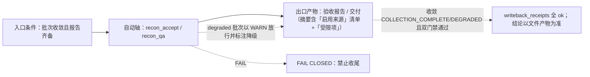

# S5 报告与验收

## 目标

本文件是 S5 的唯一入口，也是 S5 收尾顺序、门禁和验收口径的权威来源。S5 是本次侦察的唯一收尾阶段，负责把 S0-S4 的产物收敛为可审计报告，执行最终验收和质量检查，并形成明确的交付结论；思考与工具调用过程由 ARTEX transcript/activity 自动留痕，无需导出思考日志。其他文档与本入口冲突时以本入口为准。

> **本阶段契约摘要**：输入资产 CSV、根部三报告、线索包/计划、ledger、manifest 与 inventory；输出 `acceptance_report_<target>.md`、`summary_report_<target>.md` 与交付结论（过程留痕由 ARTEX transcript/activity 承担）；验收门禁固定为「报告门禁 → `recon_accept` → `recon_qa` → `recon_accept_gaps`」（首选 `batch_finalize` 保持顺序），FAIL 禁止收尾。完成判定只看 `--gaps` 的 `complete=true`（完整完成）/ `degraded=true`（降级完成，报告不得写“完整覆盖”），`recon_accept` exit 0 本身不构成完整覆盖证明；writeback 回执 gate 仅在本阶段全量执行。

## 条件

- `batch_run` 已打印 `COLLECTION_COMPLETE`（判定 = 原收尾 5 步 + `recon_converge` 零新增 + `--gates collect` 全绿或显式 N/A 且 manifest 写明理由；LLM/执行者禁止凭主观判断宣布收集完成，必须引用门禁全绿输出），或本次授权范围内的 S1-S4 已按阶段门禁完成。
- 当前 run/batch 的 `divergence/plan_<run>_<batch>.json`、`divergence/report_<run>_<batch>.json`、`raw/execution_ledger.jsonl`、manifest 与 artifact 可相互核验；`tool_runs.log` 仅作兼容摘要。
- `manual_work_report.json` 与 `related_entity_tasks_<target>.json` 分别提供人工待办和关联主体任务状态；它们不替代 inventory、ledger 或人工证据。
- 输出目录根部已有人工报告；`generated/` 下自动报告只能作为输入，不能满足报告门禁。
- 自动任务终态只认 `ok|empty`，人工任务终态只认 `manual_done`/`not_executed`/`limited`/`disabled` 四种登记；`failed` 不得冒充完成。
- `$OUTPUT_DIR/profile_resolved.json` 存在时必须读取：启用来源清单进摘要「启用来源」节；`disabled`（no_key / profile_off）项进「受限项」，与 `limited`（执行了但受限）区分，不得混写。

## 输入

- `assets_<target>.csv`
- `business_profile_<target>.md`
- `sensitive_findings_<target>.md`（执行 S4 时必需）
- `clues_<target>.yaml`、`s1_ready.json`
- 全部数字批次的 `divergence/plan_<run>_<batch>.json` 与 `report_<run>_<batch>.json`
- `profile_resolved.json`（启用来源真相）、已执行时的 `source_health_<run>.json`、`raw/execution_ledger.jsonl`、当前 run/batch manifest 与其声明的 artifacts
- `related_roots_<target>.triage.md`、裸 IP 裁决与端口扫描产物（存在相应候选时）
- ARTEX transcript/activity（自动留痕，替代原 pi session 思考日志导出，无需作为输入）

## 顺序

1. 完成批次收尾检查点：固化批开始 pending 快照，特征回填、per-batch 计划与查询复用/执行、资产再提取、原子 A/B/C triage、收敛扫描与门禁，随后 `settle-batch`、生产 pending-work、manifest/emit/真实回执。真实查询失败保留 PENDING；缺终态、坏 artifact 或计数异常必须 fail closed。
2. 按 [`references/report_templates.md`](references/report_templates.md) 生成或更新输出目录根部报告。摘要必须将 S0 置顶，写清扩展根域、IP/C 段、未展开原因及全部 WARN/受限项；并按模板填写每轮 planned/executed/cached、disabled/limited、unconsumed_subjects、S1 readiness 与源健康状态。
3. 摘要固定包含「启用来源」节（读 `profile_resolved.json`：enabled 源逐条列出；`disabled_no_key`/`disabled_profile_off`/`disabled_default` 写明原因并同步进「受限项」），不得只写"已用尽所有渠道"这类无证据表述。
4. 首选执行 `batch_finalize`，其固定顺序为报告门禁、`recon_accept`、`recon_qa`；随后运行 `recon_accept_gaps`/`accept_check --gaps` 取得 `complete/degraded/gaps` JSON，`batch_finalize` 只接受 COMPLETE 或显式 DEGRADED，PENDING/控制面错误/授权拒绝一律禁止收尾。局部阶段手工收尾时也必须保持此顺序。
5. 对报告执行一致性复核：资产数、active 数、工具执行声明和敏感发现叙事必须与计划、ledger、artifact、CSV 一致；裸 IP verdict↔inventory↔CSV、每轮 cached artifact 和 disabled 台账必须一致。修正补做后遗留的旧结论。
6. 汇总验收结论和交付指标，确认路径后交付。收敛状态与验收结论以文件产物和门禁 JSON 为准，并 `record_fact` 写入收敛事实（summary + asset_ids 关联已回写资产；`report_finding` 不由本 agent 调用）；交付汇报固定包含各类型 pending、完整/降级/部分状态、ARTEX 已回写/跳过/失败数（`raw/writeback_receipts.jsonl`）、未使用种子、未授权项和覆盖边界。

## 产物

- `summary_report_<target>.md`
- `business_profile_<target>.md`
- `sensitive_findings_<target>.md`（适用时）
- `assets_<target>.csv`
- `bare_ip_report_<target>.md`（必写；0 候选时也须写文件说明来源范围与“0 候选”）
- 当前 run/batch 的验收与 QA 结论

以上交付清单遵循当前 snake_case 命名契约；交付前另对照 [`../SKILL.md`](../SKILL.md) 的「双图回写检查清单」确认每轮 emit→`insert_assets`→回执登记均已完成，收敛与验收结论已 `record_fact` 写入（`report_finding` 不由本 agent 调用）。思考与执行过程留痕由 ARTEX transcript/activity 自动承担，不导出独立思考日志文件。

## 验收

本节是 S5 验收权威，验收实现必须遵循以下口径：

- **存在性**：必做 raw 产物和输出目录根部人工报告存在且非空。
- **闭环性**：计划项、ledger 终态和 artifact 一一对应；artifact 可读且校验通过。
- **一致性**：摘要中的资产数和 active 数与 CSV 一致；“已执行”声明有当前 run/batch 证据；跨报告不存在“已完成/未完成”冲突。active 数须按摘要口径规范以固定写法「活跃（active）: N」声明（见 [`references/report_templates.md`](references/report_templates.md) 摘要模板）；未声明会产生验收 WARN。
- **质量**：unknown 比例、泛解析、related roots 分级、A 类扩域覆盖、裸 IP 扫描资格和扫描产物满足门禁。
- **登记**：工具均通过 `krun` / `recon_*` 封装留痕；缺少必做项留痕产生 WARN，并逐条进入摘要“受限项”。
- **WARN 承接格式**：摘要根部必须有 `## 受限项`，其中 Markdown 表格的 `验收 WARN` 列逐条填写 `S阶段 / 检查项`（与 `验收报告` 的 WARN 表格一致）；仅在正文提到 WARN 不算承接。
- **degraded 批次放行**：测绘源配额耗尽或 key 缺失（`error_class` 为 `quota`/`auth`）且计划 `required=false` 的降级批次由 `recon_accept` 以 WARN 放行，报告必须标注降级（缺失查询 + 补跑建议）；FAIL 仍禁止收尾。
- `recon_accept` 无 FAIL，随后 `recon_qa` 通过，收尾顺序即完成。

## 失败

- `recon_accept` 返回 1、报告门禁缺失、必需计划项为 `failed|limited|not_executed`，或 artifact 校验失败时，立即停止 S5，不运行 QA。
- WARN 不得静默忽略；逐条写入摘要“受限项”，说明影响、证据和后续动作后再复验。
- 数量或执行叙事不一致时，以 CSV、当前 run/batch ledger 和 artifact 为准修正报告，禁止放宽检查或伪造成功终态。
- 批次收尾检查点任一必需步骤失败时返回失败并排查，禁止把生产者失败解释为零发现或已收敛。

## 交付

向用户汇报：子域数、资产数、active 数、关联根域 A/B/C、裸 IP 候选与 A 类数、C 段、critical/high、key 自检结果、输出路径，以及验收 PASS/WARN/FAIL 数和 WARN 处置。FAIL 时只汇报阻塞项，不声明完成。

## refs

- Skill 总入口与阶段编排：[`../SKILL.md`](../SKILL.md)
- 流程图集：[`../s0-preparation/references/workflow_diagrams.md`](../s0-preparation/references/workflow_diagrams.md#12-s5-报告与最终验收)
- 报告 schema、模板、命名和编码：[`references/report_templates.md`](references/report_templates.md)
- 过程留痕（ARTEX transcript/activity）与脱敏：[`references/transcript_privacy.md`](references/transcript_privacy.md)
- 验收与 QA 实现：[`../s0-preparation/scripts/accept_check.py`](../s0-preparation/scripts/accept_check.py)、[`scripts/qa_recon.py`](scripts/qa_recon.py)
